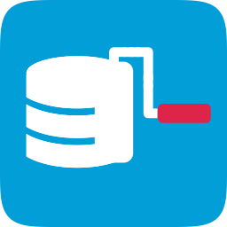
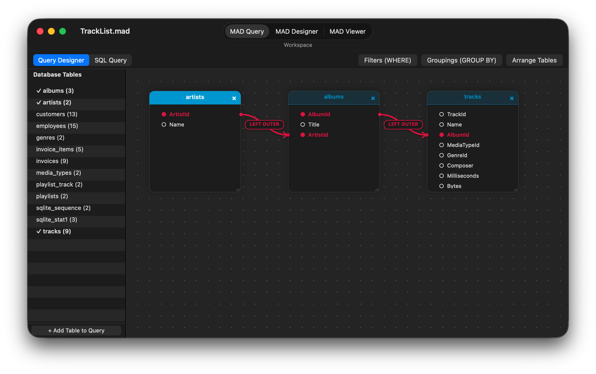
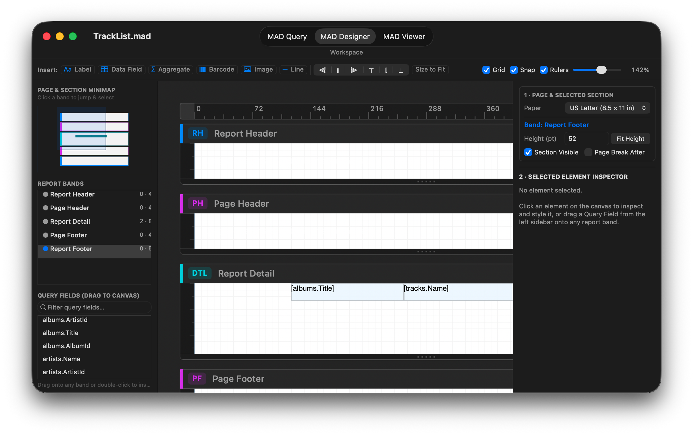
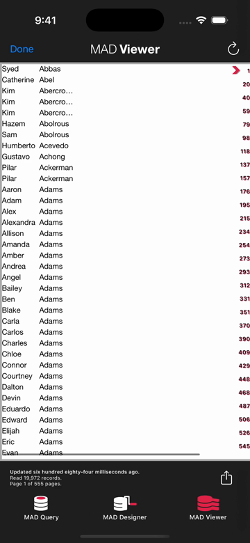
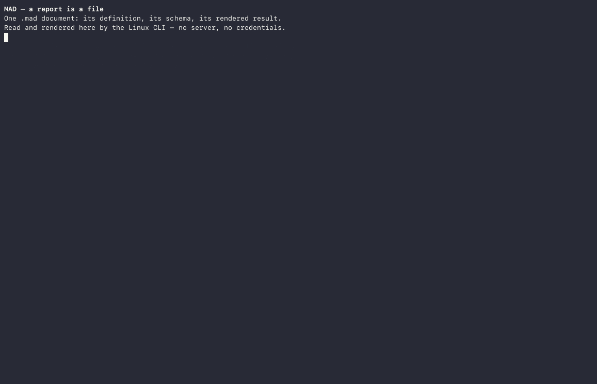

**English** | [简体中文](translations/README_zh.md) | [日本語](translations/README_ja.md) | [Português (Brasil)](translations/README_pt-BR.md) | [Deutsch](translations/README_de.md) | [Español](translations/README_es.md)

> **A note from the author on agentic programming and LLMs** — [Read it here](Note%20from%20Author%20on%20Agentic%20Programming%20and%20LLMs.md)

# <a href="StaticResources/Images/icons/document/Designer%20Icon@3x.png"></a> MAD (Mobile Analytics Document)

[](https://github.com/mthomason/MAD/actions/workflows/linux.yml) [](https://github.com/mthomason/MAD/actions/workflows/windows.yml) [](https://github.com/mthomason/MAD/actions/workflows/macos.yml)

**An open format and embeddable engine for relational reporting — where every report is a portable query graph, a materialized SQLite table, and a parametric layout, and a composition report joins several reports from different databases into one document.**

MAD is a relational reporting platform built from scratch in Objective-C for ad hoc query, reporting, and design: the **MAD Designer** and **MAD Viewer** apps for iOS, native macOS (`AppKit`), and native Windows (WPF); the headless **`mad` CLI and engine** that run on Linux and macOS; and the open **`.mad` specification**.

A `.mad` file holds a report's entire definition — the database schema snapshot, the relational query graph (tables, joins, predicates, groupings), and the banded layout tree — in a single file under 100 KB, cleanly separated from the data it displays. A report is an executable file, not a server: any runtime that speaks `.mad` can inspect the schema, compile deterministic SQL for the target database, materialize the result set into a local SQLite table, and render it to native AppKit/UIKit views, paginated HTML, PDF, CSV, or JSON.

A **Composition Report** extends that model across databases. The document holds a graph of complete reports — a **Result** plus its **sources** — and joins their materialized tables in local SQLite. Each source keeps its own database connection, query, layout, and data. One portable `.mad` file can span MySQL, PostgreSQL, SQL Server, and SQLite without a federation server in the middle.

The repository is one self-contained project: the iPad/iPhone apps, the native macOS (`AppKit`) desktop app (`Mac/`), the native Windows (WPF) app (`Windows/`), fourteen frameworks (twelve multiplatform across iOS, iOS Simulator, and native macOS; twelve headless on Linux), the headless Linux build and test suite (130 suites, 1,313 tests), the `mad` command-line tool, and the build system (`Compressor`) that compiles the third-party C libraries from pinned sources. The code is published under the MIT licence; the `.mad` format is an open specification (see [`docs/`](docs/)), though the project's names and app artwork are not covered by the licence grant (see [`NOTICE`](NOTICE)).

> **New in 0.8: Composition Reports.** Combine existing reports into one document on macOS and Windows; every source keeps its layout and data. See [the composition guide](docs/composition.md) and the [sample reports](Samples/README.md). Composition is included in the published 0.8.0 download below.

> **Try MAD Designer on macOS (macOS 12.0+, Apple Silicon) — published 0.8.0:**
> * **Homebrew:** `brew install --cask mthomason/tap/mad-designer`
> * **Direct Download:** [**MAD-Designer-macOS.dmg**](https://github.com/mthomason/MAD/releases/download/v0.8.0/MAD-Designer-macOS.dmg) | [**MAD-Designer-macOS.zip**](https://github.com/mthomason/MAD/releases/download/v0.8.0/MAD-Designer-macOS.zip) *(for direct downloads, run `xattr -cr "/Applications/MAD Designer.app"` once after copying to `/Applications`)*
> * **Version:** app 0.8.0 / engine 9.1 (r5164).

> **Try MAD Designer on Windows (Windows 10 1903+, Windows 11, 64-bit) — published 0.8.0:**
> * **Direct Download:** [**MAD-Designer-Windows-0.8.0.zip**](https://github.com/mthomason/MAD/releases/download/v0.8.0/MAD-Designer-Windows-0.8.0.zip) *(unsigned: Windows SmartScreen will ask — choose More info → Run anyway; see [the Windows guide](docs/windows.md))*
> * **Version:** app 0.8.0 / engine 9.1 (r5164) · **No .NET install needed** (self-contained).
>
> **Try the headless `mad` CLI (Linux, amd64) — published 0.8.0:**
> * **Direct Download:** [**mad-linux-amd64.tar.gz**](https://github.com/mthomason/MAD/releases/download/v0.8.0/mad-linux-amd64.tar.gz) *(the runtime Docker image: `docker load -i mad-linux-amd64.tar.gz`, then `docker run --rm -v "$PWD:/docs:ro" mad-cli:0.8.0 mad inspect /docs/Reports/Chinook-Standard.mad`)*
> * **Version:** engine 9.1 (r5164).
>
> **Sample reports — published 0.8.0:**
> * **Direct Download:** [**MAD-Samples-0.8.0.zip**](https://github.com/mthomason/MAD/releases/download/v0.8.0/MAD-Samples-0.8.0.zip) *(the runnable reports, the Chinook SQLite database, the database-setup scripts, and a README; also in [`Samples/`](Samples/README.md))*

## Why MAD

Today, any developer can ask an LLM to generate a one-off SQL script and a React table in ten minutes. Six months later, the organization has forty bespoke mini-apps, forty incompatible definitions of an `INNER JOIN` between `customers` and `invoices`, hardcoded database credentials, hallucinated aggregate math, and zero interoperability between mobile, desktop, CI pipelines, and external partners.

MAD solves the reporting problem at the **format and engine level**:

* **Interoperability through a shared contract.** Instead of scattering ad hoc SQL and UI glue code across bespoke scripts, a `.mad` document packages the schema contract, the query AST, and the presentation layout into one inspectable, diffable, versioned artifact. The same file opens natively on macOS, Windows, and iPad, runs headlessly in a Linux Docker container, executes in GitHub Actions, or embeds inside another application — producing byte-identical SQL and exports across Apple, Windows, and Linux.
* **Deterministic SQL and two-pass local math.** Neither the end user nor an AI model needs to hand-write dialect-specific SQL or compute totals in application code. The engine validates the query graph against the document's schema snapshot, compiles deterministic SQL for the wire driver, pulls the result set once into a local SQLite row cache (`MADDataTableFast`), and computes groupings, sort keys, and header/footer aggregates locally in two passes.
* **Composition without a federation server.** A Composition Report materializes each source in its own database, then joins the materialized tables locally in SQLite. There is no central server to deploy, no shared warehouse to populate, and no second SQL dialect to maintain: each source understands its own data, and MAD understands the resulting tables. A source is a full report — query, layout, and rows — not a table stripped of its design.
* **Written, not assembled.** The SQL generator, the SQL parser, the data-table engine, the portable store, the layout model, and the page renderer are first-party Objective-C across fourteen frameworks. Third-party code is strictly limited to the wire — MariaDB Connector/C, FreeTDS, `libpq`, and SQLite — plus `libarchive`/`bzip2` and `zint` for barcodes. No proprietary reporting SDK is being resold.
* **Mobile-first means memory-budgeted.** Because the result set is materialized into an indexed SQLite table on disk and pages are formatted into a geometry-keyed cache, a phone or a small container can paginate and aggregate hundred-thousand-row reports without holding the dataset in RAM.

The technical documentation and format specification are also served at <https://docs.everydayapps.com>.

## Composition Reports

A **Composition Report** combines other reports into one `.mad` document. The reports you bring in are **sources**; the document's default report is the **Result**, which joins the sources' result tables into a new report of its own.


* **Every member is a report.** A source is imported with its query definition, its own report layout, and its data. Selecting it in the toolbar's **Report** picker (macOS) or the **Composition** pane and **Component** picker (Windows) switches the Query, Designer, and Viewer workspaces together. A source with no layout is still a report of rows: the Viewer shows a grid, and the Designer offers to author its layout.
* **Join across databases.** Each source executes against its own database with its own credentials. The Result joins the materialized tables locally in SQLite — MySQL, PostgreSQL, SQL Server, and SQLite in one document.
* **Credentials stay out of the document.** Refresh asks for one password per source, with the connection details prefilled. Passwords live in the Keychain, the session, or the platform credential store — never in the `.mad`.
* **Portable as a unit.** The definition, every source's layout, and the connection references live in the one `.mad` file. Rows and page caches stay in companion storage beside it.

Composition ships in MAD Designer for **macOS** and **Windows** 0.8. The iOS app does not author compositions yet. Read [the composition guide](docs/composition.md) for the model, the workflow, and the current limits.

## See it

**[MAD Designer for macOS](docs/macos.md)** — the native `AppKit` desktop application (`Mac/`), showing the **MAD Query** visual relationship canvas and the **MAD Designer** banded layout workspace:





**MAD Designer for iOS**, from choosing a data source to reading the finished report in MAD Viewer (28 seconds; [video](https://docs.everydayapps.com/assets/app-preview.mp4)):

[](https://docs.everydayapps.com/assets/app-preview.mp4)

**The same engine running headlessly on Linux**: `inspect`, `schema`, `query`, `refresh`, and `export` through the `mad` CLI, with no reporting server:



The recording's [exported report](https://docs.everydayapps.com/assets/london.html) is plain HTML, opened in any browser.

## Sample reports

[`Samples/Reports`](Samples/Reports) holds runnable `.mad` documents for the desktop apps:

* **Chinook-Standard.mad** — one table, column headers, a detail band, a multi-page report.
* **Chinook-Grouped.mad** — a query grouping with group header and footer bands.
* **Chinook-Composition.mad** — two SQLite sources (one with its own layout, one without) joined into a Result.
* **Composition-MySQL-PostgreSQL-SQLServer.mad** — one table from each of MySQL, PostgreSQL, and SQL Server, joined on `demo_id`.
* **PostgreSQL-Chinook.mad** — a server connection with no stored password; the first refresh asks for it.

The SQLite samples need only the bundled `chinook.sqlite3`. The cross-database sample needs the three live test servers; one idempotent script stands them up and seeds the demo table:

```sh
./Samples/setup-databases.sh up
```

On Windows PowerShell:

```powershell
.\Samples\setup-databases.ps1 -Action up
```

See [the samples guide](Samples/README.md) for the first-run walkthrough, the per-source password prompts, and how the samples are generated and checked.

## Localization

The iOS, macOS, and Windows applications are fully localized into **English, German, Spanish, Japanese, Brazilian Portuguese, and Simplified Chinese**. The interface follows the system language, and the documentation is translated into the same languages. Brand and product names, SQL identifiers, database and font names, and licence text remain in English by design. The translations are machine-assisted; corrections are welcome at the [issue tracker](https://github.com/mthomason/MAD/issues).

## Privacy

MAD respects your privacy. The applications contain no analytics, telemetry, or tracking code, and they do not record or copy your files. The only network connections they make are the database connections you configure; report data stays in the document's local SQLite cache and companion files.

On macOS, the app may ask for access to **Documents**, **Desktop**, **Downloads**, or another folder. That prompt comes from the standard macOS Open panel used to choose a `.mad` report (or a SQLite database file): macOS grants access to the folder so the panel can display its contents, and the app reads only the file you select. This is standard behaviour for macOS applications — it is not MAD scanning, recording, copying, or tracking anything.

## Inside the `.mad` Format

A `.mad` file is not a static printout like a PDF, and it is not a dump of row data. It is a **declarative program** that turns a database connection into a typed table and a formatted view.

The architecture splits a report into **the portable definition** (inside the `.mad` file, typically 15–80 KB) and **the derived companion caches** (generated locally on refresh and disposable at any time):

| Layer | File / Member | Format | Role |
|---|---|---|---|
| **1. Container** | `<Name>.mad` | 16-byte `MADFILE\0` v1 header + `pax restricted` bzip2 tar archive | Content-identifiable outer archive (`tar xjf` compatible for v0, header + bzip2 tar for v1). |
| **2. Definition Store** | `StoreContent/analyitics` | Portable SQLite (`MADStoreSchema`, versioned via `PRAGMA user_version`) | Holds the `Rptq*` object graph: the imported database schema snapshot, the query graph (tables, aliases, joins, predicates, groupings, and optional `sqlSourceText`), and the banded section/element layout tree. Zero Core Data or Apple dependencies. |
| **3. Metadata & Preview** | `meta.plist`, `AdditionalContent/` | XML Property List + optional `thumbnail@2x.png` | Generator metadata, format version, and optional document preview. |
| **4. Materialized Table** *(companion)* | `<hash>.maddb` + `<hash>.mdcache` | SQLite row database (`t<tag>`) + column schema plist (`MADDataColumn`) | **The report's output as a database table.** Holds the fetched rows, group-key indexes, and column type metadata so two-pass aggregates (`SUM`, `COUNT`, `AVG`, `MIN`, `MAX`), sorting, and re-rendering never re-query the remote database. |
| **5. Page Cache** *(companion)* | `<hash>{ih,lh}{w,h}.madac` | SQLite index (`ih`) and layout (`lh`) databases keyed by page geometry | Pre-calculated page breaks and element frames for a target viewport (e.g., `{612, 792}` US Letter), keeping scrolling and export instantaneous. |

A Composition Report writes the same container and store with one addition: the store records the query graph's root (`rootQuery`), each query's upstream tables, and each query's own layout sections. A composed document declares the `query-composition` required capability and a `1.1` container header; an ordinary report stays `1.0`. The full specification — container layout, store tables, companion schemas, known quirks (including why the inner store filename is historically spelled `analyitics` for backward compatibility), and cross-platform digest verification — is documented chapter by chapter in [`docs/`](docs/).

## Where MAD Is Going

Same-document composition is built. The direction now extends it and the rest of the architecture:

1. **Cross-document composition and a stable data-object identity.**
   A Composition Report already addresses each source's materialized table inside its own document. The next step is a stable identity for a report's output *across* documents, so one `.mad` can reference another `.mad`'s report with document identity, path resolution, live-versus-pinned data, and a credential policy. The [data-object design](docs/developers/data-object.md) records the model and what formalizing it takes.
2. **Beyond the paper paradigm: native interactive data views.**
   Banded page layout was born from printing. In MAD, paper pagination is one view over the document's data object; the same layout and local `.maddb` table can drive interactive tables, data explorers, and native views. Design once, render as paginated paper or as native interactive UI.
3. **Converting legacy Crystal Reports (`.rpt`) and enterprise report files to `.mad`.**
   Thousands of companies are still locked into decades of Crystal Reports files that nobody wants to rewrite by hand. Because MAD shares the classic banded-section and relational-query-graph DNA of Crystal Reports — while storing everything in an open, inspectable SQLite-in-tar format — MAD is building importers to convert legacy definitions directly into open `.mad` files.
4. **AI-authored documents.**
   A model could propose a real, editable MAD document — discover sources and schema metadata, choose tables and fields, construct query graphs and layouts, and submit the result to the engine for validation and execution — rather than generate a one-off answer. The document remains inspectable, editable, and independent of the model.

See [`docs/vision.md`](docs/vision.md), [`docs/developers/data-object.md`](docs/developers/data-object.md), and [`docs/project/registers/TODO.md`](docs/project/registers/TODO.md).

## Try it

The headless engine runs the `mad` CLI in Docker. Pull the published image and inspect one of the checked-in sample documents:

```sh
docker run --rm -v "$PWD/CLI/Fixtures":/docs:ro ghcr.io/mthomason/mad \
    mad inspect /docs/London.portable.mad
```

Every verb works the same way — `schema`, `query`, `refresh`, `export` (HTML paged facsimile and reflowable `html-flow`, plain text, CSV, JSON data contract, and `json-report`; PDF runs natively on Apple and is deferred on Linux by design):

```sh
docker run --rm -v "$PWD/CLI/Fixtures":/docs:ro ghcr.io/mthomason/mad \
    mad refresh /docs/Music.portable.mad
docker run --rm -v "$PWD/CLI/Fixtures":/docs:ro -v "$PWD/out":/out ghcr.io/mthomason/mad \
    mad export /docs/London.portable.mad --format html --out /out/london.html
```

The published tags are `latest` and the commit's short SHA, built for `linux/amd64` by the publish workflow on every push to `master`. On Apple silicon add `--platform linux/amd64` — Docker Desktop runs the tag under emulation, and without the flag the pull fails (`no matching manifest`). Building a native `arm64` image locally (`mad-cli:latest`) and running the full cross-platform verification suite is one command:

```sh
./Linux/build.sh --verify                 # build the toolchain and run the checks (~20 min first time)
```

The sample documents refresh against the Sqlite3 sample database that ships inside the image; the MySQL, SQL Server, and PostgreSQL fixtures expect the test servers from [`docs/project/build/DEVELOPER.md`](docs/project/build/DEVELOPER.md). A composed document refreshes every source and exports the selected report; `mad` resolves each source's credential from the keychain, with `--credentials` as the fallback.

## In CI

The [mad-action](https://github.com/mthomason/mad-action) GitHub Action runs a checked-in `.mad` in a workflow and uploads its export as an artifact:

```yaml
- uses: mthomason/mad-action@v1
  with:
    command: export
    document: reports/sales.mad
```

It runs the published image, so the action and the CLI are the same engine. The action is generated from [`satellites/mad-action/`](satellites/mad-action/) here; [`docs/developers/satellites.md`](docs/developers/satellites.md) records how the satellite is kept current.

## Database drivers

MAD talks to databases through `MADDatabase` subclasses. Four drivers ship today:

* **MySQL / MariaDB** — `MADMySQL`, over MariaDB Connector/C;
* **SQL Server** — `MADTdsClient`, over FreeTDS;
* **PostgreSQL** — `MADPostgres`, over `libpq`;
* **SQLite** — `MADSqlite3`, for sample documents, local databases, and internal materialization tables.

A driver is a framework that subclasses `MADDatabase` and registers itself with `MADDatabaseDriverRegistry` — the query designer and the engine never see the wire protocol. Writing one is the intended first contribution (see the driver-authoring tutorial under [`docs/tutorials/driver-authoring.md`](docs/tutorials/driver-authoring.md)). The seam is real: users can build a query visually or paste SQL (`MADSQLParser`), the engine generates the dialect-specific statement, and the driver only has to execute it and stream rows into `id<MADDataTableWriting>`.

## Embedding the engine

Twelve of the fourteen frameworks are UIKit-free and build headlessly. The `mad` CLI above is that engine wearing a command line: the verb set — `inspect`, `schema`, `query`, `refresh`, `export`, `write`, and the `serve` JSON protocol — is the embedding surface, and an application that links `MAD`, a driver framework, and `MADSqlite3` has relational reporting with no server in the loop. Drivers and export formats (`<MADReportExporting>` / `MADReportExporterRegistry`) self-register, so adding a data source or an output format is a subclass, not a fork.

A composed document is one more case of the same surface: `MADOperationRefreshComposed` walks the graph, each node materializes its own table, and the selected report's result is what the CLI, the apps, and the exporters read.

## Native macOS application

The native macOS desktop app ([`docs/macos.md`](docs/macos.md), [`Mac/`](Mac/)) is built directly with `AppKit` (`macosx` SDK, `MACOSX_DEPLOYMENT_TARGET = 12.0`) over the twelve multiplatform MAD frameworks and the ten universal (`arm64` + `x86_64`) static C libraries compiled by `Compressor`:

* **Native `NSDocument` architecture (`MADMacDocument` / `MADMacDocumentController`):** Opens and saves `.mad` archives natively from Finder or the standard Open Panel (with an integrated **New Document** button), automatically migrates legacy Core Data `.mad` files via `MADStoreConverter`, and integrates `MADDesignerLayout` directly with `NSDocument.undoManager` (`Cmd+Z` / `Cmd+Shift+Z`).
* **Database Connection & Schema Import Assistant (`MADMacConnectionWindowController`):** Connects to **SQLite**, **MySQL / MariaDB**, **Microsoft SQL Server**, or **PostgreSQL**, verifies connectivity, stores credentials in the macOS Keychain (`MADKeyChain`), and imports table and column schemas into a new `.mad` document.
* **Composition Reports:** A **Report** picker in the toolbar switches every workspace between the Result and its sources; the Designer edits the selected report's own bands and field list; the Viewer renders its own pages or, for a layout-less source, its cached rows as a grid. **File ▸ New Composition…**, **Import Report…**, and **Convert to Composition…** author the graph, and refresh prompts once per credential-taking source. See [the composition guide](docs/composition.md).
* **Three integrated workspaces** (`Cmd+1`, `Cmd+2`, `Cmd+3`):
  1. **MAD Query (`MADMacQueryViewController`):** Toggles between the interactive **Query Designer** (draggable table cards, Bezier join connectors with clickable join-type badges, `WHERE` filter and `GROUP BY` popovers) and the **SQL Query** editor (`MADSQLParser` + `MADSQLQueryCompiler`).
  2. **MAD Designer (`MADMacDesignerViewController`):** Three-pane split view with an interactive **Page & Section Minimap**, **Report Bands** outline, searchable query fields drag source, zoomable/ruled design canvas (`MADMacDesignerCanvasView`) with cross-section drag-and-drop and smart alignment guides, and a dual-card **Page & Element Inspector**.
  3. **MAD Viewer (`MADMacViewerViewController`):** Live data refresh (`Cmd+R`), instant **Page Size** re-pagination (`US Letter`, `Legal`, `Tabloid`, `A3`, `A4`, `A5`, `B4`, `B5`, `JIS B4`, `JIS B5`), framed `PDFView` preview, native `NSPrintOperation` printing (`Cmd+P`), and export (`Cmd+E`) to **PDF**, **HTML**, **HTML Flow**, **CSV**, **JSON**, **JSON Full Report**, and **Plain Text**.

See [`docs/macos.md`](docs/macos.md) for the full guide and [`docs/developers/build/macos.md`](docs/developers/build/macos.md) for the multiplatform portability audit.

## Native Windows application

The native Windows app ([`docs/windows.md`](docs/windows.md), [`Windows/`](Windows/)) is a WPF application on .NET 10 over the same first-party Objective-C engine (`mad.exe`), so its documents are compatible with macOS, iOS, the CLI, and `mad-action`:

* **Three workspaces:** the visual query canvas and SQL editor, the banded Designer with minimap, outline, field list, and inspector, and the page-accurate Viewer with PDF, HTML, HTML Flow, CSV, JSON, JSON Full Report, and Plain Text export.
* **Composition Reports:** A docked **Composition** pane shows the Result and its sources as a graph; its cards and the toolbar **Component** picker share one selection across all three workspaces. Every source keeps its own query, layout, and rows, and a layout-less source renders as a row grid. **File ▸ New Composition…**, **Import…**, and **Convert to Composition** author the graph.
* **Packaging:** `Windows/package.ps1` builds the unsigned, self-contained release zip and the CI engine asset; the engine itself is built by `Windows/Engine/build.ps1` on the pinned toolchain.

See [`docs/windows.md`](docs/windows.md) for the install guide and [`docs/developers/build/windows.md`](docs/developers/build/windows.md) for the build record.

## Build and test

The workspace (`Reports.xcworkspace`) builds the fourteen frameworks, the iOS apps, and the native macOS app (`MAD Designer Mac`).

### Native macOS

Build, run the end-to-end smoke test suite, and package `.zip` and `.dmg` release artifacts from the repository root:

```sh
./Mac/build.sh                     # build 12 macOS frameworks + Mac/build/MAD Designer.app
./Mac/build.sh --no-frameworks     # rebuild only MAD Designer.app (fast iteration)
./Mac/build.sh --smoke-test        # build and run the end-to-end macOS smoke suite
./Mac/build.sh --package           # create Mac/build/MAD-Designer-macOS.zip and .dmg
```

You can also build and debug interactively in Xcode using the shared **`MAD Designer Mac`** scheme, or run any framework's unit test suite natively on macOS:

```sh
xcodebuild test -workspace Reports.xcworkspace -scheme MAD \
	-destination 'platform=macOS,arch=arm64' \
	-derivedDataPath ~/Library/Developer/Xcode/DerivedData/Reports-cozeiyczmvgrbeapplwfuygymqci
```

### iOS Simulator

Run a framework's suite against the iOS Simulator:

```sh
xcodebuild test -workspace Reports.xcworkspace -scheme MADFoundation \
	-destination 'platform=iOS Simulator,id=94952340-7629-4EBB-BBD3-6FEE068793B8' \
	-derivedDataPath ~/Library/Developer/Xcode/DerivedData/Reports-cozeiyczmvgrbeapplwfuygymqci
```

(`MADMySQL`, `MADTdsClient`, and `MADPostgres` also carry live suites that talk to a real database server and skip when one is not reachable — see [`docs/project/build/DEVELOPER.md`](docs/project/build/DEVELOPER.md).)

### Linux (Headless Engine & CLI)

The headless engine is verified the same way on Linux. From the repository root, with Docker installed:

```sh
./Linux/build.sh       # build the toolchain image, compile the twelve frameworks, run the suites
```

This runs 130 suites and 1,313 tests inside the container, and `--verify` adds the CLI's end-to-end checks against the checked-in fixtures and their pinned digests. See [`Linux/README.md`](Linux/README.md) for the image, the pins, and the GNUstep divergences the port found.

### Windows (WPF App & Engine)

The native engine builds on an elevated Windows workstation — Clang 20.1.8, Visual Studio's MSVC, NASM, Strawberry Perl, Meson, Python, and GNUstep built from source into `C:\GNUstep` — and the WPF app with the .NET SDK pinned in `Windows/global.json`:

```powershell
pwsh -File .\Windows\Engine\build.ps1 -SkipToolchain   # rebuild after the toolchain exists
dotnet test Windows\App\Mad.Designer.Windows.slnx      # both .NET suites, against the built engine
pwsh -File .\Windows\package.ps1                      # the unsigned release zip and the CI engine asset
```

CI does not rebuild the engine (it needs that workstation toolchain): [`windows.yml`](.github/workflows/windows.yml) downloads a pre-built engine asset and runs both suites. See [`docs/windows.md`](docs/windows.md) for the install guide and [`docs/developers/build/windows.md`](docs/developers/build/windows.md) for the build record.

### Sample databases

The samples' cross-database composition uses the three pinned test servers. Start them and seed the demo table with one script:

```sh
./Samples/setup-databases.sh up       # macOS, Linux, Git Bash
.\Samples\setup-databases.ps1 -Action up   # Windows PowerShell
```

The containers and their public test credentials are documented in [`TestDatabase/README.md`](TestDatabase/README.md) and [`docs/project/build/DEVELOPER.md`](docs/project/build/DEVELOPER.md).

## Support

MAD is free software and stays free. One maintainer keeps it: the design documents, the multi-platform test matrix, and the agent-driven development all run on real time and API tokens. If MAD saves your team time, here is how to give some of it back — and thank you either way:

* **[Sponsor the maintainer](https://github.com/sponsors/mthomason)** — one-time or monthly, GitHub Sponsors.
* **Send API credits.** The project is developed with AI agents; OpenAI, Anthropic, or agent-token credits go straight back into the work. Get in touch through the sponsor page or an issue.
* **[Contribute](CONTRIBUTING.md).** A database driver, a document element, an export format, a legacy importer, or a fix — the seams are the point.

## Licence

MIT — see [`LICENSE`](LICENSE). The licence covers the software; the names "MAD", "MAD Designer" and "MAD Viewer", the app icons and other product artwork, and the app preview media are the author's and are excluded from it (see [`NOTICE`](NOTICE)). Every third-party component, its licence, and what shipping it obliges us to do is recorded in [`docs/project/THIRD_PARTY_LICENSES.md`](docs/project/THIRD_PARTY_LICENSES.md).

## Export compliance

The MySQL, FreeTDS, and PostgreSQL drivers use OpenSSL/TLS; no custom encryption is implemented. Under Apple's export compliance guidelines this is exempt encryption, and the app sets `ITSAppUsesNonExemptEncryption = NO`.
