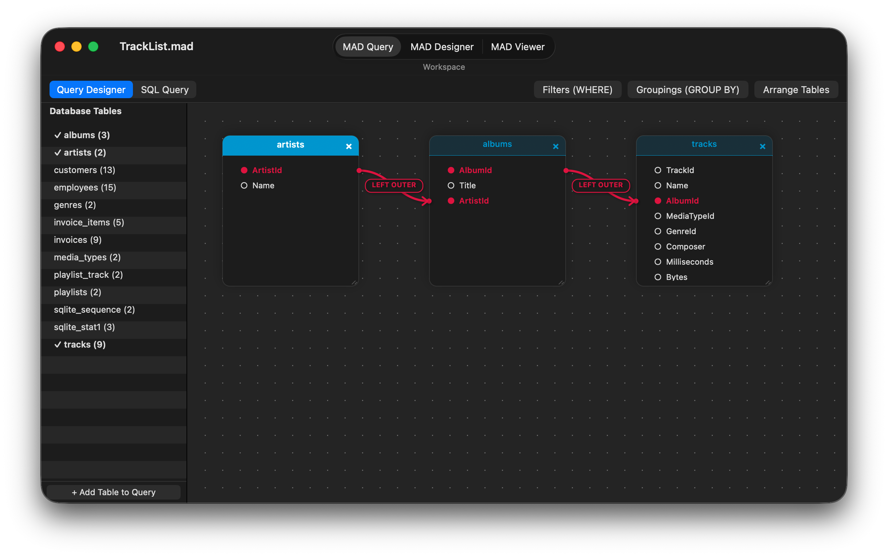
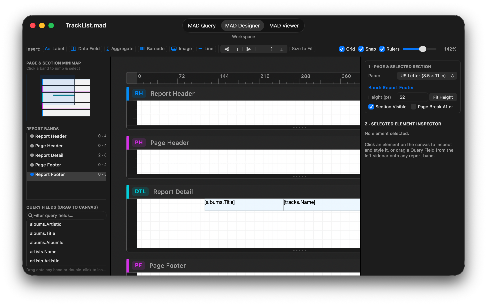
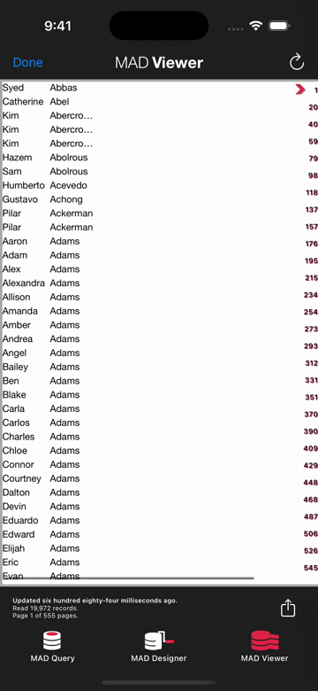

**English** | [简体中文](README_zh.md)

# MAD (Mobile Analytics Document)

**An open format and embeddable engine for relational reporting — where every report is a portable query graph, a materialized SQLite table, and a parametric layout.**

MAD is a relational reporting platform built from scratch in Objective-C for ad hoc query, reporting, and design: the **MAD Designer** app for iOS and native macOS (`AppKit`), where queries and layouts are built visually or from SQL; the **MAD Viewer** app, where reports are read and refreshed; the headless **`mad` CLI and engine** that run on Linux and macOS; and the open **`.mad` specification**.

A `.mad` file holds a report's entire definition — the database schema snapshot, the relational query graph (tables, joins, predicates, groupings), and the banded layout tree — in a single file under 100 KB, cleanly separated from the data it displays. A report is an executable file, not a server: any runtime that speaks `.mad` can inspect the schema, compile deterministic SQL for the target database, materialize the result set into a local SQLite table, and render it to native AppKit/UIKit views, paginated HTML, PDF, CSV, or JSON.

The repository is one self-contained project: the iPad/iPhone apps, the native macOS (`AppKit`) desktop app (`Mac/`), fourteen frameworks (twelve multiplatform across iOS, iOS Simulator, and native macOS; eleven headless on Linux), the headless Linux build and test suite (126 test executables, 1,303 tests), the `mad` command-line tool, and the build system (`Compressor`) that compiles the third-party C libraries from pinned sources. The code is published under the MIT licence; the `.mad` format is an open specification (see [`docs/`](docs/)), though the project's names and app artwork are not covered by the licence grant (see [`NOTICE`](NOTICE)).

[](https://github.com/mthomason/MAD/actions/workflows/linux.yml)

## Why MAD

Today, any developer can ask an LLM to generate a one-off SQL script and a React table in ten minutes. Six months later, the organization has forty bespoke mini-apps, forty incompatible definitions of an `INNER JOIN` between `customers` and `invoices`, hardcoded database credentials, hallucinated aggregate math, and zero interoperability between mobile, desktop, CI pipelines, and external partners.

MAD solves the reporting problem at the **format and engine level**:

* **Interoperability through a shared contract.** Instead of scattering ad hoc SQL and UI glue code across bespoke scripts, a `.mad` document packages the schema contract, the query AST, and the presentation layout into one inspectable, diffable, versioned artifact. The same 80 KB file opens natively on macOS and iPad, runs headlessly in a Linux Docker container, executes in GitHub Actions, or embeds inside another application — producing byte-identical SQL and exports across Apple and Linux.
* **Deterministic SQL and two-pass local math.** Neither the end user nor an AI model needs to hand-write dialect-specific SQL or compute totals in application code. The engine validates the query graph against the document's schema snapshot, compiles deterministic SQL for the wire driver, pulls the result set once into a local SQLite row cache (`MADDataTableFast`), and computes groupings, sort keys, and header/footer aggregates locally in two passes.
* **Written, not assembled.** The SQL generator, the SQL parser, the data-table engine, the portable store, the layout model, and the page renderer are first-party Objective-C across fourteen frameworks. Third-party code is strictly limited to the wire — MariaDB Connector/C, FreeTDS, `libpq`, and SQLite — plus `libarchive`/`bzip2` and `zint` for barcodes. No proprietary reporting SDK is being resold.
* **Mobile-first means memory-budgeted.** Because the result set is materialized into an indexed SQLite table on disk and pages are formatted into a geometry-keyed cache, a phone or a small container can paginate and aggregate hundred-thousand-row reports without holding the dataset in RAM.

The technical documentation and format specification are also served at <https://docs.everydayapps.com>.

## See it

**[MAD Designer for macOS](docs/macos.md)** — the native `AppKit` desktop application (`Mac/`), showing the **MAD Query** visual relationship canvas and the **MAD Designer** banded layout workspace:





**MAD Designer for iOS**, from choosing a data source to reading the finished report in MAD Viewer (28 seconds; [video](https://docs.everydayapps.com/assets/app-preview.mp4)):

[](https://docs.everydayapps.com/assets/app-preview.mp4)

**The same engine running headlessly on Linux**: `inspect`, `schema`, `query`, `refresh`, and `export` through the `mad` CLI, with no reporting server:


The recording's [exported report](https://docs.everydayapps.com/assets/london.html) is plain HTML, opened in any browser.

## Inside the `.mad` Format

A `.mad` file is not a static printout like a PDF, and it is not a dump of row data. It is a **declarative program** that turns a database connection into a typed table and a formatted view.

The architecture splits a report into **the portable definition** (inside the `.mad` file, typically 15–80 KB) and **the derived companion caches** (generated locally on refresh and disposable at any time):

| Layer | File / Member | Format | Role |
|---|---|---|---|
| **1. Container** | `<Name>.mad` | 16-byte `MADFILE\0` v1 header + `pax restricted` bzip2 tar archive | Content-identifiable outer archive (`tar xjf` compatible for v0, header + bzip2 tar for v1). |
| **2. Definition Store** | `StoreContent/analyitics` | Portable SQLite (`MADStoreSchema`, versioned via `PRAGMA user_version`) | Holds the `Rptq*` object graph: the imported database schema snapshot, the query graph (tables, aliases, joins, predicates, groupings, and optional `sqlSourceText`), and the banded section/element layout tree. Zero Core Data or Apple dependencies. |
| **3. Metadata & Preview** | `meta.plist`, `AdditionalContent/` | XML Property List + optional `thumbnail@2x.png` | Generator metadata, format version, and optional document preview. |
| **4. Materialized Table** *(companion)* | `<hash>.maddb` + `<hash>.mdcache` | SQLite row database (`t<tag>`) + column schema plist (`MADDataColumn`) | **The report's output as a database table.** Holds the fetched rows, group-key indexes, and column type metadata so two-pass aggregates (`SUM`, `COUNT`, `AVG`, `MIN`, `MAX`), sorting, and re-rendering never re-query the remote database. |
| **5. Page Cache** *(companion)* | `<hash>{ih,lh}{w,h}.madac` | SQLite index (`ih`) and layout (`lh`) databases keyed by page geometry | Pre-calculated page breaks and element frames for a target viewport (e.g., `{612, 792}` US Letter), keeping scrolling and export instantaneous. |

The full specification — container layout, store tables, companion schemas, known quirks (including why the inner store filename is historically spelled `analyitics` for backward compatibility), and cross-platform digest verification — is documented chapter by chapter in [`docs/`](docs/).

## Where MAD Is Going: The Roadmap & Vision

Because MAD already separates the **query graph**, the **materialized SQLite result table**, and the **presentation layout**, the architecture unlocks four major capabilities that are actively being designed and queued (see [`docs/vision.md`](docs/vision.md), [`docs/project/MAD_DATA_OBJECT.md`](docs/project/MAD_DATA_OBJECT.md), and [`docs/project/TODO.md`](docs/project/TODO.md)):

1. **A `.mad` report as an ad hoc database table (Composable Data Objects).**
   In a traditional database, you `SELECT` from base tables like `employee` or `sales_data`. A `.mad` report joins and filters multiple tables, and its output (`.maddb` + `.mdcache`) is already a physical SQLite table with a typed schema (`MADDataColumn`). By making a report's output addressable as a table source inside the query designer, **a `.mad` file becomes a virtual/materialized database table**. Other reports, queries, or tools can `SELECT` from and `JOIN` against a `.mad` report just like any table in a database.
2. **Multiple data sources in a single report (Federation without a server).**
   Every database driver (`MADMySQL`, `MADPostgres`, `MADTdsClient`, `MADSqlite3`) materializes its query result into the same local SQLite table representation (`MADDataTableFast`). Once a report can hold multiple query objects and treat each materialized output as a local table, a single `.mad` report can join a `customers` table from PostgreSQL with an `orders` table from SQL Server and a local SQLite table — federated locally over SQLite without a heavyweight federation server in the middle.
3. **Beyond the paper paradigm: native UIKit & interactive data views.**
   Banded page layout (Report Header, Page Header, Group Headers/Footers, Detail, Page/Report Footer) was born from printing on paper. In MAD, paper pagination is becoming **just one view paradigm** over the document's data object. When you are not printing or exporting a paged facsimile, the same layout and local `.maddb` table will drive rich, interactive native UIKit components and raw data exploration views — design once, render either as paginated paper or as native interactive UI.
4. **Converting legacy Crystal Reports (`.rpt`) and enterprise report files to `.mad`.**
   Thousands of companies are still locked into decades of Crystal Reports (`.rpt`) files that nobody wants to rewrite by hand and no modern SaaS dashboard can import cleanly. Because MAD shares the classic banded-section + relational-query-graph DNA of Crystal Reports — while storing everything in an open, inspectable SQLite-in-tar format — MAD is building importers to convert legacy `.rpt` definitions directly into open `.mad` files.

## Try it

The headless engine runs the `mad` CLI in Docker. Pull the published image and inspect one of the checked-in sample documents:

```sh
docker run --rm -v "$PWD/CLI/Fixtures":/docs:ro ghcr.io/mthomason/mad \
    mad inspect /docs/London.portable.mad
```

Every verb works the same way — `schema`, `query`, `refresh`, `export` (HTML paged facsimile and reflowable `html-flow`, plain text, CSV, JSON data contract, and `json-report`; PDF runs natively on Apple and is deferred on Linux by design):

```sh
docker run --rm -v "$PWD/CLI/Fixtures":/docs:ro ghcr.io/mthomason/mad \
    mad refresh /docs/Music.portable.mad
docker run --rm -v "$PWD/CLI/Fixtures":/docs:ro -v "$PWD/out":/out ghcr.io/mthomason/mad \
    mad export /docs/London.portable.mad --format html --out /out/london.html
```

The published tags are `latest` and the commit's short SHA, built for `linux/amd64` by the publish workflow on every push to `master`. On Apple silicon add `--platform linux/amd64` — Docker Desktop runs the tag under emulation, and without the flag the pull fails (`no matching manifest`). Building a native `arm64` image locally (`mad-cli:latest`) and running the full cross-platform verification suite is one command:

```sh
./Linux/build.sh --verify                 # build the toolchain and run the checks (~20 min first time)
```

The sample documents refresh against the Sqlite3 sample database that ships inside the image; the MySQL, SQL Server, and PostgreSQL fixtures expect the test servers from [`docs/project/DEVELOPER.md`](docs/project/DEVELOPER.md).

## In CI

The [mad-action](https://github.com/mthomason/mad-action) GitHub Action runs a checked-in `.mad` in a workflow and uploads its export as an artifact:

```yaml
- uses: mthomason/mad-action@v1
  with:
    command: export
    document: reports/sales.mad
```

It runs the published image, so the action and the CLI are the same engine. The action is generated from [`satellites/mad-action/`](satellites/mad-action/) here; [`docs/project/SATELLITE_REPOS.md`](docs/project/SATELLITE_REPOS.md) records how the satellite is kept current.

## Database drivers

MAD talks to databases through `MADDatabase` subclasses. Four drivers ship today:

* **MySQL / MariaDB** — `MADMySQL`, over MariaDB Connector/C;
* **SQL Server** — `MADTdsClient`, over FreeTDS;
* **PostgreSQL** — `MADPostgres`, over `libpq`;
* **SQLite** — `MADSqlite3`, for sample documents, local databases, and internal materialization tables.

A driver is a framework that subclasses `MADDatabase` and registers itself with `MADDatabaseDriverRegistry` — the query designer and the engine never see the wire protocol. Writing one is the intended first contribution (see the driver-authoring tutorial under [`docs/tutorials/driver-authoring.md`](docs/tutorials/driver-authoring.md)). The seam is real: users can build a query visually or paste SQL (`MADSQLParser`), the engine generates the dialect-specific statement, and the driver only has to execute it and stream rows into `id<MADDataTableWriting>`.

## Embedding the engine

Eleven of the fourteen frameworks are UIKit-free and build headlessly. The `mad` CLI above is that engine wearing a command line: the verb set — `inspect`, `schema`, `query`, `refresh`, `export`, `write` — is the embedding surface, and an application that links `MAD`, a driver framework, and `MADSqlite3` has relational reporting with no server in the loop. Drivers and export formats (`<MADReportExporting>` / `MADReportExporterRegistry`) self-register, so adding a data source or an output format is a subclass, not a fork.

## Native macOS application

The native macOS desktop app ([`docs/macos.md`](docs/macos.md), [`Mac/`](Mac/)) is built directly with `AppKit` (`macosx` SDK, `MACOSX_DEPLOYMENT_TARGET = 12.0`) over the twelve multiplatform MAD frameworks and the ten universal (`arm64` + `x86_64`) static C libraries compiled by `Compressor`:

* **Native `NSDocument` architecture (`MADMacDocument` / `MADMacDocumentController`):** Opens and saves `.mad` archives natively from Finder or the standard Open Panel (with an integrated **New Document** button), automatically migrates legacy Core Data `.mad` files via `MADStoreConverter`, and integrates `MADDesignerLayout` directly with `NSDocument.undoManager` (`Cmd+Z` / `Cmd+Shift+Z`).
* **Database Connection & Schema Import Assistant (`MADMacConnectionWindowController`):** Connects to **SQLite**, **MySQL / MariaDB**, **Microsoft SQL Server**, or **PostgreSQL**, verifies connectivity, stores credentials in the macOS Keychain (`MADKeyChain`), and imports table and column schemas into a new `.mad` document.
* **Three integrated workspaces** (`Cmd+1`, `Cmd+2`, `Cmd+3`):
  1. **MAD Query (`MADMacQueryViewController`):** Toggles between the interactive **Query Designer** (draggable table cards, Bezier join connectors with clickable join-type badges, `WHERE` filter and `GROUP BY` popovers) and the **SQL Query** editor (`MADSQLParser` + `MADSQLQueryCompiler`).
  2. **MAD Designer (`MADMacDesignerViewController`):** Three-pane split view with an interactive **Page & Section Minimap**, **Report Bands** outline, searchable **Query Fields** drag source, zoomable/ruled design canvas (`MADMacDesignerCanvasView`) with cross-section drag-and-drop and smart alignment guides, and a dual-card **Page & Element Inspector**.
  3. **MAD Viewer (`MADMacViewerViewController`):** Live data refresh (`Cmd+R`), instant **Page Size** re-pagination (`US Letter`, `Legal`, `Tabloid`, `A3`, `A4`, `A5`, `B4`, `B5`, `JIS B4`, `JIS B5`), framed `PDFView` preview, native `NSPrintOperation` printing (`Cmd+P`), and export (`Cmd+E`) to **PDF**, **HTML**, **HTML Flow**, **CSV**, **JSON**, **JSON Full Report**, and **Plain Text**.

See [`docs/macos.md`](docs/macos.md) for the full guide and [`docs/project/MAD_MACOS.md`](docs/project/MAD_MACOS.md) for the multiplatform portability audit.

## Build and test

The workspace (`Reports.xcworkspace`) builds the fourteen frameworks, the iOS apps, and the native macOS app (`MAD Designer Mac`).

### Native macOS

Build, run the end-to-end smoke test suite, and package `.zip` and `.dmg` release artifacts from the repository root:

```sh
./Mac/build.sh                     # build 12 macOS frameworks + Mac/build/MAD Designer.app
./Mac/build.sh --no-frameworks     # rebuild only MAD Designer.app (fast iteration)
./Mac/build.sh --smoke-test        # build and run the end-to-end macOS smoke suite
./Mac/build.sh --package           # create Mac/build/MAD-Designer-macOS.zip and .dmg
```

You can also build and debug interactively in Xcode using the shared **`MAD Designer Mac`** scheme, or run any framework's unit test suite natively on macOS:

```sh
xcodebuild test -workspace Reports.xcworkspace -scheme MAD \
	-destination 'platform=macOS,arch=arm64' \
	-derivedDataPath ~/Library/Developer/Xcode/DerivedData/Reports-cozeiyczmvgrbeapplwfuygymqci
```

### iOS Simulator

Run a framework's suite against the iOS Simulator:

```sh
xcodebuild test -workspace Reports.xcworkspace -scheme MADFoundation \
	-destination 'platform=iOS Simulator,id=94952340-7629-4EBB-BBD3-6FEE068793B8' \
	-derivedDataPath ~/Library/Developer/Xcode/DerivedData/Reports-cozeiyczmvgrbeapplwfuygymqci
```

(`MADMySQL`, `MADTdsClient`, and `MADPostgres` also carry live suites that talk to a real database server and skip when one is not reachable — see [`docs/project/DEVELOPER.md`](docs/project/DEVELOPER.md).)

### Linux (Headless Engine & CLI)

The headless engine is verified the same way on Linux. From the repository root, with Docker installed:

```sh
./Linux/build.sh       # build the toolchain image, compile the eleven frameworks, run the suites
```

This runs 126 test executables and 1,303 tests inside the container, and `--verify` adds the CLI's end-to-end checks against the checked-in fixtures and their pinned digests. See [`Linux/README.md`](Linux/README.md) for the image, the pins, and the GNUstep divergences the port found.

## Support

MAD is free software and stays free. One maintainer keeps it: the design documents, the two-platform test matrix, and the agent-driven development all run on real time and API tokens. If MAD saves your team time, here is how to give some of it back — and thank you either way:

* **[Sponsor the maintainer](https://github.com/sponsors/mthomason)** — one-time or monthly, GitHub Sponsors.
* **Send API credits.** The project is developed with AI agents; OpenAI, Anthropic, or agent-token credits go straight back into the work. Get in touch through the sponsor page or an issue.
* **[Contribute](CONTRIBUTING.md).** A database driver, a document element, an export format, a legacy importer, or a fix — the seams are the point.

## Licence

MIT — see [`LICENSE`](LICENSE). The licence covers the software; the names "MAD", "MAD Designer" and "MAD Viewer", the app icons and other product artwork, and the app preview media are the author's and are excluded from it (see [`NOTICE`](NOTICE)). Every third-party component, its licence, and what shipping it obliges us to do is recorded in [`docs/project/THIRD_PARTY_LICENSES.md`](docs/project/THIRD_PARTY_LICENSES.md).

## Export compliance

The MySQL, FreeTDS, and PostgreSQL drivers use OpenSSL/TLS; no custom encryption is implemented. Under Apple's export compliance guidelines this is exempt encryption, and the app sets `ITSAppUsesNonExemptEncryption = NO`.
