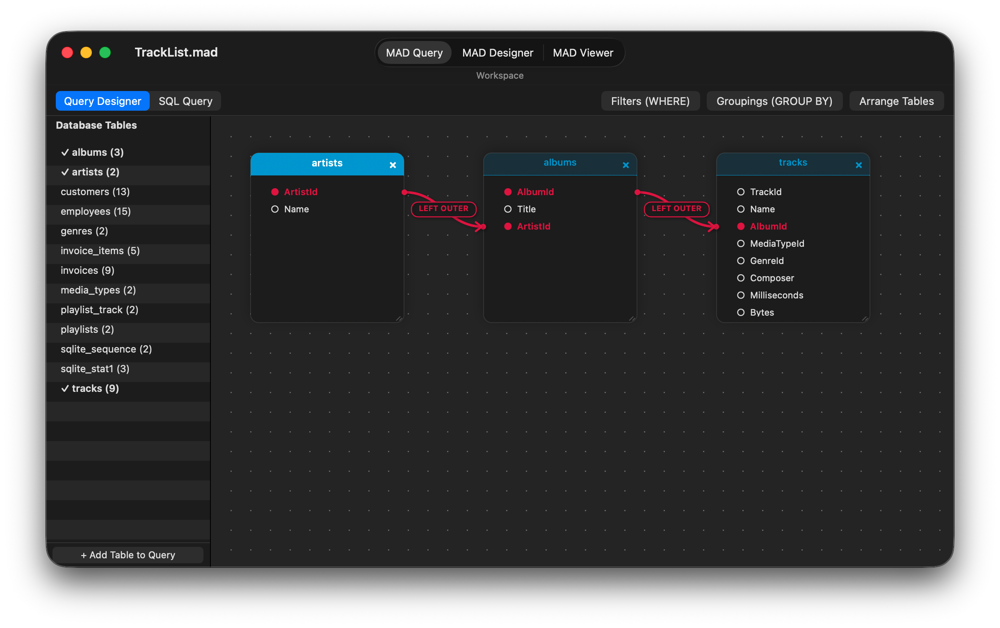
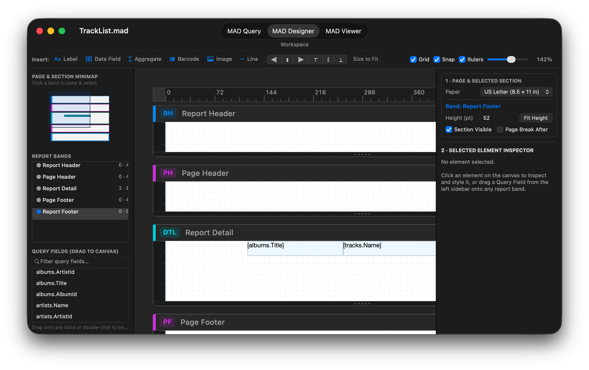
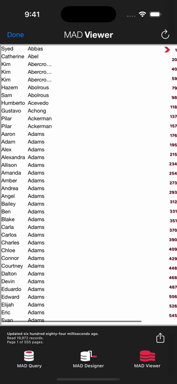
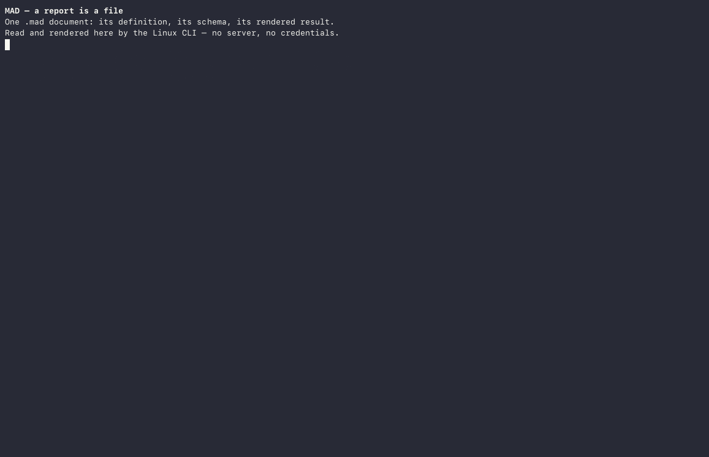

[English](README.md) | [简体中文](README_zh.md) | [日本語](README_ja.md) | [Português (Brasil)](README_pt-BR.md) | **Deutsch** | [Español](README_es.md)

> **Eine Anmerkung des Autors zu agentischem Programmieren und LLMs** — [Hier lesen](Note%20from%20Author%20on%20Agentic%20Programming%20and%20LLMs_de.md)

# <a href="StaticResources/Images/icons/document/Designer%20Icon@3x.png"></a> MAD (Mobile Analytics Document)

**Ein offenes Format und eine einbettbare Engine für relationales Reporting — hier ist jeder Bericht ein portabler Abfragegraph, eine materialisierte SQLite-Tabelle und ein parametrisches Layout.**

MAD ist eine von Grund auf in Objective-C entwickelte Plattform für relationales Reporting für Ad-hoc-Abfragen, Berichte und Design: die App **MAD Designer** für iOS und natives macOS (`AppKit`), in der Abfragen und Layouts visuell oder per SQL erstellt werden; die App **MAD Viewer**, in der Berichte gelesen und aktualisiert werden; die headless **`mad`-CLI und -Engine**, die unter Linux und macOS laufen; und die offene **`.mad`-Spezifikation**.

Eine `.mad`-Datei enthält die gesamte Definition eines Berichts — den Schema-Snapshot der Datenbank, den relationalen Abfragegraphen (Tabellen, Joins, Prädikate, Gruppierungen) und den bandbasierten Layoutbaum — in einer einzigen Datei unter 100 KB, sauber getrennt von den Daten, die sie anzeigt. Ein Bericht ist eine ausführbare Datei, kein Server: Jede Laufzeitumgebung, die `.mad` versteht, kann das Schema inspizieren, deterministisches SQL für die Zieldatenbank kompilieren, die Ergebnismenge in eine lokale SQLite-Tabelle materialisieren und sie als native AppKit-/UIKit-Ansichten, seitenweise aufgeteiltes HTML, PDF, CSV oder JSON rendern.

Das Repository ist ein einziges, in sich geschlossenes Projekt: die iPad-/iPhone-Apps, die native macOS-Desktopanwendung (`AppKit`, `Mac/`), vierzehn Frameworks (zwölf multiplattformfähig für iOS, iOS-Simulator und natives macOS; elf headless unter Linux), der headless Linux-Build und seine Testsuite (126 Testprogramme, 1.303 Tests), das Kommandozeilenwerkzeug `mad` und das Buildsystem (`Compressor`), das die C-Bibliotheken von Drittanbietern aus fixierten Quellen kompiliert. Der Code wird unter der MIT-Lizenz veröffentlicht; das `.mad`-Format ist eine offene Spezifikation (siehe [`docs/`](docs/de/)), die Namen und das App-Artwork des Projekts sind jedoch nicht von der Lizenzgewährung abgedeckt (siehe [`NOTICE`](NOTICE)).

[](https://github.com/mthomason/MAD/actions/workflows/linux.yml)

> **MAD Designer unter macOS ausprobieren (macOS 12.0+, Apple Silicon):**
> * **Homebrew:** `brew install --cask mthomason/tap/mad-designer`
> * **Direkter Download:** [**MAD-Designer-macOS.dmg**](https://github.com/mthomason/MAD/releases/download/v9.1.0-macos/MAD-Designer-macOS.dmg) | [**MAD-Designer-macOS.zip**](https://github.com/mthomason/MAD/releases/download/v9.1.0-macos/MAD-Designer-macOS.zip) *(bei direkten Downloads nach dem Kopieren nach `/Applications` einmal `xattr -cr "/Applications/MAD Designer.app"` ausführen)*

## Warum MAD

Heute kann jeder Entwickler ein LLM bitten, in zehn Minuten ein einmaliges SQL-Skript und eine React-Tabelle zu erzeugen. Ein halbes Jahr später hat die Organisation vierzig maßgeschneiderte Mini-Apps, vierzig inkompatible Definitionen eines `INNER JOIN` zwischen `customers` und `invoices`, fest verdrahtete Datenbank-Zugangsdaten, halluzinierte Aggregatmathematik und null Interoperabilität zwischen Mobilgeräten, Desktop, CI-Pipelines und externen Partnern.

MAD löst das Reporting-Problem auf der Ebene des **Formats und der Engine**:

* **Interoperabilität durch einen gemeinsamen Kontrakt.** Statt Ad-hoc-SQL und UI-Klebstoff über maßgeschneiderte Skripte zu verteilen, bündelt ein `.mad`-Dokument den Schema-Kontrakt, den Abfrage-AST und das Präsentationslayout in einem einzigen einsehbaren, diffbaren, versionierten Artefakt. Dieselbe 80-KB-Datei öffnet sich nativ unter macOS und auf dem iPad, läuft headless in einem Linux-Docker-Container, führt in GitHub Actions aus oder bettet sich in eine andere Anwendung ein — mit byte-identischem SQL und byte-identischen Exporten auf Apple- und Linux-Plattformen.
* **Deterministisches SQL und lokale Mathematik in zwei Durchläufen.** Weder Endbenutzer noch KI-Modell müssen dialektspezifisches SQL von Hand schreiben oder Summen im Anwendungscode berechnen. Die Engine validiert den Abfragegraphen gegen den Schema-Snapshot des Dokuments, kompiliert deterministisches SQL für den Wire-Treiber, zieht die Ergebnismenge einmal in einen lokalen SQLite-Zeilen-Cache (`MADDataTableFast`) und berechnet Gruppierungen, Sortierschlüssel sowie Kopf- und Fußzeilenaggregate lokal in zwei Durchläufen.
* **Geschrieben, nicht zusammengesetzt.** Der SQL-Generator, der SQL-Parser, die Datenbanktabellen-Engine, der portable Speicher, das Layoutmodell und der Seitenrenderer sind eigenentwickeltes Objective-C über vierzehn Frameworks. Drittanbieter-Code beschränkt sich strikt auf die Verbindungsebene — MariaDB Connector/C, FreeTDS, `libpq` und SQLite — plus `libarchive`/`bzip2` und `zint` für Barcodes. Kein proprietäres Reporting-SDK wird weiterverkauft.
* **Mobile-first heißt speicherbudgetiert.** Weil die Ergebnismenge in eine indizierte SQLite-Tabelle auf der Festplatte materialisiert und Seiten in einem geometrieindizierten Cache formatiert werden, kann ein Telefon oder ein kleiner Container Berichte mit hunderttausend Zeilen seitenweise aufteilen und aggregieren, ohne den Datensatz im RAM zu halten.

Die technische Dokumentation und die Format-Spezifikation werden auch unter <https://docs.everydayapps.com> bereitgestellt.

## In Aktion

**[MAD Designer für macOS](docs/de/macos.md)** — die native `AppKit`-Desktopanwendung (`Mac/`), mit der visuellen Beziehungsleinwand **MAD Query** und dem bandbasierten Layout-Arbeitsbereich **MAD Designer**:





**MAD Designer für iOS**, von der Auswahl einer Datenquelle bis zum fertigen Bericht in MAD Viewer (28 Sekunden; [Video](https://docs.everydayapps.com/assets/app-preview.mp4)):

[](https://docs.everydayapps.com/assets/app-preview.mp4)

**Dieselbe Engine headless unter Linux**: `inspect`, `schema`, `query`, `refresh` und `export` über die `mad`-CLI, ohne Reporting-Server:



Der [exportierte Bericht](https://docs.everydayapps.com/assets/london.html) der Aufzeichnung ist reines HTML und lässt sich in jedem Browser öffnen.

## Im Inneren des `.mad`-Formats

Eine `.mad`-Datei ist kein statischer Ausdruck wie ein PDF und auch kein Rohdatenauszug. Sie ist ein **deklaratives Programm**, das eine Datenbankverbindung in eine typisierte Tabelle und eine formatierte Ansicht verwandelt.

Die Architektur teilt einen Bericht in **die portable Definition** (innerhalb der `.mad`-Datei, typischerweise 15–80 KB) und **die abgeleiteten Begleit-Caches** (lokal beim Aktualisieren erzeugt und jederzeit entbehrlich):

| Schicht | Datei / Eintrag | Format | Rolle |
|---|---|---|---|
| **1. Container** | `<Name>.mad` | 16-Byte-`MADFILE\0`-v1-Header + `pax restricted` bzip2-tar-Archiv | Inhaltsidentifizierbares äußeres Archiv (`tar xjf`-kompatibel für v0, Header + bzip2-tar für v1). |
| **2. Definitionsspeicher** | `StoreContent/analyitics` | Portables SQLite (`MADStoreSchema`, versioniert über `PRAGMA user_version`) | Enthält den `Rptq*`-Objektgraphen: den importierten Schema-Snapshot der Datenbank, den Abfragegraphen (Tabellen, Aliase, Joins, Prädikate, Gruppierungen und optional `sqlSourceText`) sowie den bandbasierten Layoutbaum aus Bereichen und Elementen. Keine Core-Data- oder Apple-Abhängigkeiten. |
| **3. Metadaten & Vorschau** | `meta.plist`, `AdditionalContent/` | XML-Property-List + optionales `thumbnail@2x.png` | Generator-Metadaten, Formatversion und optionales Dokument-Vorschaubild. |
| **4. Materialisierte Tabelle** *(Begleitdatei)* | `<hash>.maddb` + `<hash>.mdcache` | SQLite-Zeilendatenbank (`t<tag>`) + Spalten-Schema-Plist (`MADDataColumn`) | **Die Ausgabe des Berichts als Datenbanktabelle.** Enthält die abgerufenen Zeilen, Gruppenschlüsselindizes und Spaltentyp-Metadaten, damit zweistufige Aggregate (`SUM`, `COUNT`, `AVG`, `MIN`, `MAX`), Sortierung und erneutes Rendern nie die entfernte Datenbank erneut abfragen. |
| **5. Seitencache** *(Begleitdatei)* | `<hash>{ih,lh}{w,h}.madac` | SQLite-Datenbanken für Index (`ih`) und Layout (`lh`), indiziert nach Seitengeometrie | Vorberechnete Seitenumbrüche und Elementrahmen für einen Ziel-Viewport (z. B. `{612, 792}` US Letter), damit Scrollen und Export sofort erfolgen. |

Die vollständige Spezifikation — Container-Layout, Speichertabellen, Schemata der Begleitdateien, bekannte Eigenheiten (einschließlich der Frage, warum der interne Speicherdateiname aus Gründen der Rückwärtskompatibilität historisch `analyitics` geschrieben wird) und die plattformübergreifende Digest-Verifikation — ist Kapitel für Kapitel in [`docs/`](docs/de/) dokumentiert.

## Wohin MAD führt: Roadmap & Vision

Weil MAD den **Abfragegraphen**, die **materialisierte SQLite-Ergebnistabelle** und das **Präsentationslayout** bereits trennt, eröffnet die Architektur vier große Fähigkeiten, die aktiv entworfen und eingeplant werden (siehe [`docs/vision.md`](docs/de/vision.md), [`docs/project/MAD_DATA_OBJECT.md`](docs/project/MAD_DATA_OBJECT.md) und [`docs/project/TODO.md`](docs/project/TODO.md)):

1. **Ein `.mad`-Bericht als Ad-hoc-Datenbanktabelle (kombinierbare Datenobjekte).**
   In einer traditionellen Datenbank wählt man mit `SELECT` aus Basistabellen wie `employee` oder `sales_data` aus. Ein `.mad`-Bericht verknüpft und filtert mehrere Tabellen, und seine Ausgabe (`.maddb` + `.mdcache`) ist bereits eine physische SQLite-Tabelle mit typisiertem Schema (`MADDataColumn`). Indem man die Ausgabe eines Berichts als Tabellenquelle im Abfrage-Designer adressierbar macht, **wird eine `.mad`-Datei zu einer virtuellen/materialisierten Datenbanktabelle**. Andere Berichte, Abfragen oder Werkzeuge können aus einem `.mad`-Bericht mit `SELECT` auswählen und dagegen `JOIN`en wie gegen jede Tabelle einer Datenbank.
2. **Mehrere Datenquellen in einem einzigen Bericht (Föderation ohne Server).**
   Jeder Datenbanktreiber (`MADMySQL`, `MADPostgres`, `MADTdsClient`, `MADSqlite3`) materialisiert sein Abfrageergebnis in derselben lokalen SQLite-Tabellendarstellung (`MADDataTableFast`). Sobald ein Bericht mehrere Abfrageobjekte halten und jede materialisierte Ausgabe als lokale Tabelle behandeln kann, kann ein einzelner `.mad`-Bericht eine `customers`-Tabelle aus PostgreSQL mit einer `orders`-Tabelle aus SQL Server und einer lokalen SQLite-Tabelle joinen — lokal über SQLite föderiert, ohne einen schwergewichtigen Föderationsserver dazwischen.
3. **Jenseits des Papierparadigmas: native UIKit- und interaktive Datenansichten.**
   Das bandbasierte Seitenlayout (Report Header, Page Header, Gruppenkopf- und -fußzeilen, Detail, Seiten-/Berichtsfußzeile) entstand aus dem Druck auf Papier. In MAD wird die Paginierung auf Papier zu **nur einem Ansichtsparadigma** über dem Datenobjekt des Dokuments. Wenn Sie nicht drucken oder ein seitengenaues Faksimile exportieren, werden dasselbe Layout und dieselbe lokale `.maddb`-Tabelle reichhaltige, interaktive native UIKit-Komponenten und Ansichten zur Rohdatenerkundung antreiben — einmal entwerfen, als seitenweise aufgeteiltes Papier oder als native interaktive UI rendern.
4. **Legacy-Crystal-Reports-Dateien (`.rpt`) und Enterprise-Berichtsdateien in `.mad` konvertieren.**
   Tausende Unternehmen sind noch immer in jahrzehntealten Crystal-Reports-Dateien (`.rpt`) gefangen, die niemand von Hand neu schreiben möchte und kein modernes SaaS-Dashboard sauber importieren kann. Weil MAD die klassische DNA aus bandbasierten Bereichen und relationalem Abfragegraphen mit Crystal Reports teilt — und dabei alles in einem offenen, einsehbaren SQLite-in-tar-Format speichert —, baut MAD Importer, um Legacy-`.rpt`-Definitionen direkt in offene `.mad`-Dateien zu konvertieren.

## Ausprobieren

Die headless Engine führt die `mad`-CLI in Docker aus. Ziehen Sie das veröffentlichte Image und inspizieren Sie eines der eingecheckten Beispieldokumente:

```sh
docker run --rm -v "$PWD/CLI/Fixtures":/docs:ro ghcr.io/mthomason/mad \
    mad inspect /docs/London.portable.mad
```

Jedes Verb funktioniert auf dieselbe Weise — `schema`, `query`, `refresh`, `export` (seitengenaues HTML-Faksimile und reflow-fähiger `html-flow`, Klartext, CSV, JSON-Datenkontrakt und `json-report`; PDF läuft nativ auf Apple und ist unter Linux bewusst zurückgestellt):

```sh
docker run --rm -v "$PWD/CLI/Fixtures":/docs:ro ghcr.io/mthomason/mad \
    mad refresh /docs/Music.portable.mad
docker run --rm -v "$PWD/CLI/Fixtures":/docs:ro -v "$PWD/out":/out ghcr.io/mthomason/mad \
    mad export /docs/London.portable.mad --format html --out /out/london.html
```

Die veröffentlichten Tags sind `latest` und der kurze SHA des Commits, gebaut für `linux/amd64` vom Publish-Workflow bei jedem Push auf `master`. Unter Apple Silicon fügen Sie `--platform linux/amd64` hinzu — Docker Desktop führt den Tag in Emulation aus, und ohne das Flag schlägt der Pull fehl (`no matching manifest`). Ein natives `arm64`-Image lokal zu bauen (`mad-cli:latest`) und die vollständige plattformübergreifende Verifikationssuite auszuführen, ist ein Befehl:

```sh
./Linux/build.sh --verify                 # build the toolchain and run the checks (~20 min first time)
```

Die Beispieldokumente aktualisieren sich gegen die Sqlite3-Beispieldatenbank, die im Image enthalten ist; die Fixtures für MySQL, SQL Server und PostgreSQL erwarten die Testserver aus [`docs/project/DEVELOPER.md`](docs/project/DEVELOPER.md).

## In CI

Die [mad-action](https://github.com/mthomason/mad-action) GitHub Action führt eine eingecheckte `.mad`-Datei in einem Workflow aus und lädt ihren Export als Artefakt hoch:

```yaml
- uses: mthomason/mad-action@v1
  with:
    command: export
    document: reports/sales.mad
```

Sie führt das veröffentlichte Image aus, daher sind Action und CLI dieselbe Engine. Die Action wird aus [`satellites/mad-action/`](satellites/mad-action/) hier generiert; [`docs/project/SATELLITE_REPOS.md`](docs/project/SATELLITE_REPOS.md) hält fest, wie das Satelliten-Repository aktuell gehalten wird.

## Datenbanktreiber

MAD spricht über Unterklassen von `MADDatabase` mit Datenbanken. Vier Treiber werden heute ausgeliefert:

* **MySQL / MariaDB** — `MADMySQL`, über MariaDB Connector/C;
* **SQL Server** — `MADTdsClient`, über FreeTDS;
* **PostgreSQL** — `MADPostgres`, über `libpq`;
* **SQLite** — `MADSqlite3`, für Beispieldokumente, lokale Datenbanken und interne Materialisierungstabellen.

Ein Treiber ist ein Framework, das `MADDatabase` ableitet und sich bei `MADDatabaseDriverRegistry` registriert — der Abfrage-Designer und die Engine sehen das Wire-Protokoll nie. Einen zu schreiben ist der vorgesehene erste Beitrag (siehe das Tutorial zum Schreiben von Treibern unter [`docs/tutorials/driver-authoring.md`](docs/de/tutorials/driver-authoring.md)). Die Nahtstelle ist real: Benutzer können eine Abfrage visuell bauen oder SQL einfügen (`MADSQLParser`), die Engine erzeugt die dialektspezifische Anweisung, und der Treiber muss sie nur ausführen und Zeilen in `id<MADDataTableWriting>` streamen.

## Die Engine einbetten

Elf der vierzehn Frameworks sind frei von UIKit und lassen sich headless bauen. Die `mad`-CLI oben ist diese Engine in Kommandozeilengewand: Die Verbs — `inspect`, `schema`, `query`, `refresh`, `export`, `write` — bilden die Einbettungsoberfläche, und eine Anwendung, die `MAD`, ein Treiber-Framework und `MADSqlite3` linkt, hat relationales Reporting ohne Server im Spiel. Treiber und Exportformate (`<MADReportExporting>` / `MADReportExporterRegistry`) registrieren sich selbst, sodass eine Datenquelle oder ein Ausgabeformat hinzuzufügen eine Unterklasse ist, kein Fork.

## Native macOS-Anwendung

Die native macOS-Desktopanwendung ([`docs/macos.md`](docs/de/macos.md), [`Mac/`](Mac/)) ist direkt mit `AppKit` (SDK `macosx`, `MACOSX_DEPLOYMENT_TARGET = 12.0`) auf den zwölf multiplattformfähigen MAD-Frameworks und den zehn universellen (`arm64` + `x86_64`) statischen C-Bibliotheken gebaut, die `Compressor` kompiliert:

* **Native `NSDocument`-Architektur (`MADMacDocument` / `MADMacDocumentController`):** Öffnet und speichert `.mad`-Archive nativ aus dem Finder oder dem Standard-Öffnen-Dialog (mit integrierter Schaltfläche **New Document**), migriert ältere Core-Data-`.mad`-Dateien automatisch über `MADStoreConverter` und integriert `MADDesignerLayout` direkt in `NSDocument.undoManager` (`Cmd+Z` / `Cmd+Shift+Z`).
* **Datenbankverbindung und Schema-Import-Assistent (`MADMacConnectionWindowController`):** Verbindet zu **SQLite**, **MySQL / MariaDB**, **Microsoft SQL Server** oder **PostgreSQL**, prüft die Konnektivität, speichert Zugangsdaten im macOS-Schlüsselbund (`MADKeyChain`) und importiert Tabellen- und Spaltenschemata in ein neues `.mad`-Dokument.
* **Drei integrierte Arbeitsbereiche** (`Cmd+1`, `Cmd+2`, `Cmd+3`):
  1. **MAD Query (`MADMacQueryViewController`):** Wechselt zwischen dem interaktiven **Query Designer** (verschiebbare Tabellenkarten, Bézier-Join-Verbindungen mit anklickbaren Join-Typ-Badges, Popover für `WHERE`-Filter und `GROUP BY`) und dem Editor **SQL Query** (`MADSQLParser` + `MADSQLQueryCompiler`).
  2. **MAD Designer (`MADMacDesignerViewController`):** Dreigeteilte Ansicht mit interaktiver **Page & Section Minimap**, Gliederung **Report Bands**, durchsuchbarer Drag-Quelle **Query Fields**, zoombarer/mit Linealen versehener Design-Leinwand (`MADMacDesignerCanvasView`) mit Drag-and-Drop zwischen Bereichen und intelligenten Ausrichtungshilfen sowie einem zweikartigen **Page & Element Inspector**.
  3. **MAD Viewer (`MADMacViewerViewController`):** Live-Datenaktualisierung (`Cmd+R`), sofortige Neupaginierung per **Page Size** (`US Letter`, `Legal`, `Tabloid`, `A3`, `A4`, `A5`, `B4`, `B5`, `JIS B4`, `JIS B5`), gerahmte `PDFView`-Vorschau, natives Drucken über `NSPrintOperation` (`Cmd+P`) und Export (`Cmd+E`) nach **PDF**, **HTML**, **HTML Flow**, **CSV**, **JSON**, **JSON Full Report** und **Plain Text**.

Siehe [`docs/macos.md`](docs/de/macos.md) für die vollständige Anleitung und [`docs/project/MAD_MACOS.md`](docs/project/MAD_MACOS.md) für den Multiplattform-Portabilitäts-Audit.

## Bauen und testen

Der Workspace (`Reports.xcworkspace`) baut die vierzehn Frameworks, die iOS-Apps und die native macOS-App (`MAD Designer Mac`).

### Natives macOS

Bauen Sie vom Wurzelverzeichnis des Repository aus, führen Sie die End-to-End-Smoke-Test-Suite aus und paketieren Sie die Release-Artefakte `.zip` und `.dmg`:

```sh
./Mac/build.sh                     # build 12 macOS frameworks + Mac/build/MAD Designer.app
./Mac/build.sh --no-frameworks     # rebuild only MAD Designer.app (fast iteration)
./Mac/build.sh --smoke-test        # build and run the end-to-end macOS smoke suite
./Mac/build.sh --package           # create Mac/build/MAD-Designer-macOS.zip and .dmg
```

Sie können auch interaktiv in Xcode mit dem gemeinsamen Scheme **`MAD Designer Mac`** bauen und debuggen oder die Unit-Test-Suite eines beliebigen Frameworks nativ unter macOS ausführen:

```sh
xcodebuild test -workspace Reports.xcworkspace -scheme MAD \
	-destination 'platform=macOS,arch=arm64' \
	-derivedDataPath ~/Library/Developer/Xcode/DerivedData/Reports-cozeiyczmvgrbeapplwfuygymqci
```

### iOS-Simulator

Führen Sie die Suite eines Frameworks gegen den iOS-Simulator aus:

```sh
xcodebuild test -workspace Reports.xcworkspace -scheme MADFoundation \
	-destination 'platform=iOS Simulator,id=94952340-7629-4EBB-BBD3-6FEE068793B8' \
	-derivedDataPath ~/Library/Developer/Xcode/DerivedData/Reports-cozeiyczmvgrbeapplwfuygymqci
```

(`MADMySQL`, `MADTdsClient` und `MADPostgres` führen außerdem Live-Suites aus, die mit einem echten Datenbankserver sprechen und übersprungen werden, wenn keiner erreichbar ist — siehe [`docs/project/DEVELOPER.md`](docs/project/DEVELOPER.md).)

### Linux (headless Engine & CLI)

Die headless Engine wird unter Linux auf dieselbe Weise verifiziert. Vom Wurzelverzeichnis des Repository aus, mit installiertem Docker:

```sh
./Linux/build.sh       # build the toolchain image, compile the eleven frameworks, run the suites
```

Dies führt 126 Testprogramme und 1.303 Tests im Container aus, und `--verify` ergänzt die End-to-End-Prüfungen der CLI gegen die eingecheckten Fixtures und ihre fixierten Digests. Siehe [`Linux/README.md`](Linux/README_de.md) für das Image, die fixierten Versionen und die GNUstep-Abweichungen, die der Port gefunden hat.

## Unterstützung

MAD ist freie Software und bleibt frei. Ein Maintainer hält das Projekt am Laufen: die Design-Dokumente, die Testmatrix für zwei Plattformen und die agentengesteuerte Entwicklung kosten echte Zeit und API-Tokens. Wenn MAD Ihrem Team Zeit spart, können Sie hier etwas davon zurückgeben — und so oder so: danke.

* **[Sponsern Sie den Maintainer](https://github.com/sponsors/mthomason)** — einmalig oder monatlich, über GitHub Sponsors.
* **Senden Sie API-Guthaben.** Das Projekt wird mit KI-Agenten entwickelt; OpenAI-, Anthropic- oder Agent-Token-Guthaben fließen direkt in die Arbeit zurück. Melden Sie sich über die Sponsorenseite oder ein Issue.
* **[Mitwirken](CONTRIBUTING_de.md).** Ein Datenbanktreiber, ein Dokumentelement, ein Exportformat, ein Legacy-Importer oder eine Korrektur — die Nahtstellen sind der Punkt.

## Lizenz

MIT — siehe [`LICENSE`](LICENSE). Die Lizenz deckt die Software ab; die Namen „MAD“, „MAD Designer“ und „MAD Viewer“, die App-Symbole und das übrige Produkt-Artwork sowie die Vorschau-Medien der App gehören dem Autor und sind von der Lizenz ausgeschlossen (siehe [`NOTICE`](NOTICE)). Jede Drittkomponente, ihre Lizenz und die Pflichten, die ihre Auslieferung mit sich bringt, sind in [`docs/project/THIRD_PARTY_LICENSES.md`](docs/project/THIRD_PARTY_LICENSES.md) festgehalten.

## Export-Compliance

Die Treiber für MySQL, FreeTDS und PostgreSQL verwenden OpenSSL/TLS; es ist keine eigene Verschlüsselung implementiert. Nach den Export-Compliance-Richtlinien von Apple handelt es sich um ausgenommene Verschlüsselung, und die App setzt `ITSAppUsesNonExemptEncryption = NO`.
