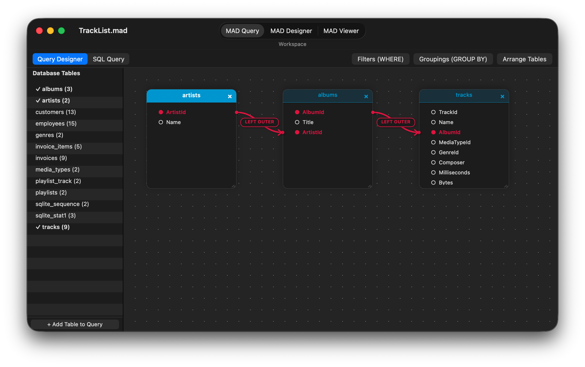
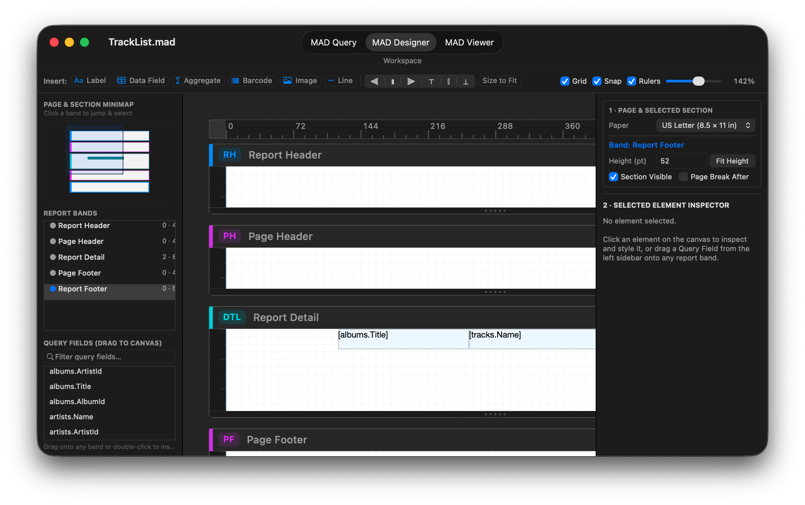
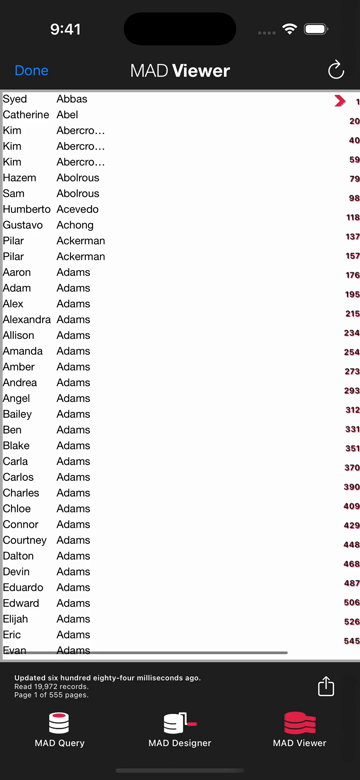
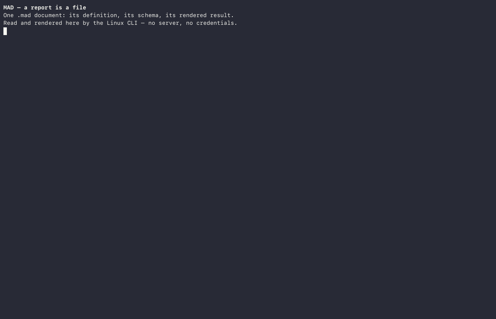

[English](README.md) | [简体中文](README_zh.md) | [日本語](README_ja.md) | [Português (Brasil)](README_pt-BR.md) | [Deutsch](README_de.md) | **Español**

> **Una nota del autor sobre la programación con agentes y los LLM** — [Léala aquí](Note%20from%20Author%20on%20Agentic%20Programming%20and%20LLMs_es.md)

# <a href="StaticResources/Images/icons/document/Designer%20Icon@3x.png"></a> MAD (Mobile Analytics Document)

**Un formato abierto y un motor embebible para la generación de informes relacionales: cada informe es un grafo de consultas portátil, una tabla SQLite materializada y un diseño paramétrico.**

MAD es una plataforma de generación de informes relacionales construida desde cero en Objective-C para consultas ad hoc, informes y diseño: la aplicación **MAD Designer** para iOS y macOS nativo (`AppKit`), donde las consultas y los diseños se construyen visualmente o desde SQL; la aplicación **MAD Viewer**, donde se leen y actualizan los informes; la **CLI y el motor `mad`** sin interfaz gráfica (headless) que se ejecutan en Linux y macOS; y la **especificación `.mad`** abierta.

Un archivo `.mad` contiene la definición completa de un informe —la instantánea del esquema de la base de datos, el grafo de consultas relacional (tablas, joins, predicados, agrupaciones) y el árbol de diseño por bandas— en un único archivo de menos de 100 KB, separado limpiamente de los datos que muestra. Un informe es un archivo ejecutable, no un servidor: cualquier entorno de ejecución que hable `.mad` puede inspeccionar el esquema, compilar SQL determinista para la base de datos de destino, materializar el conjunto de resultados en una tabla SQLite local y renderizarlo a vistas nativas de AppKit/UIKit, HTML paginado, PDF, CSV o JSON.

El repositorio es un único proyecto autocontenido: las aplicaciones para iPad/iPhone, la aplicación de escritorio nativa para macOS (`AppKit`) (`Mac/`), catorce frameworks (doce multiplataforma entre iOS, el Simulador de iOS y macOS nativo; once sin interfaz gráfica en Linux), la compilación y la suite de pruebas de Linux sin interfaz gráfica (126 ejecutables de prueba, 1 303 pruebas), la herramienta de línea de comandos `mad` y el sistema de compilación (`Compressor`) que compila las bibliotecas C de terceros desde fuentes fijadas. El código se publica bajo la licencia MIT; el formato `.mad` es una especificación abierta (consulte [`docs/`](docs/es/)), aunque los nombres y el arte de las aplicaciones del proyecto no están cubiertos por la concesión de la licencia (consulte [`NOTICE`](https://github.com/mthomason/MAD/blob/master/NOTICE)).

[](https://github.com/mthomason/MAD/actions/workflows/linux.yml)

> **Pruebe MAD Designer en macOS (macOS 12.0+, Apple Silicon):**
> * **Homebrew:** `brew install --cask mthomason/tap/mad-designer`
> * **Descarga directa:** [**MAD-Designer-macOS.dmg**](https://github.com/mthomason/MAD/releases/download/v9.1.0-macos/MAD-Designer-macOS.dmg) | [**MAD-Designer-macOS.zip**](https://github.com/mthomason/MAD/releases/download/v9.1.0-macos/MAD-Designer-macOS.zip) *(en las descargas directas, ejecute `xattr -cr "/Applications/MAD Designer.app"` una vez después de copiar la aplicación a `/Applications`)*

## Por qué MAD

Hoy cualquier desarrollador puede pedirle a un LLM que genere un script SQL de un solo uso y una tabla de React en diez minutos. Seis meses después, la organización tiene cuarenta mini-aplicaciones a medida, cuarenta definiciones incompatibles de un `INNER JOIN` entre `customers` e `invoices`, credenciales de base de datos codificadas directamente, matemática de agregados alucinada y cero interoperabilidad entre teléfonos y tabletas, escritorio, canalizaciones de CI y socios externos.

MAD resuelve el problema de la generación de informes en el **nivel del formato y del motor**:

* **Interoperabilidad mediante un contrato compartido.** En lugar de dispersar SQL ad hoc y código de interfaz de pegamento por scripts a medida, un documento `.mad` empaqueta el contrato del esquema, el AST de la consulta y el diseño de presentación en un único artefacto inspeccionable, comparable con diff y versionado. El mismo archivo de 80 KB se abre de forma nativa en macOS y en el iPad, se ejecuta sin interfaz gráfica en un contenedor Docker de Linux, se ejecuta en GitHub Actions o se incrusta dentro de otra aplicación, produciendo SQL y exportaciones idénticos byte a byte en Apple y Linux.
* **SQL determinista y matemática local en dos pasadas.** Ni el usuario final ni un modelo de IA necesita escribir a mano SQL específico del dialecto ni calcular totales en el código de la aplicación. El motor valida el grafo de consultas contra la instantánea del esquema del documento, compila SQL determinista para el driver de transporte, extrae el conjunto de resultados una vez a una caché local de filas SQLite (`MADDataTableFast`) y calcula las agrupaciones, las claves de ordenación y los agregados de encabezado y pie localmente en dos pasadas.
* **Escrito, no ensamblado.** El generador de SQL, el analizador de SQL, el motor de tablas de datos, el almacén portátil, el modelo de diseño y el renderizador de páginas son Objective-C propio distribuido en catorce frameworks. El código de terceros se limita estrictamente al transporte —MariaDB Connector/C, FreeTDS, `libpq` y SQLite— más `libarchive`/`bzip2` y `zint` para códigos de barras. No se revende ningún SDK de generación de informes propietario.
* **Diseñado primero para teléfonos y tabletas, con presupuesto de memoria.** Como el conjunto de resultados se materializa en una tabla SQLite indexada en disco y las páginas se formatean en una caché indexada por geometría, un teléfono o un contenedor pequeño puede paginar y agregar informes de cien mil filas sin mantener el conjunto de datos en la RAM.

La documentación técnica y la especificación del formato también se publican en <https://docs.everydayapps.com>.

## Véalo

**[MAD Designer para macOS](docs/es/macos.md)** — la aplicación de escritorio nativa de `AppKit` (`Mac/`), que muestra el lienzo visual de relaciones de **MAD Query** y el espacio de trabajo de diseño por bandas de **MAD Designer**:





**MAD Designer para iOS**, desde la elección de una fuente de datos hasta la lectura del informe terminado en MAD Viewer (28 segundos; [vídeo](https://docs.everydayapps.com/assets/app-preview.mp4)):

[](https://docs.everydayapps.com/assets/app-preview.mp4)

**El mismo motor ejecutándose sin interfaz gráfica en Linux**: `inspect`, `schema`, `query`, `refresh` y `export` a través de la CLI `mad`, sin servidor de informes:



El [informe exportado](https://docs.everydayapps.com/assets/london.html) de la grabación es HTML simple, y se abre en cualquier navegador.

## Dentro del formato `.mad`

Un archivo `.mad` no es una impresión estática como un PDF, ni un volcado de datos de fila. Es un **programa declarativo** que convierte una conexión a base de datos en una tabla tipada y una vista formateada.

La arquitectura divide un informe en **la definición portátil** (dentro del archivo `.mad`, normalmente 15–80 KB) y **las cachés complementarias derivadas** (generadas localmente al actualizar y desechables en cualquier momento):

| Capa | Archivo / Miembro | Formato | Función |
|---|---|---|---|
| **1. Contenedor** | `<Name>.mad` | Cabecera `MADFILE\0` v1 de 16 bytes + archivo tar bzip2 `pax restricted` | Archivo externo identificable por contenido (compatible con `tar xjf` para v0; cabecera + tar bzip2 para v1). |
| **2. Almacén de la definición** | `StoreContent/analyitics` | SQLite portátil (`MADStoreSchema`, versionado mediante `PRAGMA user_version`) | Contiene el grafo de objetos `Rptq*`: la instantánea del esquema de la base de datos importada, el grafo de consultas (tablas, alias, joins, predicados, agrupaciones y `sqlSourceText` opcional) y el árbol de diseño de secciones y elementos por bandas. Sin dependencias de Core Data ni de Apple. |
| **3. Metadatos y vista previa** | `meta.plist`, `AdditionalContent/` | Property List XML + `thumbnail@2x.png` opcional | Metadatos del generador, versión del formato y vista previa opcional del documento. |
| **4. Tabla materializada** *(complementaria)* | `<hash>.maddb` + `<hash>.mdcache` | Base de datos de filas SQLite (`t<tag>`) + lista de propiedades del esquema de columnas (`MADDataColumn`) | **La salida del informe como tabla de base de datos.** Contiene las filas obtenidas, los índices de claves de grupo y los metadatos de tipos de columna, de modo que los agregados en dos pasadas (`SUM`, `COUNT`, `AVG`, `MIN`, `MAX`), la ordenación y el renderizado posterior nunca vuelvan a consultar la base de datos remota. |
| **5. Caché de páginas** *(complementaria)* | `<hash>{ih,lh}{w,h}.madac` | Bases de datos SQLite de índice (`ih`) y de diseño (`lh`) indexadas por geometría de página | Saltos de página y marcos de elementos precalculados para una ventana de visualización de destino (p. ej., `{612, 792}` US Letter), lo que mantiene instantáneos el desplazamiento y la exportación. |

La especificación completa —disposición del contenedor, tablas del almacén, esquemas de los archivos complementarios, rarezas conocidas (incluida la razón por la que el nombre del archivo del almacén interno se escribe históricamente `analyitics` por compatibilidad hacia atrás) y verificación de resúmenes entre plataformas— está documentada capítulo a capítulo en [`docs/`](docs/es/).

## Hacia dónde va MAD: hoja de ruta y visión

Como MAD ya separa el **grafo de consultas**, la **tabla de resultados SQLite materializada** y el **diseño de presentación**, la arquitectura habilita cuatro capacidades principales que se están diseñando y encolando activamente (véanse [`docs/vision.md`](docs/es/vision.md), [`docs/project/MAD_DATA_OBJECT.md`](docs/project/MAD_DATA_OBJECT.md) y [`docs/project/TODO.md`](docs/project/TODO.md)):

1. **Un informe `.mad` como tabla ad hoc de base de datos (objetos de datos componibles).**
   En una base de datos tradicional, se hace `SELECT` sobre tablas base como `employee` o `sales_data`. Un informe `.mad` enlaza y filtra varias tablas, y su salida (`.maddb` + `.mdcache`) ya es una tabla SQLite física con un esquema tipado (`MADDataColumn`). Al hacer que la salida de un informe sea direccionable como fuente de tabla dentro del diseñador de consultas, **un archivo `.mad` se convierte en una tabla de base de datos virtual/materializada**. Otros informes, consultas o herramientas pueden hacer `SELECT` y `JOIN` contra un informe `.mad` igual que contra cualquier tabla de una base de datos.
2. **Varias fuentes de datos en un solo informe (federación sin servidor).**
   Cada driver de base de datos (`MADMySQL`, `MADPostgres`, `MADTdsClient`, `MADSqlite3`) materializa el resultado de su consulta en la misma representación local de tabla SQLite (`MADDataTableFast`). Una vez que un informe puede contener varios objetos de consulta y tratar cada salida materializada como una tabla local, un único informe `.mad` puede unir una tabla `customers` de PostgreSQL con una tabla `orders` de SQL Server y una tabla SQLite local, federadas localmente sobre SQLite sin un servidor de federación pesado en medio.
3. **Más allá del paradigma del papel: vistas nativas de UIKit y datos interactivos.**
   El diseño de página por bandas (Report Header, Page Header, Group Headers/Footers, Detail, Page/Report Footer) nació de la impresión en papel. En MAD, la paginación de papel se está convirtiendo en **solo un paradigma de vista** sobre el objeto de datos del documento. Cuando no se imprime ni se exporta un facsímil paginado, el mismo diseño y la misma tabla local `.maddb` impulsarán componentes nativos de UIKit ricos e interactivos y vistas de exploración de datos sin procesar: diseñar una vez, renderizar como papel paginado o como interfaz nativa interactiva.
4. **Convertir informes heredados de Crystal Reports (`.rpt`) y archivos de informes empresariales a `.mad`.**
   Miles de empresas siguen atadas a décadas de archivos de Crystal Reports (`.rpt`) que nadie quiere reescribir a mano y que ningún panel de SaaS moderno puede importar limpiamente. Como MAD comparte el ADN clásico de secciones por bandas y grafo de consultas relacionales de Crystal Reports —almacenando todo en un formato abierto e inspeccionable de SQLite dentro de tar—, MAD está construyendo importadores para convertir definiciones `.rpt` heredadas directamente en archivos `.mad` abiertos.

## Pruébelo

El motor sin interfaz gráfica ejecuta la CLI `mad` en Docker. Descargue la imagen publicada e inspeccione uno de los documentos de muestra incluidos en el repositorio:

```sh
docker run --rm -v "$PWD/CLI/Fixtures":/docs:ro ghcr.io/mthomason/mad \
    mad inspect /docs/London.portable.mad
```

Cada verbo funciona de la misma manera: `schema`, `query`, `refresh`, `export` (facsímil paginado en HTML y `html-flow` reflujable, texto plano, CSV, contrato de datos JSON y `json-report`; el PDF se ejecuta de forma nativa en Apple y está aplazado en Linux por diseño):

```sh
docker run --rm -v "$PWD/CLI/Fixtures":/docs:ro ghcr.io/mthomason/mad \
    mad refresh /docs/Music.portable.mad
docker run --rm -v "$PWD/CLI/Fixtures":/docs:ro -v "$PWD/out":/out ghcr.io/mthomason/mad \
    mad export /docs/London.portable.mad --format html --out /out/london.html
```

Las etiquetas publicadas son `latest` y el SHA corto del commit, compiladas para `linux/amd64` por el flujo de publicación en cada push a `master`. En Apple Silicon añada `--platform linux/amd64`: Docker Desktop ejecuta la etiqueta bajo emulación, y sin el indicador la descarga falla (`no matching manifest`). Compilar localmente una imagen `arm64` nativa (`mad-cli:latest`) y ejecutar la suite completa de verificación multiplataforma es un solo comando:

```sh
./Linux/build.sh --verify                 # build the toolchain and run the checks (~20 min first time)
```

Los documentos de muestra se actualizan contra la base de datos de muestra de Sqlite3 incluida en la imagen; las fixtures de MySQL, SQL Server y PostgreSQL esperan los servidores de prueba de [`docs/project/DEVELOPER.md`](docs/project/DEVELOPER.md).

## En CI

La GitHub Action [mad-action](https://github.com/mthomason/mad-action) ejecuta un `.mad` incluido en el repositorio dentro de un flujo de trabajo y carga su exportación como artefacto:

```yaml
- uses: mthomason/mad-action@v1
  with:
    command: export
    document: reports/sales.mad
```

Ejecuta la imagen publicada, así que la acción y la CLI son el mismo motor. La acción se genera desde [`satellites/mad-action/`](satellites/mad-action/) aquí; [`docs/project/SATELLITE_REPOS.md`](docs/project/SATELLITE_REPOS.md) registra cómo se mantiene actualizado el repositorio satélite.

## Drivers de base de datos

MAD se comunica con las bases de datos a través de subclases de `MADDatabase`. Hoy se distribuyen cuatro drivers:

* **MySQL / MariaDB** — `MADMySQL`, sobre MariaDB Connector/C;
* **SQL Server** — `MADTdsClient`, sobre FreeTDS;
* **PostgreSQL** — `MADPostgres`, sobre `libpq`;
* **SQLite** — `MADSqlite3`, para documentos de muestra, bases de datos locales y tablas de materialización internas.

Un driver es un framework que crea una subclase de `MADDatabase` y se registra con `MADDatabaseDriverRegistry`: el diseñador de consultas y el motor nunca ven el protocolo de transporte. Escribir uno es la primera contribución prevista (consulte el tutorial para escribir drivers en [`docs/tutorials/driver-authoring.md`](docs/es/tutorials/driver-authoring.md)). La costura es real: los usuarios pueden construir una consulta visualmente o pegar SQL (`MADSQLParser`), el motor genera la sentencia específica del dialecto y el driver solo tiene que ejecutarla y transmitir las filas a `id<MADDataTableWriting>`.

## Incrustar el motor

Once de los catorce frameworks no dependen de UIKit y se compilan sin interfaz gráfica. La CLI `mad` anterior es ese motor vestido de línea de comandos: el conjunto de verbos —`inspect`, `schema`, `query`, `refresh`, `export`, `write`— es la superficie de incrustación, y una aplicación que enlaza `MAD`, un framework de driver y `MADSqlite3` tiene generación de informes relacionales sin ningún servidor de por medio. Los drivers y los formatos de exportación (`<MADReportExporting>` / `MADReportExporterRegistry`) se autorregistran, así que añadir una fuente de datos o un formato de salida es una subclase, no un fork.

## Aplicación nativa de macOS

La aplicación de escritorio nativa de macOS ([`docs/macos.md`](docs/es/macos.md), [`Mac/`](Mac/)) se compila directamente con `AppKit` (SDK `macosx`, `MACOSX_DEPLOYMENT_TARGET = 12.0`) sobre los doce frameworks multiplataforma de MAD y las diez bibliotecas C estáticas universales (`arm64` + `x86_64`) compiladas por `Compressor`:

* **Arquitectura nativa de `NSDocument` (`MADMacDocument` / `MADMacDocumentController`):** Abre y guarda archivos `.mad` de forma nativa desde el Finder o el panel de apertura estándar (con un botón integrado **New Document**), migra automáticamente los archivos `.mad` heredados de Core Data mediante `MADStoreConverter` e integra `MADDesignerLayout` directamente con `NSDocument.undoManager` (`Cmd+Z` / `Cmd+Shift+Z`).
* **Asistente de conexión a base de datos e importación de esquema (`MADMacConnectionWindowController`):** Se conecta a **SQLite**, **MySQL / MariaDB**, **Microsoft SQL Server** o **PostgreSQL**, verifica la conectividad, guarda las credenciales en el Llavero de macOS (`MADKeyChain`) e importa los esquemas de tablas y columnas a un nuevo documento `.mad`.
* **Tres espacios de trabajo integrados** (`Cmd+1`, `Cmd+2`, `Cmd+3`):
  1. **MAD Query (`MADMacQueryViewController`):** Alterna entre el **Query Designer** interactivo (tarjetas de tabla arrastrables, conectores de join Bézier con distintivos de tipo de join en los que se puede hacer clic, y paneles emergentes de filtro `WHERE` y `GROUP BY`) y el editor **SQL Query** (`MADSQLParser` + `MADSQLQueryCompiler`).
  2. **MAD Designer (`MADMacDesignerViewController`):** Vista dividida en tres paneles con un **Page & Section Minimap** interactivo, un esquema **Report Bands**, una fuente de arrastre **Query Fields** con búsqueda, un lienzo de diseño ampliable y con reglas (`MADMacDesignerCanvasView`) con arrastrar y soltar entre secciones y guías de alineación inteligentes, y un **Page & Element Inspector** de dos tarjetas.
  3. **MAD Viewer (`MADMacViewerViewController`):** Actualización de datos en vivo (`Cmd+R`), repaginación instantánea por **Page Size** (`US Letter`, `Legal`, `Tabloid`, `A3`, `A4`, `A5`, `B4`, `B5`, `JIS B4`, `JIS B5`), vista previa enmarcada en `PDFView`, impresión nativa con `NSPrintOperation` (`Cmd+P`) y exportación (`Cmd+E`) a **PDF**, **HTML**, **HTML Flow**, **CSV**, **JSON**, **JSON Full Report** y **Plain Text**.

Consulte [`docs/macos.md`](docs/es/macos.md) para la guía completa y [`docs/project/MAD_MACOS.md`](docs/project/MAD_MACOS.md) para la auditoría de portabilidad multiplataforma.

## Compilación y pruebas

El espacio de trabajo (`Reports.xcworkspace`) compila los catorce frameworks, las aplicaciones de iOS y la aplicación nativa de macOS (`MAD Designer Mac`).

### macOS nativo

Compile, ejecute la suite de pruebas de humo integral y empaquete los artefactos de versión `.zip` y `.dmg` desde la raíz del repositorio:

```sh
./Mac/build.sh                     # build 12 macOS frameworks + Mac/build/MAD Designer.app
./Mac/build.sh --no-frameworks     # rebuild only MAD Designer.app (fast iteration)
./Mac/build.sh --smoke-test        # build and run the end-to-end macOS smoke suite
./Mac/build.sh --package           # create Mac/build/MAD-Designer-macOS.zip and .dmg
```

También puede compilar y depurar de forma interactiva en Xcode con el scheme compartido **`MAD Designer Mac`**, o ejecutar la suite de pruebas unitarias de cualquier framework de forma nativa en macOS:

```sh
xcodebuild test -workspace Reports.xcworkspace -scheme MAD \
	-destination 'platform=macOS,arch=arm64' \
	-derivedDataPath ~/Library/Developer/Xcode/DerivedData/Reports-cozeiyczmvgrbeapplwfuygymqci
```

### Simulador de iOS

Ejecute la suite de un framework contra el Simulador de iOS:

```sh
xcodebuild test -workspace Reports.xcworkspace -scheme MADFoundation \
	-destination 'platform=iOS Simulator,id=94952340-7629-4EBB-BBD3-6FEE068793B8' \
	-derivedDataPath ~/Library/Developer/Xcode/DerivedData/Reports-cozeiyczmvgrbeapplwfuygymqci
```

(`MADMySQL`, `MADTdsClient` y `MADPostgres` también incluyen suites en vivo que se comunican con un servidor de base de datos real y se omiten cuando no hay ninguno disponible; consulte [`docs/project/DEVELOPER.md`](docs/project/DEVELOPER.md)).)

### Linux (motor y CLI sin interfaz gráfica)

El motor sin interfaz gráfica se verifica del mismo modo en Linux. Desde la raíz del repositorio, con Docker instalado:

```sh
./Linux/build.sh       # build the toolchain image, compile the eleven frameworks, run the suites
```

Esto ejecuta 126 ejecutables de prueba y 1 303 pruebas dentro del contenedor, y `--verify` añade las comprobaciones integrales de la CLI contra las fixtures incluidas y sus resúmenes fijados. Consulte [`Linux/README.md`](Linux/README_es.md) para la imagen, las versiones fijadas y las divergencias de GNUstep que encontró el port.

## Soporte

MAD es software libre y sigue siendo libre. Una sola persona lo mantiene: los documentos de diseño, la matriz de pruebas de dos plataformas y el desarrollo impulsado por agentes consumen tiempo real y tokens de API. Si MAD le ahorra tiempo a su equipo, aquí tiene cómo devolver parte de él, y gracias de cualquier forma:

* **[Patrocine al mantenedor](https://github.com/sponsors/mthomason)** — único o mensual, mediante GitHub Sponsors.
* **Envíe créditos de API.** El proyecto se desarrolla con agentes de IA; los créditos de OpenAI, Anthropic o de tokens de agentes vuelven directamente al trabajo. Póngase en contacto a través de la página de patrocinio o de un issue.
* **[Contribuya](CONTRIBUTING_es.md).** Un driver de base de datos, un elemento de documento, un formato de exportación, un importador heredado o una corrección: las costuras son el punto.

## Licencia

MIT — consulte [`LICENSE`](https://github.com/mthomason/MAD/blob/master/LICENSE). La licencia cubre el software; los nombres «MAD», «MAD Designer» y «MAD Viewer», los iconos de las aplicaciones y el resto del arte del producto, y los medios de vista previa de la aplicación son del autor y quedan excluidos de ella (consulte [`NOTICE`](https://github.com/mthomason/MAD/blob/master/NOTICE)). Cada componente de terceros, su licencia y las obligaciones que su distribución nos impone se registran en [`docs/project/THIRD_PARTY_LICENSES.md`](https://github.com/mthomason/MAD/blob/master/docs/project/THIRD_PARTY_LICENSES.md).

## Cumplimiento de exportación

Los drivers de MySQL, FreeTDS y PostgreSQL usan OpenSSL/TLS; no se implementa cifrado propio. Según las directrices de cumplimiento de exportación de Apple, se trata de cifrado exento, y la aplicación establece `ITSAppUsesNonExemptEncryption = NO`.
