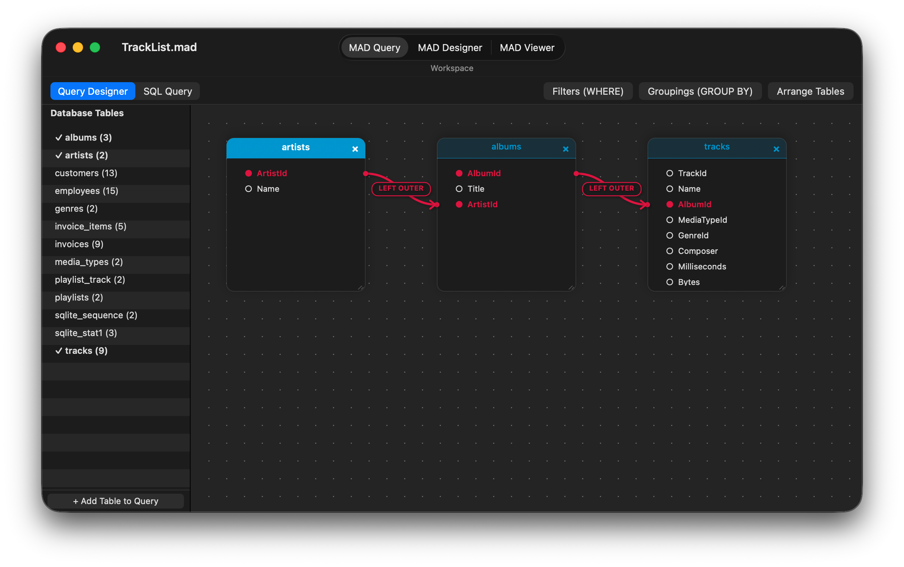
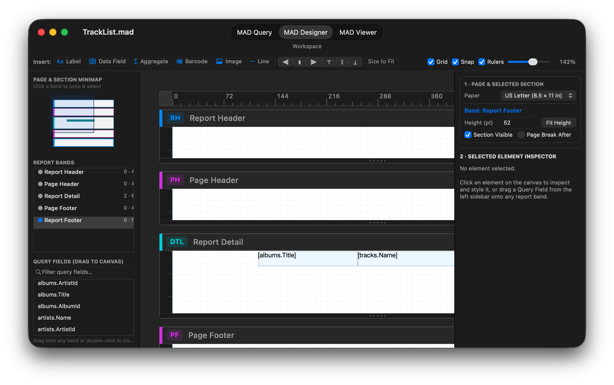
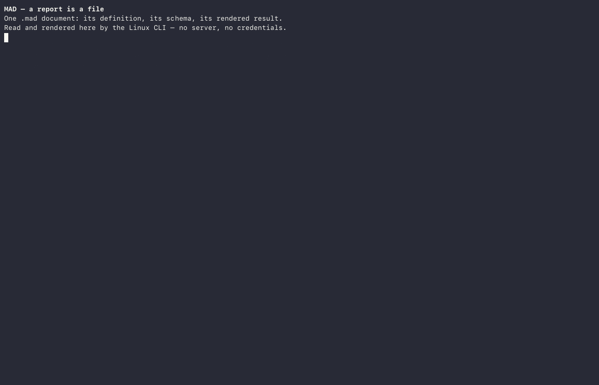

<strong>Ein offenes Format und eine einbettbare Engine für relationales Reporting — hier ist jeder Bericht ein portabler Abfragegraph, eine materialisierte SQLite-Tabelle und ein parametrisches Layout.</strong>

MAD ist eine eingebettete Plattform für relationales Reporting für Ad-hoc-Abfragen, Berichte und Design: die Apps **MAD Designer** und **MAD Viewer** für iOS und natives macOS (`AppKit`), die headless Engine, die sie unter Linux und macOS ausführt, und das offene `.mad`-Dokumentformat. Eine `.mad`-Datei enthält die gesamte Definition eines Berichts — den Schema-Snapshot der Datenbank, den Abfragegraphen (Tabellen, Joins, Prädikate, Gruppierungen) und das bandbasierte Layout seiner Elemente — in weniger als 100 KB, sauber getrennt von der materialisierten SQLite-Tabelle (`.maddb` + `.mdcache`), die sie beim Aktualisieren erzeugt.

Der Code liegt auf
[github.com/mthomason/MAD](https://github.com/mthomason/MAD), unter MIT-Lizenz;
die Namen und das App-Artwork sind von dieser Lizenz nicht abgedeckt (siehe
[NOTICE](https://github.com/mthomason/MAD/blob/master/NOTICE)).

> **MAD Designer auf macOS ausprobieren (macOS 12.0+, Apple Silicon):**
> * **Homebrew:** `brew install --cask mthomason/tap/mad-designer`
> * **Direkter Download:** [**MAD-Designer-macOS.dmg**](https://github.com/mthomason/MAD/releases/download/v9.1.0-macos/MAD-Designer-macOS.dmg) | [**MAD-Designer-macOS.zip**](https://github.com/mthomason/MAD/releases/download/v9.1.0-macos/MAD-Designer-macOS.zip) *(bei direkten Downloads nach dem Kopieren nach `/Applications` einmal `xattr -cr "/Applications/MAD Designer.app"` ausführen)*

## In Aktion

**[MAD Designer für macOS](macos.html)** — native `AppKit`-Desktopanwendung (`NSDocument`, visuelle Abfrageleinwand für Tabellen und Joins, interaktive Minimap der Bereiche und bandbasierter Berichtsdesigner sowie seitenweise Anzeige von PDF/HTML/CSV/JSON-Berichten):

**MAD Designer für iOS**, von der Auswahl einer Datenquelle bis zum fertigen
Bericht in MAD Viewer:

<video controls playsinline preload="metadata" width="360"
  poster="../assets/app-preview-poster.png">
  <source src="../assets/app-preview.mp4" type="video/mp4">
  Ihr Browser unterstützt das Video-Element nicht; die
  <a href="../assets/app-preview.mp4">App-Vorschau</a> ist eine einfache MP4-Datei.
</video>

**Dieselbe Engine headless unter Linux**: `inspect`, `schema`, `query`, `refresh`
und `export` über die `mad`-CLI, ohne Datenbankserver und ohne Zugangsdaten:

Der [exportierte Bericht](../assets/london.html) der Aufzeichnung ist reines HTML
und lässt sich in jedem Browser öffnen.

## Warum MAD

* **Interoperabel durch Kontrakt.** Statt einmalige SQL-Skripte und
  maßgeschneiderten Dashboard-Klebstoff über eine Organisation zu verteilen,
  bündelt eine `.mad`-Datei den Schema-Kontrakt, den Abfrage-AST und das
  Präsentationslayout in einem einzigen einsehbaren, diffbaren Artefakt, das
  byte-identisches SQL und byte-identische Exporte auf Apple- und
  Linux-Plattformen erzeugt.
* **Geschrieben, nicht zusammengesetzt.** Die SQL-Erzeugung, der SQL-Parser, die
  Datenbanktabellen-Engine, der Speicher, das Layoutmodell und der Renderer sind
  eigenentwickeltes Objective-C über vierzehn Frameworks. Drittanbieter-Code
  beschränkt sich auf die Verbindungsebene — MariaDB Connector/C, FreeTDS,
  `libpq`, SQLite — plus `libarchive`/`bzip2` und `zint` für Barcodes. Kein
  proprietäres Reporting-SDK wird weiterverkauft.
* **Mobile-first, speicherbudgetiert.** Ein Refresh liest die Ergebnismenge
  einmal in einen SQLite-Zeilen-Cache (`MADDataTableFast`) und berechnet von dort
  zweistufige Gruppierungen und Aggregate, sodass das seitenweise Rendern im
  Speicher eines Telefons schnell bleibt.
* **Einbettbar und portabel.** Elf der vierzehn Frameworks sind frei von UIKit
  und lassen sich headless bauen; sie bestehen 1.303 Tests unter Linux in Docker.
  Der `.mad`-Container ist ein bzip2-tar-Archiv mit einem portablen
  SQLite-Speicher; zum Öffnen ist kein Apple-Framework erforderlich.

## Das `.mad`-Format

Die offene Spezifikation, ein Kapitel pro Datei:

[Was ein Dokument ist](01-document.html) ·
[Der Container](02-container.html) ·
[Der Speicher](03-store.html) ·
[Lesen und Schreiben](04-reading-writing.html) ·
[Begleitdateien](05-companion-files.html) ·
[Fallstricke](06-hazards.html) ·
[Normativ `v1`](07-normative.html) ·
[Offene Fragen](08-open-questions.html) ·
[Verifikation](09-verification.html)

## Die Engine verwenden

* [MAD Designer für macOS](macos.html) — die native `AppKit`-Desktop-App:
  visuelle Abfrageleinwand, bandbasierter Berichtsdesigner mit Minimap und
  Inspector, seitenweise Anzeige und wie man sie aus dem Quellcode baut oder
  paketiert.
* [Bauen und testen](https://github.com/mthomason/MAD#build-and-test) —
  die genauen Befehle für die iOS-Suites, die nativen macOS-Suites und den
  Linux-Build.
* [Die `mad`-CLI](https://github.com/mthomason/MAD#try-it) — eine `.mad`-Datei
  mit einer Zeile aus Docker inspizieren, aktualisieren und exportieren.
* [mad-action](https://github.com/mthomason/mad-action) — eine eingecheckte
  `.mad`-Datei in GitHub Actions ausführen und ihren Export hochladen;
  `mthomason/mad-action@v1`.
* [Tutorial zum Schreiben eines Treibers](tutorials/driver-authoring.html) — der
  vorgesehene erste Beitrag: `MADDatabase` ableiten, den Treiber registrieren,
  Zeilen zurückgeben.

## Die Richtung

[Vision](vision.html) — Berichte als kombinierbare Datenbanktabellen, Abfragen mit
mehreren Quellen in einem einzigen Bericht, native UIKit-Datenansichten jenseits
des Papierparadigmas und die Konvertierung von Legacy-Crystal-Reports-Dateien
(`.rpt`) in offene `.mad`-Dateien.

---

Die App **MAD Designer** — der Berichtsdesigner, der auf dieser Engine aufbaut —
hat ihre eigene Website unter [mad.everydayapps.com](https://mad.everydayapps.com/).
