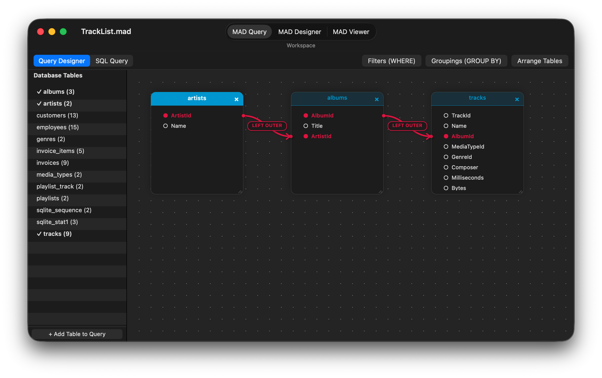
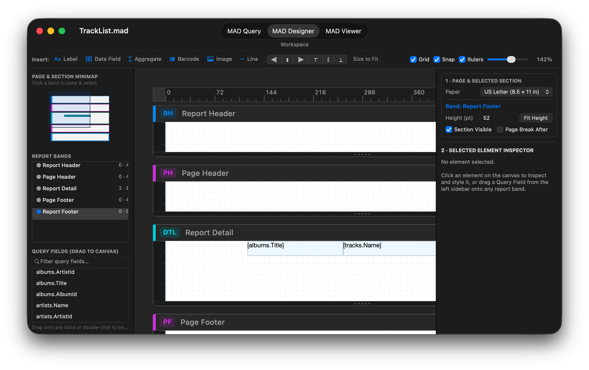

# <a href="https://raw.githubusercontent.com/mthomason/MAD/master/StaticResources/Images/icons/document/Designer%20Icon@3x.png"></a>MAD Designer für macOS

**MAD Designer für macOS** ist eine native `AppKit`-Desktopanwendung (SDK
`macosx`, `MACOSX_DEPLOYMENT_TARGET = 12.0`) zum Erstellen, Abfragen, Layouten,
Aktualisieren, Drucken und Exportieren von Mobile Analytics Documents (`.mad`).
Sie bindet dieselben eigenentwickelten Objective-C-Frameworks und universellen
statischen C-Bibliotheken (`Compressor`) ein, auf denen die iOS-Apps und die
headless Engine basieren.

Jede unter macOS erstellte oder bearbeitete `.mad`-Datei ist byte-kompatibel mit
den iPad-/iPhone-Apps, der `mad`-CLI unter Linux und der GitHub Action
[`mad-action`](https://github.com/mthomason/mad-action).

## Herunterladen & installieren

* **Homebrew (macOS 12.0+, Apple Silicon):**
  ```sh
  brew install --cask mthomason/tap/mad-designer
  ```
* **Direkter Download:** [**MAD-Designer-macOS.dmg**](https://github.com/mthomason/MAD/releases/download/v9.1.0-macos/MAD-Designer-macOS.dmg) | [**MAD-Designer-macOS.zip**](https://github.com/mthomason/MAD/releases/download/v9.1.0-macos/MAD-Designer-macOS.zip)
  *(Wenn Sie die `.dmg` oder `.zip` in einem Browser herunterladen, führen Sie nach dem Kopieren nach `/Applications` einmal `xattr -cr "/Applications/MAD Designer.app"` aus, um das Quarantäne-Flag von macOS Gatekeeper zu entfernen.)*

---

## Arbeitsbereiche

Jedes geöffnete `.mad`-Dokument läuft in einem nativen `NSDocument`-Fenster
(`MADMacDocument` / `MADMacWindowController`) mit einem zentrierten segmentierten
Steuerelement **Workspace** in der Fenstersymbolleiste (`Cmd+1`, `Cmd+2`,
`Cmd+3`), das zwischen den drei Berichtsphasen wechselt:

### 1. MAD Query (`Cmd+1`)



Der Arbeitsbereich **MAD Query** (`MADMacQueryViewController`) baut den
relationalen Abfragegraphen, der in `RptqQuery` gespeichert wird. Ein Umschalter
in der Arbeitsbereichsleiste wechselt zwischen zwei sich gegenseitig
ausschließenden Ansichten der Abfrage:

* **Query Designer (visueller Graph):**
  * **Database Tables-Seitenleiste:** Zeigt jede in den Schema-Snapshot des
    Dokuments importierte Tabelle (`RptqDatabaseSchemaTable`) mit Spaltenanzahl
    und Häkchen für Tabellen, die derzeit an der Abfrage teilnehmen.
    Doppelklicken Sie auf eine Tabelle (oder klicken Sie auf **+ Add Table to
    Query**), um sie der Leinwand hinzuzufügen.
  * **Interaktive Beziehungsleinwand (`MADMacQueryCanvasView`):** Stellt jede
    Abfragetabelle als verschiebbare, in der Größe veränderbare Karte
    (`MADMacQueryTableCardView`) auf einer Punktraster-Leinwand dar, gestaltet
    mit topologischen Kopfzeilenfarben für Wurzel und Kinder, die von `MTGraph`
    berechnet werden.
  * **Visuelle Join-Verbindungen (`MADMacQueryLinksOverlayView`):** Das Ziehen
    von einer Spalte einer Tabellenkarte zu einer Spalte einer anderen erzeugt
    einen Join (standardmäßig `LEFT OUTER`), gezeichnet mit glatten kubischen
    Bézierkurven, Richtungspfeilen und Pillen-Badges. Ein Klick oder Rechtsklick
    auf ein Join-Badge öffnet ein Join-Inspector-Popover oder ein Kontextmenü, um
    den Join-Typ zu ändern (`INNER`, `LEFT OUTER`, `RIGHT OUTER`, `FULL OUTER`,
    `CROSS`), die Join-Richtung umzukehren oder die Verbindung zu löschen.
  * **Filter, Gruppierungen & automatisches Layout:** Popover in der Kopfleiste
    bearbeiten **`WHERE`-Prädikate** (`Filters (WHERE)`), **`GROUP BY` /
    Sortierreihenfolge** (`Groupings (GROUP BY)` — wodurch automatisch passende
    Layoutbänder `Group Header` und `Group Footer` bereitgestellt werden) sowie
    **Arrange Tables** für die automatische topologische Platzierung der Karten.
* **SQL Query (direkte SQL-Eingabe & -Inspektion):**
  * Zeigt das aus dem visuellen Graphen erzeugte deterministische,
    dialektspezifische SQL an und erlaubt das Einfügen oder Bearbeiten einer
    `SELECT`-Anweisung.
  * Validiert und kompiliert eingegebenes SQL über `MADSQLParser`,
    `MADSQLStatementResolver` und `MADSQLQueryCompiler` zurück in den portablen
    `RptqQuery`-Objektgraphen und bewahrt die Anweisung in
    `RptqQuery.sqlSourceText` auf.

---

### 2. MAD Designer (`Cmd+2`)



Der Arbeitsbereich **MAD Designer** (`MADMacDesignerViewController`) legt die
parametrischen Bänder und Elemente des Berichts in einer vom Benutzer in der
Größe veränderbaren dreigeteilten Ansicht aus:

* **Obere Designer-Symbolleiste:**
  * **Elementpalette:** Klicken Sie auf **Label**, **Data Field**,
    **Aggregate**, **Barcode**, **Image** oder **Line**, oder ziehen Sie es auf
    ein Bereichsband, um es einzufügen.
  * **Ausrichtung & Größe:** Ausrichtungsschaltflächen für mehrere Elemente
    (`Align Left`, `Center`, `Right`, `Top`, `Middle`, `Bottom`) und **Size to
    Fit**.
  * **Leinwand-Steuerung:** Unabhängige Umschalter für **Grid**, **Snap** und
    **Rulers** sowie ein kontinuierlicher **Zoom**-Schieberegler (`50%–250%`) mit
    Ein-Klick-Zurücksetzen auf `100%`.
* **Linke Navigator-Seitenleiste:**
  * **Page & Section Minimap (`MADMacDesignerMinimapView`):**
    Live-Proportionalansicht aller Berichtsbänder aus der Vogelperspektive, mit
    elementaren Miniaturblöcken und dem Rechteck des aktiven Scrollbereichs.
    Klicken oder ziehen Sie in der Minimap, um zu einem Band zu springen und es
    auszuwählen.
  * **Report Bands Outline:** Listet `Report Header`, `Page Header`, alle Bänder
    `Group Header` / `Group Footer`, `Report Detail`, `Page Footer` und
    `Report Footer` mit Elementanzahl, Höhe in Punkten und
    Seitenumbruchindikatoren auf. Ein Doppelklick auf eine Zeile schaltet die
    Sichtbarkeit des Bereichs um.
  * **Query Fields Browser:** Filterbare Liste aller Spalten `RptqQueryField` aus
    der Abfrage. Ziehen Sie ein Feld direkt auf ein Bereichsband der Leinwand
    (oder doppelklicken Sie darauf), um ein gebundenes Datenfeldelement zu
    erstellen (`RptqDocumentElementLabelDataField`).
* **Mittlere interaktive Leinwand (`MADMacDesignerCanvasView`):**
  * Geflippte, zoombare `NSView`-Leinwand mit horizontalen und vertikalen
    Punktlinealen, Papierrandhilfen, farbcodierten Bereichsköpfen (`RH`, `PH`,
    `GH`, `DTL`, `GF`, `PF`, `RF`) und Griffen am unteren Rand zum Ändern der
    Bereichshöhen.
  * Unterstützt Gummibandauswahl, Mehrfachauswahl per `Shift`-Klick,
    8-Punkt-Größenänderungsgriffe, intelligente Ausrichtungshilfen, Einrasten am
    Raster, Inline-Textbearbeitung per Doppelklick, Drag-and-Drop zwischen
    Bereichen (`-moveElement:toSection:atOrigin:`) und vollständiges
    Rückgängig/Wiederholen mit `NSUndoManager` (`Cmd+Z` / `Cmd+Shift+Z`) für
    einzelne und Massenänderungen von Eigenschaften.
* **Rechte Inspector-Seitenleiste:**
  * **`1 · PAGE & SELECTED SECTION`:** Konfiguriert die Ziel-Papiergröße
    (**Paper**), zeigt das aktive Band-Badge an, bearbeitet die Bereichshöhe **Height (pt)**
    mit der Schaltfläche **Fit Height** und schaltet **Section Visible** sowie
    **Page Break After** um.
  * **`2 · SELECTED ELEMENT INSPECTOR`:** Vier kontextbezogene Karten, wenn ein
    Element ausgewählt ist:
    1. **Element & Band Assignment:** Weist das Element einem anderen
       Bereichsband zu, dupliziert es (`Cmd+D`) oder löscht es (`Delete`).
    2. **Content & Data Binding:** Statischer Text, gebundene Abfragespalte
       (`table.column`), Aggregatfunktion (`SUM`, `COUNT`, `AVG`, `MIN`, `MAX`,
       `STDDEV`, `VARIANCE`) und Geltungsbereich (`Report` oder `Group`),
       Währungsformatierung oder Barcode-Symbologie (`zint`).
    3. **Typography & Appearance:** Schriftfamilie, Schriftgröße in Punkten,
       Fett / Kursiv / Unterstrichen / Durchgestrichen, horizontale und vertikale
       Textausrichtung, Vordergrundfarbe und Hintergrundfüllung.
    4. **Position, Size & Box Model:** Exakte Koordinaten in Punkten (`X`, `Y`,
       `W`, `H`), Rahmenbreite und -farbe, Innenabstand und Außenabstände.

---

### 3. MAD Viewer (`Cmd+3`)

Der Arbeitsbereich **MAD Viewer** (`MADMacViewerViewController`) aktualisiert die
Abfrage gegen ihre Live-Datenquelle, materialisiert die Ergebnismenge in den
lokalen SQLite-Tabellen-Cache (`MADDataTableFast`) und rendert die Seiten:

* **Viewer-Symbolleiste:**
  * **Page Size Selector (`MTPaper`):** Paginiert und rendert den Bericht sofort
    neu für **US Letter**, **US Legal**, **US Tabloid**, **A3**, **A4**, **A5**,
    **B4**, **B5**, **JIS B4** oder **JIS B5**.
  * **Refresh (`Cmd+R`):** Führt die Abfrage über den registrierten
    Datenbanktreiber des Dokuments aus, füllt den begleitenden SQLite-Cache
    `.maddb` / `.mdcache`, berechnet zweistufige Gruppierungen und Aggregate und
    baut den Seitencache neu auf.
  * **Zoom & Seitenavigation:** Verkleinern, Zurücksetzen auf `100%`, Vergrößern
    und Blättern durch die Seiten (`Previous`, `Page N of M`, `Next`).
  * **Print (`Cmd+P`) & Export (`Cmd+E`):** Druckt nativ über
    `NSPrintOperation` oder öffnet `NSSavePanel` mit einer Formatauswahl für alle
    sieben registrierten Exporter:
    * **PDF Document (`.pdf`)** — natives CoreGraphics-/AppKit-Vektor-PDF über
      `MADReportExporterPDF`
    * **HTML Page (`.html`)** — positioniertes seitengenaues Faksimile
      (`MADReportExporterHTML`)
    * **HTML Flow (`.html`)** — responsives, reflow-fähiges semantisches HTML
      (`MADReportExporterHTMLFlow`)
    * **CSV Spreadsheet (`.csv`)** — Detailzeilenexport nach RFC 4180
      (`MADReportExporterCSV`)
    * **JSON Data (`.json`)** — Schema-Kontrakt + Detailzeilen
      (`MADReportExporterJSON`)
    * **JSON Full Report (`.json`)** — hierarchische Bereiche, Gruppen und
      ausgewertete Elemente (`MADReportExporterJSONReport`)
    * **Plain Text (`.txt`)** — Texttabelle in Festbreitenschrift
      (`MADReportExporterText`)
* **Gerahmte Seitenvorschau & Statusleiste:** Rendert gestochen scharfe, mit
  Schatten versehene Seiten in einem nativen `PDFView` und zeigt in der unteren
  Statusleiste die Anzahl der gerenderten Seiten, der zwischengespeicherten
  Zeilen und die Papierabmessungen an.

---

## Dokumente öffnen und erstellen

* **Launch & Open Panel (`MADMacDocumentController`):** Beim Start ohne Datei
  zeigt die App den macOS-Dialog **Open Report** an, gefiltert auf
  `.mad`-Dokumente (`com.everydayapps.productivity.mad` und
  `com.thomason.report.mad`), mit einer primären Schaltfläche **New Document** in
  der unteren linken Leiste. Ein Doppelklick auf eine `.mad`-Datei im Finder
  öffnet sie direkt in ihrem Arbeitsbereichsfenster.
* **Legacy Document Migration:** Beim Öffnen eines älteren Core-Data-`.mad`-Archivs
  wird sein Speicher über `MADStoreConverter` an Ort und Stelle in das portable
  SQLite-Schema (`MADStoreSchema`) konvertiert.
* **New Report from Database Connection (`Cmd+N`):** Ein Klick auf **New
  Document** (oder **File → New Document…**) öffnet den
  Datenbankverbindungsassistenten (`MADMacConnectionWindowController`):
  * Wählen Sie **SQLite**, **MySQL**, **Microsoft SQL Server** oder
    **PostgreSQL**.
  * Wählen Sie eine lokale `.sqlite3`- / `.db`-Datenbank aus oder geben Sie
    Server-Host, Port, optionale SQL-Server-Instanz, Datenbankname, Benutzername
    und Kennwort ein.
  * Klicken Sie auf **Test Connection**, um die Konnektivität zu prüfen und die
    gefundene Tabellenanzahl einzusehen.
  * Klicken Sie auf **Create Document…**, um das Tabellen- und Spaltenschema der
    Datenbank in eine neue `.mad`-Datei zu importieren und sie im Arbeitsbereich
    **MAD Query** zu öffnen. Zugangsdaten werden über `MADKeyChain` im
    macOS-Schlüsselbund gespeichert.

---

## Architektur: natives `AppKit` auf multiplattformfähigen Frameworks

Statt die iOS-Oberfläche in Mac Catalyst zu verpacken, kompiliert MAD zwölf seiner
vierzehn Frameworks nativ für `macosx` (`SUPPORTED_PLATFORMS = "iphoneos
iphonesimulator macosx"`, `MACOSX_DEPLOYMENT_TARGET = 12.0`) und legt eine eigens
dafür gebaute `AppKit`-Dokumentarchitektur (`Mac/Source/`) darüber:

| Schicht | Komponenten | Rolle unter macOS |
|---|---|---|
| **Statische C-Bibliotheken (`Compressor`)** | `sqlite3`, `zlib`, `openssl`, `bzip2`, `libpng`, `libarchive`, `freetds`, `mariadb`, `postgres`, `zint` | Universelle (`arm64` + `x86_64`) `macosx`-Slices in `.xcframework`-Bundles, geprüft durch `./Compressor/build.sh --verify --all --platforms ios,simulator,macosx`. |
| **Kern- und Treiber-Frameworks** | `MADFoundation`, `MADDataStructures`, `MADCocoaExtensions`, `MADFileManager`, `MADAPI`, `MADSqlite3`, `MADTds`, `MADTdsClient`, `MADMySQL`, `MADPostgres`, `MADBarcodes`, `MAD` | Gemeinsames Objective-C-Modell, portabler SQLite-Speicher (`Rptq*`), SQL-Parser/-Compiler, Wire-Datenbanktreiber, zint-Barcode-Renderer, `MADDesignerLayout`-Rückgängig/Wiederholen-Engine und `MADPrintPageRenderer` / `MADReportExporterPDF`. |
| **Nativer `AppKit`-Frontend (`Mac/`)** | `MADMacAppDelegate`, `MADMacAboutWindowController`, `MADMacDocumentController`, `MADMacDocument`, `MADMacWindowController`, `MADMacConnectionWindowController`, `MADMacQueryViewController`, `MADMacDesignerViewController`, `MADMacDesignerCanvasView`, `MADMacViewerViewController` | Nativer `NSDocument`-Lebenszyklus, About- / Overview- / Acknowledgements-Fenster, Symbol- und Menüleiste, visuelle Abfrageleinwand, dreigeteilter Berichtsdesigner mit Minimap und Inspector sowie `PDFView`-Berichtsanzeige. |

Der vollständige Architektur-Audit und das Fehlerprotokoll aus dem
Multiplattform-Port sind in
[`docs/project/MAD_MACOS.md`](https://github.com/mthomason/MAD/blob/master/docs/project/MAD_MACOS.md)
festgehalten.

---

## Bauen, testen und paketieren

### In Xcode

Öffnen Sie `Reports.xcworkspace`, wählen Sie das gemeinsame Scheme **`MAD Designer
Mac`** mit dem Ziel **My Mac** und drücken Sie **Run (`Cmd+R`)**, um die native
macOS-App interaktiv zu bauen und zu debuggen.

Um die Unit-Test-Suite eines beliebigen Frameworks nativ unter macOS auszuführen:

```sh
xcodebuild test -workspace Reports.xcworkspace -scheme MAD \
	-destination 'platform=macOS,arch=arm64' \
	-derivedDataPath ~/Library/Developer/Xcode/DerivedData/Reports-cozeiyczmvgrbeapplwfuygymqci
```

### Build über die Kommandozeile, Smoke-Suite & Release-Paketierung

Das eigenständige Skript `Mac/build.sh` kompiliert alle zwölf macOS-Frameworks,
setzt `Mac/build/MAD Designer.app` zusammen und signiert es, führt die
End-to-End-Smoke-Test-Suite für Headless und AppKit
(`Mac/Tests/MADMacSmokeTest.m`) aus und paketiert verteilbare `.zip`- und
`.dmg`-Archive:

```sh
./Mac/build.sh                     # build 12 macOS frameworks + MAD Designer.app
./Mac/build.sh --no-frameworks     # rebuild only MAD Designer.app (fast iteration)
./Mac/build.sh --smoke-test        # build and run the end-to-end macOS smoke suite
./Mac/build.sh --package           # package MAD-Designer-macOS.zip and MAD-Designer-macOS.dmg
```
