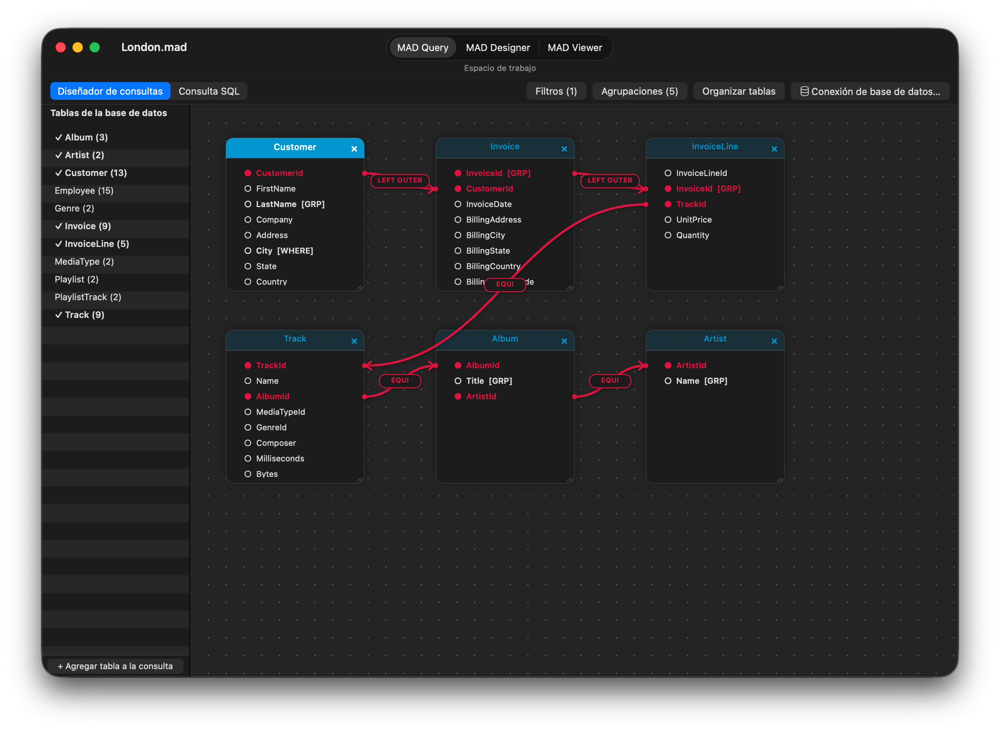
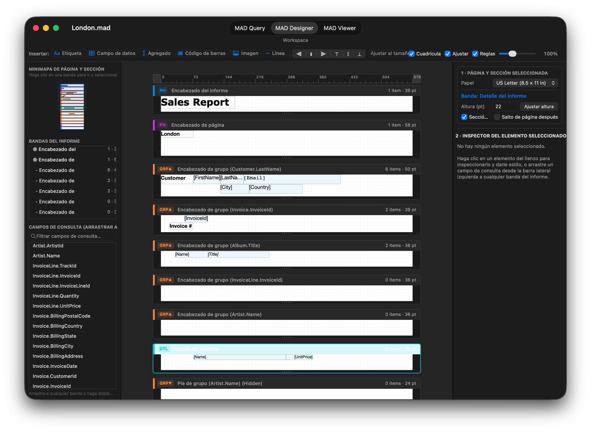
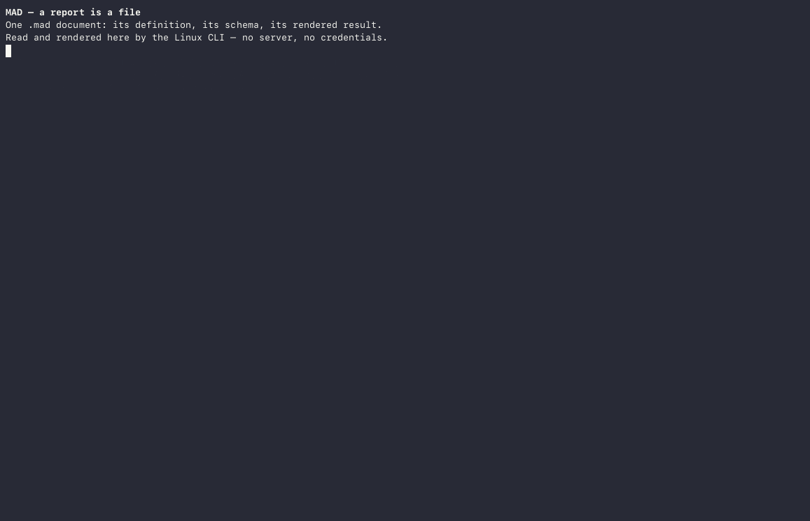

<strong>Un formato abierto y un motor embebible para la generación de informes relacionales: cada informe es un grafo de consultas portátil, una tabla SQLite materializada y un diseño paramétrico.</strong>

MAD es una plataforma embebida de generación de informes relacionales para consultas ad hoc, informes y diseño: las aplicaciones **MAD Designer** y **MAD Viewer** para iOS y macOS nativo (`AppKit`), el motor sin interfaz gráfica (headless) que las ejecuta en Linux y macOS, y el formato de documento abierto `.mad`. Un archivo `.mad` contiene la definición completa de un informe —la instantánea del esquema de la base de datos, el grafo de consultas (tablas, joins, predicados, agrupaciones) y el diseño por bandas de sus elementos— en menos de 100 KB, separado limpiamente de la tabla SQLite materializada (`.maddb` + `.mdcache`) que produce al actualizarse.

El código está en
[github.com/mthomason/MAD](https://github.com/mthomason/MAD), con licencia MIT;
los nombres y el arte de las aplicaciones no están cubiertos por esa licencia (consulte
[NOTICE](https://github.com/mthomason/MAD/blob/master/NOTICE)).

> **Pruebe MAD Designer en macOS (macOS 12.0+, Apple Silicon):**
> * **Homebrew:** `brew install --cask mthomason/tap/mad-designer`
> * **Descarga directa:** [**MAD-Designer-macOS.dmg**](https://github.com/mthomason/MAD/releases/download/v9.1.0-macos/MAD-Designer-macOS.dmg) | [**MAD-Designer-macOS.zip**](https://github.com/mthomason/MAD/releases/download/v9.1.0-macos/MAD-Designer-macOS.zip) *(en las descargas directas, ejecute `xattr -cr "/Applications/MAD Designer.app"` una vez después de copiar la aplicación a `/Applications`)*

## Véalo

**[MAD Designer para macOS](macos.html)** — aplicación de escritorio nativa de `AppKit` (`NSDocument`, lienzo visual de consultas de tablas y joins, minimapa interactivo de secciones y diseñador de informes por bandas, y visor de informes paginado en PDF/HTML/CSV/JSON):

**MAD Designer para iOS**, desde la elección de una fuente de datos hasta la lectura del informe terminado en
MAD Viewer:

<video controls playsinline preload="metadata" width="360"
  poster="../assets/app-preview-poster.png">
  <source src="../assets/app-preview.mp4" type="video/mp4">
  Su navegador no admite el elemento de vídeo; la
  <a href="../assets/app-preview.mp4">vista previa de la aplicación</a> es un MP4 sin formato especial.
</video>

**El mismo motor, sin interfaz gráfica, en Linux**: `inspect`, `schema`, `query`, `refresh` y
`export` a través de la CLI `mad`, sin servidor de base de datos y sin credenciales:

El [informe exportado](../assets/london.html) de la grabación es HTML simple, y se abre en
cualquier navegador.

## Por qué MAD

* **Interoperable por contrato.** En lugar de dispersar scripts SQL de un solo uso y
  código de pegamento específico para paneles personalizados por toda una organización,
  un archivo `.mad` empaqueta el contrato del esquema, el AST de la consulta y el
  diseño de presentación en un único artefacto inspeccionable y comparable con diff que
  produce SQL y exportaciones idénticos byte a byte en Apple y Linux.
* **Escrito, no ensamblado.** La generación de SQL, el analizador de SQL, el
  motor de tablas de datos, el almacén, el modelo de diseño y el renderizador son
  Objective-C propio distribuido en catorce frameworks. El código de terceros se
  limita al transporte —MariaDB Connector/C, FreeTDS, `libpq`, SQLite— más
  `libarchive`/`bzip2` y `zint` para códigos de barras. No se revende ningún SDK
  de generación de informes.
* **Pensado primero para teléfonos y tabletas, con presupuesto de memoria.** Una actualización lee el conjunto de
  resultados una sola vez en una caché de filas de SQLite (`MADDataTableFast`) y
  calcula desde allí las agrupaciones y los agregados en dos pasadas, de modo que
  el renderizado paginado se mantiene rápido dentro de la memoria de un teléfono.
* **Embebible y portátil.** Once de los catorce frameworks no dependen de UIKit y se
  compilan sin interfaz gráfica, con 1 303 pruebas superadas en Linux dentro de Docker.
  El contenedor `.mad` es un archivo tar comprimido con bzip2 que aloja un almacén
  SQLite portátil; no se necesita ningún framework de Apple para abrirlo.

## El formato `.mad`

Lea primero la [introducción a la especificación](README.html) o vaya directamente a un capítulo:

[Qué es un documento](01-document.html) ·
[El contenedor](02-container.html) ·
[El almacén](03-store.html) ·
[Lectura y escritura](04-reading-writing.html) ·
[Archivos complementarios](05-companion-files.html) ·
[Riesgos](06-hazards.html) ·
[`v1` normativa](07-normative.html) ·
[Preguntas abiertas](08-open-questions.html) ·
[Verificación](09-verification.html)

## Uso del motor

* [MAD Designer para macOS](macos.html) — la aplicación nativa de escritorio `AppKit`:
  lienzo visual de consultas, diseñador de informes por bandas con minimapa e
  inspector, visor paginado, y cómo compilarla o empaquetarla desde el código fuente.
* [Compilación y pruebas](https://github.com/mthomason/MAD#build-and-test) —
  los comandos exactos para las suites de iOS, las suites de macOS nativo y la compilación de Linux.
* [La CLI `mad`](https://github.com/mthomason/MAD#try-it) — inspeccione,
  actualice y exporte un `.mad` desde Docker en una sola línea.
* [mad-action](https://github.com/mthomason/mad-action) — ejecute un
  `.mad` versionado en GitHub Actions y cargue su exportación; `mthomason/mad-action@v1`.
* [Tutorial para escribir drivers](tutorials/driver-authoring.html) — la
  primera contribución prevista: cree una subclase de `MADDatabase`, registre el
  driver y devuelva filas.

## La dirección

[Visión](vision.html) — los informes como tablas de base de datos componibles, consultas
de varias fuentes en un solo informe, vistas de datos nativas de UIKit más allá del
paradigma del papel, y la conversión de informes heredados de Crystal Reports (`.rpt`)
en archivos `.mad` abiertos.

---

La aplicación **MAD Designer** —el diseñador de informes construido sobre este motor— tiene
su propio sitio en [mad.everydayapps.com](https://mad.everydayapps.com/).
