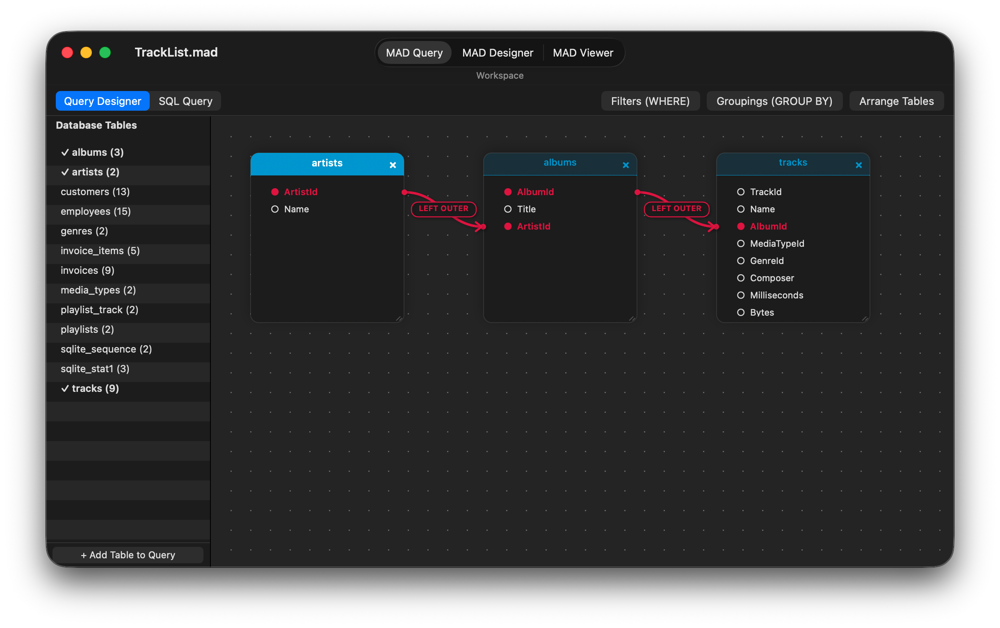
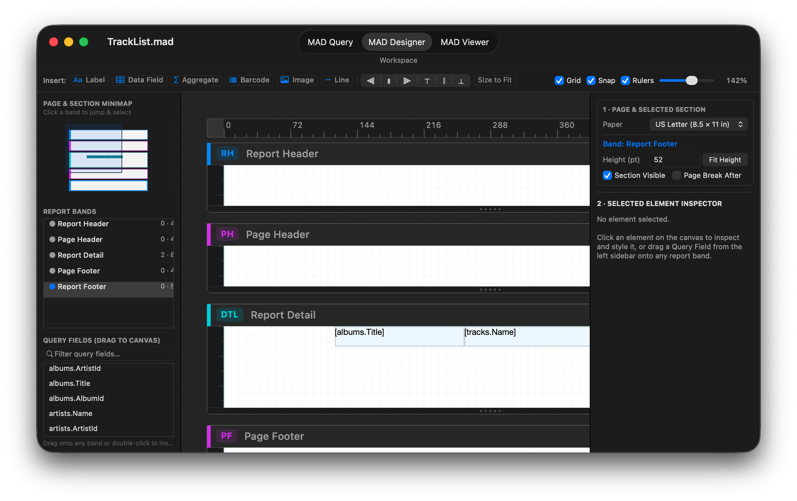

# <a href="https://raw.githubusercontent.com/mthomason/MAD/master/StaticResources/Images/icons/document/Designer%20Icon@3x.png"></a>MAD Designer para macOS

**MAD Designer para macOS** es una aplicación de escritorio nativa de `AppKit` (SDK
`macosx`, `MACOSX_DEPLOYMENT_TARGET = 12.0`) para crear, consultar, maquetar,
actualizar, imprimir y exportar Mobile Analytics Documents (`.mad`). Enlaza los mismos
frameworks Objective-C propios y las mismas bibliotecas C estáticas universales (`Compressor`)
que impulsan las aplicaciones de iOS y el motor sin interfaz gráfica.

Cada archivo `.mad` creado o editado en macOS es compatible byte a byte con las aplicaciones de
iPad/iPhone, la CLI `mad` en Linux y la GitHub Action
[`mad-action`](https://github.com/mthomason/mad-action).

## Descarga e instalación

* **Homebrew (macOS 12.0+, Apple Silicon):**
  ```sh
  brew install --cask mthomason/tap/mad-designer
  ```
* **Descarga directa:** [**MAD-Designer-macOS.dmg**](https://github.com/mthomason/MAD/releases/download/v9.1.0-macos/MAD-Designer-macOS.dmg) | [**MAD-Designer-macOS.zip**](https://github.com/mthomason/MAD/releases/download/v9.1.0-macos/MAD-Designer-macOS.zip)
  *(Si descarga el `.dmg` o el `.zip` en un navegador, ejecute `xattr -cr "/Applications/MAD Designer.app"` una vez después de copiar la aplicación a `/Applications` para eliminar la marca de cuarentena de Gatekeeper de macOS.)*

---

## Espacios de trabajo

Cada documento `.mad` abierto se ejecuta en una ventana nativa de `NSDocument` (`MADMacDocument` / `MADMacWindowController`)
con un control segmentado **Workspace** centrado en la barra de herramientas de la
ventana (`Cmd+1`, `Cmd+2`, `Cmd+3`) que alterna entre las tres etapas de generación de informes:

### 1. MAD Query (`Cmd+1`)



El espacio de trabajo **MAD Query** (`MADMacQueryViewController`) construye el grafo de consultas
relacional que se almacena en `RptqQuery`. Un conmutador de la barra del espacio de trabajo alterna entre dos vistas mutuamente excluyentes de la consulta:

* **Query Designer (grafo visual):**
  * **Barra lateral Database Tables:** Muestra cada tabla importada a la instantánea del esquema del
    documento (`RptqDatabaseSchemaTable`) con el número de columnas y marcas para las tablas que participan actualmente en la consulta. Haga doble clic en cualquier tabla (o haga clic en **+ Add Table to Query**) para añadirla al lienzo.
  * **Lienzo interactivo de relaciones (`MADMacQueryCanvasView`):** Representa cada tabla de la consulta como una tarjeta que se puede arrastrar y redimensionar (`MADMacQueryTableCardView`) sobre un lienzo de rejilla de puntos, con el estilo de los colores de cabecera de raíz e hijos calculados por `MTGraph`.
  * **Conectores visuales de join (`MADMacQueryLinksOverlayView`):** Arrastrar desde una columna de una tarjeta de tabla hasta una columna de otra crea un join (por defecto `LEFT OUTER`), dibujado con curvas Bézier cúbicas suaves, puntas de flecha direccionales y distintivos en forma de píldora. Al hacer clic o clic derecho en un distintivo de join se abre un panel emergente de inspector de join o un menú contextual para cambiar el tipo de join (`INNER`, `LEFT OUTER`, `RIGHT OUTER`, `FULL OUTER`, `CROSS`), invertir la dirección del join o eliminar el enlace.
  * **Filtros, agrupaciones y diseño automático:** Los paneles emergentes de la barra de encabezado editan los **predicados `WHERE`** (`Filters (WHERE)`), el **orden `GROUP BY` / de clasificación** (`Groupings (GROUP BY)`, que aprovisiona automáticamente las bandas de diseño `Group Header` y `Group Footer` correspondientes) y **Arrange Tables** para la colocación topológica automática de las tarjetas.
* **SQL Query (entrada y análisis directos de SQL):**
  * Muestra el SQL determinista específico del dialecto generado a partir del grafo visual y permite pegar o editar directamente una sentencia `SELECT`.
  * Valida y compila el SQL introducido de vuelta al grafo de objetos portátil `RptqQuery` mediante `MADSQLParser`, `MADSQLStatementResolver` y `MADSQLQueryCompiler`, conservando la sentencia en `RptqQuery.sqlSourceText`.

---

### 2. MAD Designer (`Cmd+2`)



El espacio de trabajo **MAD Designer** (`MADMacDesignerViewController`) maqueta las bandas y los
elementos paramétricos del informe dentro de una vista dividida en tres paneles redimensionable por el usuario:

* **Barra de herramientas superior del diseñador:**
  * **Paleta de elementos:** Haga clic o arrastre sobre cualquier banda de sección para insertar una **Label**, **Data Field**, **Aggregate**, **Barcode**, **Image** o **Line**.
  * **Alineación y tamaño:** Botones de alineación de varios elementos (`Align Left`, `Center`, `Right`, `Top`, `Middle`, `Bottom`) y **Size to Fit**.
  * **Controles del lienzo:** Conmutadores independientes para **Grid**, **Snap** y **Rulers**, más un control deslizante continuo de **Zoom** (`50%–250%`) con restablecimiento de `100%` en un clic.
* **Barra lateral del navegador izquierdo:**
  * **Minimapa de página y secciones (`MADMacDesignerMinimapView`):** Vista aérea proporcional en vivo de todas las bandas del informe, con bloques en miniatura de los elementos y el rectángulo de la ventana visible activa. Haga clic o arrastre dentro del minimapa para saltar a cualquier banda y seleccionarla.
  * **Esquema de bandas del informe:** Enumera `Report Header`, `Page Header`, las bandas `Group Header` / `Group Footer`, `Report Detail`, `Page Footer` y `Report Footer` con recuentos de elementos, alturas en puntos e indicadores de salto de página. Al hacer doble clic en una fila se alterna la visibilidad de la sección.
  * **Explorador de campos de consulta:** Lista filtrable de todas las columnas `RptqQueryField` de la consulta. Arrastre cualquier campo directamente a una banda de sección del lienzo (o haga doble clic) para crear un elemento de campo de datos vinculado (`RptqDocumentElementLabelDataField`).
* **Lienzo interactivo central (`MADMacDesignerCanvasView`):**
  * Lienzo `NSView` invertido y ampliable con reglas horizontales y verticales en puntos, guías de márgenes del papel, cabeceras de sección codificadas por color (`RH`, `PH`, `GH`, `DTL`, `GF`, `PF`, `RF`) y tiradores de arrastre inferiores para redimensionar la altura de las secciones.
  * Admite selección por lazo, multiselección con `Shift` y clic, tiradores de redimensionado de 8 puntos, guías de alineación inteligentes, ajuste a la rejilla, edición de texto en línea con doble clic, arrastrar y soltar entre secciones (`-moveElement:toSection:atOrigin:`) y deshacer/rehacer completo con `NSUndoManager` (`Cmd+Z` / `Cmd+Shift+Z`) en ediciones de propiedades individuales y masivas.
* **Barra lateral del inspector derecho:**
  * **`1 · PAGE & SELECTED SECTION`:** Configura el tamaño de **Paper** de destino, muestra el distintivo de la banda activa, edita la **Height (pt)** de la sección con un botón **Fit Height**, y alterna **Section Visible** y **Page Break After**.
  * **`2 · SELECTED ELEMENT INSPECTOR`:** Cuatro tarjetas contextuales cuando se selecciona un elemento:
    1. **Element & Band Assignment:** Reasigna el elemento a otra banda de sección, lo duplica (`Cmd+D`) o lo elimina (`Delete`).
    2. **Content & Data Binding:** Texto estático, columna de consulta vinculada (`table.column`), función de agregado (`SUM`, `COUNT`, `AVG`, `MIN`, `MAX`, `STDDEV`, `VARIANCE`) y ámbito (`Report` o `Group`), formato de moneda o simbología de código de barras (`zint`).
    3. **Typography & Appearance:** Familia tipográfica, tamaño en puntos, atributos Bold / Italic / Underline / Strikethrough, alineación horizontal y vertical del texto, color de primer plano y relleno de fondo.
    4. **Position, Size & Box Model:** Coordenadas exactas en puntos (`X`, `Y`, `W`, `H`), ancho y color del borde, relleno interior y márgenes.

---

### 3. MAD Viewer (`Cmd+3`)

El espacio de trabajo **MAD Viewer** (`MADMacViewerViewController`) actualiza la consulta contra su fuente de datos activa, materializa el conjunto de resultados en la caché local de tablas SQLite (`MADDataTableFast`) y renderiza las páginas:

* **Barra de herramientas del visor:**
  * **Selector de tamaño de página (`MTPaper`):** Vuelve a paginar y a renderizar inmediatamente el informe para **US Letter**, **US Legal**, **US Tabloid**, **A3**, **A4**, **A5**, **B4**, **B5**, **JIS B4** o **JIS B5**.
  * **Refresh (`Cmd+R`):** Ejecuta la consulta a través del driver de base de datos registrado del documento, llena la caché SQLite complementaria `.maddb` / `.mdcache`, calcula las agrupaciones y los agregados en dos pasadas y reconstruye la caché de páginas.
  * **Zoom y navegación de páginas:** Reducir, restablecer a `100%`, ampliar y avanzar por las páginas (`Previous`, `Page N of M`, `Next`).
  * **Print (`Cmd+P`) y Export (`Cmd+E`):** Imprime de forma nativa mediante `NSPrintOperation` o abre `NSSavePanel` con un selector de formato para los siete exportadores registrados:
    * **PDF Document (`.pdf`)** — PDF vectorial nativo de CoreGraphics / AppKit mediante `MADReportExporterPDF`
    * **HTML Page (`.html`)** — facsímil de página posicionado (`MADReportExporterHTML`)
    * **HTML Flow (`.html`)** — HTML semántico responsivo y reflujable (`MADReportExporterHTMLFlow`)
    * **CSV Spreadsheet (`.csv`)** — exportación de filas de detalle conforme a RFC 4180 (`MADReportExporterCSV`)
    * **JSON Data (`.json`)** — contrato de esquema + filas de detalle (`MADReportExporterJSON`)
    * **JSON Full Report (`.json`)** — secciones jerárquicas, grupos y elementos evaluados (`MADReportExporterJSONReport`)
    * **Plain Text (`.txt`)** — tabla de texto monoespaciado (`MADReportExporterText`)
* **Vista previa enmarcada de páginas y barra de estado:** Renderiza páginas nítidas con sombra en un `PDFView` nativo e indica en la barra de estado inferior el número de páginas renderizadas, el número de filas en caché y las dimensiones del papel.

---

## Abrir y crear documentos

* **Inicio y panel de apertura (`MADMacDocumentController`):** Al iniciar la aplicación sin un archivo se presenta el panel **Open Report** de macOS, filtrado a documentos `.mad` (`com.everydayapps.productivity.mad` y `com.thomason.report.mad`), con un botón principal **New Document** en la barra inferior izquierda. Al hacer doble clic en cualquier archivo `.mad` del Finder se abre directamente en su ventana de espacio de trabajo.
* **Migración de documentos heredados:** Al abrir un archivo `.mad` antiguo de Core Data, su almacén se convierte sobre el terreno al esquema SQLite portátil (`MADStoreSchema`) mediante `MADStoreConverter`.
* **Nuevo informe desde una conexión a base de datos (`Cmd+N`):** Al hacer clic en **New Document** (o elegir **File → New Document…**) se abre el asistente de conexión a bases de datos (`MADMacConnectionWindowController`):
  * Elija **SQLite**, **MySQL**, **Microsoft SQL Server** o **PostgreSQL**.
  * Busque una base de datos local `.sqlite3` / `.db` o introduzca el host, el puerto, la instancia opcional de SQL Server, el nombre de la base de datos, el usuario y la contraseña del servidor.
  * Haga clic en **Test Connection** para comprobar la conectividad e inspeccionar el número de tablas detectadas.
  * Haga clic en **Create Document…** para importar el esquema de tablas y columnas de la base de datos a un nuevo archivo `.mad` y abrirlo en el espacio de trabajo **MAD Query**. Las credenciales se guardan en el Llavero de macOS mediante `MADKeyChain`.

---

## Arquitectura: `AppKit` nativo sobre frameworks multiplataforma

En lugar de envolver la interfaz de iOS en Mac Catalyst, MAD compila doce de sus catorce frameworks de forma nativa para `macosx` (`SUPPORTED_PLATFORMS = "iphoneos iphonesimulator macosx"`, `MACOSX_DEPLOYMENT_TARGET = 12.0`) y coloca encima una arquitectura de documentos `AppKit` hecha a propósito (`Mac/Source/`):

| Capa | Componentes | Función en macOS |
|---|---|---|
| **Bibliotecas C estáticas (`Compressor`)** | `sqlite3`, `zlib`, `openssl`, `bzip2`, `libpng`, `libarchive`, `freetds`, `mariadb`, `postgres`, `zint` | Rebanadas `macosx` universales (`arm64` + `x86_64`) dentro de paquetes `.xcframework`, verificadas por `./Compressor/build.sh --verify --all --platforms ios,simulator,macosx`. |
| **Frameworks centrales y de drivers** | `MADFoundation`, `MADDataStructures`, `MADCocoaExtensions`, `MADFileManager`, `MADAPI`, `MADSqlite3`, `MADTds`, `MADTdsClient`, `MADMySQL`, `MADPostgres`, `MADBarcodes`, `MAD` | Modelo Objective-C compartido, almacén SQLite portátil (`Rptq*`), analizador/compilador de SQL, drivers de base de datos de transporte, renderizador de códigos de barras zint, motor de deshacer/rehacer `MADDesignerLayout` y `MADPrintPageRenderer` / `MADReportExporterPDF`. |
| **Frontend nativo `AppKit` (`Mac/`)** | `MADMacAppDelegate`, `MADMacAboutWindowController`, `MADMacDocumentController`, `MADMacDocument`, `MADMacWindowController`, `MADMacConnectionWindowController`, `MADMacQueryViewController`, `MADMacDesignerViewController`, `MADMacDesignerCanvasView`, `MADMacViewerViewController` | Ciclo de vida nativo de `NSDocument`, ventana About / Overview / Acknowledgements, barra de herramientas y barra de menús, lienzo visual de consultas, diseñador de informes en tres paneles con minimapa e inspector, y visor de informes `PDFView`. |

La auditoría arquitectónica completa y el registro de defectos del port multiplataforma están en
[`docs/project/MAD_MACOS.md`](https://github.com/mthomason/MAD/blob/master/docs/project/MAD_MACOS.md).

---

## Compilación, pruebas y empaquetado

### En Xcode

Abra `Reports.xcworkspace`, seleccione el scheme compartido **`MAD Designer Mac`** con el destino **My Mac** y pulse **Run (`Cmd+R`)** para compilar y depurar la aplicación nativa de macOS de forma interactiva.

Para ejecutar la suite de pruebas unitarias de cualquier framework de forma nativa en macOS:

```sh
xcodebuild test -workspace Reports.xcworkspace -scheme MAD \
	-destination 'platform=macOS,arch=arm64' \
	-derivedDataPath ~/Library/Developer/Xcode/DerivedData/Reports-cozeiyczmvgrbeapplwfuygymqci
```

### Compilación por línea de comandos, suite de humo y empaquetado de la versión

El script independiente `Mac/build.sh` compila los doce frameworks de macOS, ensambla y firma `Mac/build/MAD Designer.app`, ejecuta la suite de pruebas de humo integral sin interfaz gráfica y AppKit (`Mac/Tests/MADMacSmokeTest.m`), y empaqueta archivos `.zip` y `.dmg` distribuibles:

```sh
./Mac/build.sh                     # build 12 macOS frameworks + MAD Designer.app
./Mac/build.sh --no-frameworks     # rebuild only MAD Designer.app (fast iteration)
./Mac/build.sh --smoke-test        # build and run the end-to-end macOS smoke suite
./Mac/build.sh --package           # package MAD-Designer-macOS.zip and MAD-Designer-macOS.dmg
```
