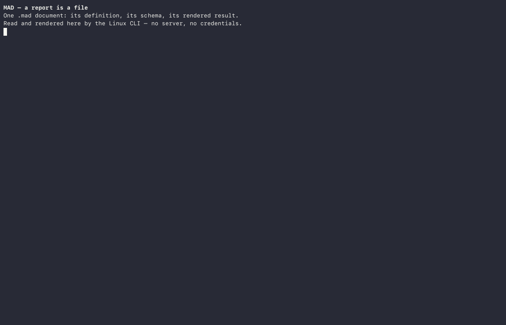

**An open format and embeddable engine for relational reporting — where every report is a portable query graph, a materialized SQLite table, and a parametric layout.**

MAD is an embedded relational reporting platform for ad hoc query, reporting, and design: the **MAD Designer** and **MAD Viewer** apps for iOS, the headless engine that runs them on Linux and macOS, and the open `.mad` document format. A `.mad` file holds a report's whole definition — the database schema snapshot, the query graph (tables, joins, predicates, groupings), and the banded layout of its elements — in under 100 KB, cleanly separated from the materialized SQLite table (`.maddb` + `.mdcache`) it produces on refresh.

The code is at
[github.com/mthomason/MAD](https://github.com/mthomason/MAD), MIT-licensed;
the names and app artwork are not covered by that licence (see
[NOTICE](https://github.com/mthomason/MAD/blob/master/NOTICE)).

## See it

MAD Designer, from choosing a data source to reading the finished report in
MAD Viewer:

<video controls playsinline preload="metadata" width="360"
  poster="assets/app-preview-poster.png">
  <source src="assets/app-preview.mp4" type="video/mp4">
  Your browser does not support the video element; the
  <a href="assets/app-preview.mp4">app preview</a> is a plain MP4.
</video>

The same engine headless: `inspect`, `schema`, `query`, `refresh`, and
`export` through the `mad` CLI, with no database server and no credentials:

The recording's [exported report](assets/london.html) is plain HTML, opened in
any browser.

## Why MAD

* **Interoperable by contract.** Instead of scattering one-off SQL scripts and
  bespoke dashboard glue across an organization, a `.mad` file packages the
  schema contract, the query AST, and the presentation layout into one
  inspectable, diffable artifact that produces byte-identical SQL and exports
  across Apple and Linux.
* **Written, not assembled.** The SQL generation, the SQL parser, the
  data-table engine, the store, the layout model, and the renderer are
  first-party Objective-C across fourteen frameworks. Third-party code is
  limited to the wire — MariaDB Connector/C, FreeTDS, `libpq`, SQLite — plus
  `libarchive`/`bzip2` and `zint` for barcodes. No reporting SDK is being
  resold.
* **Mobile-first, memory-budgeted.** A refresh reads the result set once
  into a SQLite row cache (`MADDataTableFast`) and computes two-pass groupings
  and aggregates from there, so paginated rendering stays fast within a
  phone's memory.
* **Embeddable and portable.** Eleven of the fourteen frameworks are
  UIKit-free and build headlessly, passing 1,303 tests on Linux in Docker.
  The `.mad` container is a bzip2 tar archive holding a portable SQLite store;
  no Apple framework is required to open it.

## The `.mad` format

The open specification, one chapter per file:

[What a document is](01-document.html) ·
[The container](02-container.html) ·
[The store](03-store.html) ·
[Reading and writing](04-reading-writing.html) ·
[Companion files](05-companion-files.html) ·
[Hazards](06-hazards.html) ·
[Normative `v1`](07-normative.html) ·
[Open questions](08-open-questions.html) ·
[Verification](09-verification.html)

## Using the engine

* [Build and test](https://github.com/mthomason/MAD#build-and-test) —
  the exact commands for the iOS suites and the Linux build.
* [The `mad` CLI](https://github.com/mthomason/MAD#try-it) — inspect,
  refresh, and export a `.mad` from Docker in one line.
* [mad-action](https://github.com/mthomason/mad-action) — run a checked-in
  `.mad` in GitHub Actions and upload its export; `mthomason/mad-action@v1`.
* [Driver-authoring tutorial](tutorials/driver-authoring.html) — the
  intended first contribution: subclass `MADDatabase`, register the
  driver, return rows.

## The direction

[Vision](vision.html) — reports as composable database tables, multi-source
queries in a single report, native UIKit data views beyond the paper paradigm,
and converting legacy Crystal Reports (`.rpt`) into open `.mad` files.

---

The **MAD Designer** app — the report designer built on this engine — has
its own site at [mad.everydayapps.com](https://mad.everydayapps.com/).
