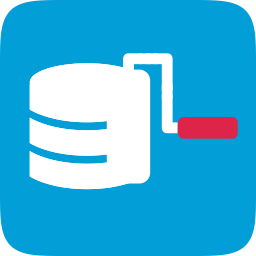
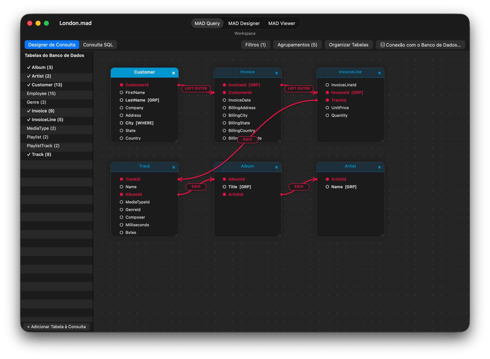
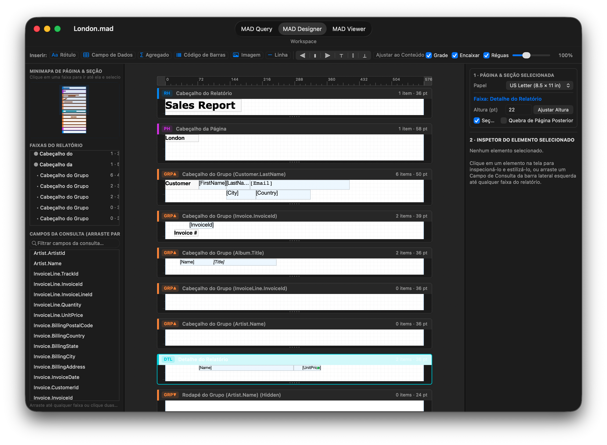
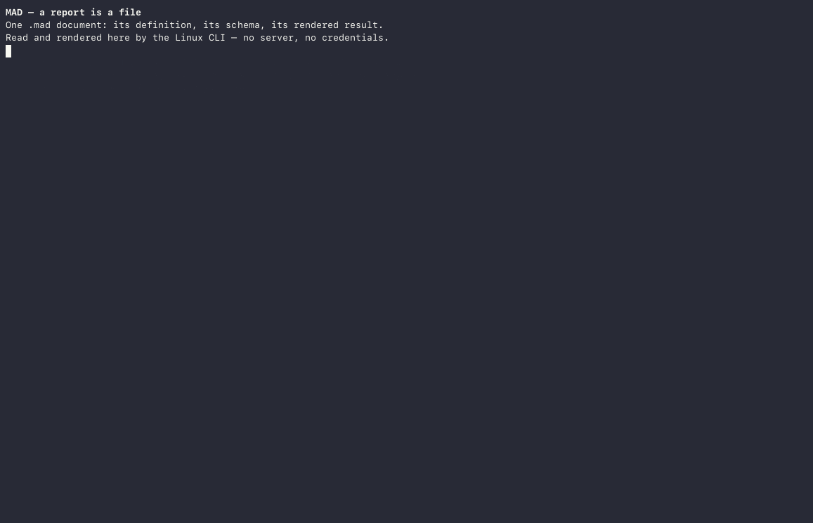

<strong>Um formato aberto e uma engine embarcável para relatórios relacionais — onde cada relatório é um grafo de consulta portável, uma tabela SQLite materializada e um layout paramétrico.</strong>

O MAD é uma plataforma embarcada de relatórios relacionais para consultas ad hoc, geração de relatórios e design: os aplicativos **MAD Designer** e **MAD Viewer** para iOS e macOS nativo (`AppKit`), a engine headless que os executa em Linux e macOS, e o formato aberto de documento `.mad`. Um arquivo `.mad` armazena toda a definição de um relatório — o snapshot do esquema do banco de dados, o grafo de consulta (tabelas, joins, predicados, agrupamentos) e o layout em bandas de seus elementos — em menos de 100 KB, claramente separado da tabela SQLite materializada (`.maddb` + `.mdcache`) que ele produz ao atualizar os dados.

O código está em
[github.com/mthomason/MAD](https://github.com/mthomason/MAD), sob licença MIT;
os nomes e a arte visual dos aplicativos não são cobertos por essa licença (consulte o
[NOTICE](https://github.com/mthomason/MAD/blob/master/NOTICE)).

> **Experimente o MAD Designer no macOS (macOS 12.0+, Apple Silicon):**
> * **Homebrew:** `brew install --cask mthomason/tap/mad-designer`
> * **Download Direto:** [**MAD-Designer-macOS.dmg**]({{ site.data.versions.release_base_url }}/MAD-Designer-macOS.dmg) | [**MAD-Designer-macOS.zip**]({{ site.data.versions.release_base_url }}/MAD-Designer-macOS.zip) *(para downloads diretos, execute `xattr -cr "/Applications/MAD Designer.app"` uma vez após copiar para `/Applications`)*
> * **Versão:** app {{ site.data.versions.macos_app_version}} / motor {{ site.data.versions.engine_version}} ({{ site.data.versions.engine_revision}})

> **Experimente o MAD Designer no Windows (Windows 10 1903+, Windows 11, 64 bits):**
> * **Download direto:** [**MAD-Designer-Windows-0.7.zip**]({{ site.data.versions.release_base_url}}/MAD-Designer-Windows-0.7.zip) *(não assinado: o Windows SmartScreen avisará — escolha Mais informações → Executar assim mesmo; veja o [guia do Windows](windows.html))*
> * **Versão:** app {{ site.data.versions.windows_app_version}} / motor {{ site.data.versions.engine_version}} ({{ site.data.versions.engine_revision}}) · **Não é necessário instalar o .NET** (autocontido)

**Idiomas.** A interface do aplicativo está disponível em inglês, chinês simplificado, japonês, português do Brasil, alemão e espanhol latino-americano. As traduções são assistidas por máquina e podem conter erros; reporte-os em <https://github.com/mthomason/MAD/issues>.

## Veja em ação

**[MAD Designer para macOS](macos.html)** — aplicativo desktop nativo em `AppKit` (`NSDocument`, canvas visual de tabelas/joins para consultas, minimapa interativo de seções e designer de relatórios em bandas, além de visualizador paginado de relatórios em PDF/HTML/CSV/JSON):

**MAD Designer para iOS**, da escolha de uma fonte de dados até a leitura do relatório finalizado no
MAD Viewer:

<video controls playsinline preload="metadata" width="360"
  poster="../assets/app-preview-poster.png">
  <source src="../assets/app-preview.mp4" type="video/mp4">
  Seu navegador não suporta o elemento de vídeo; a
  <a href="../assets/app-preview.mp4">prévia do aplicativo</a> é um arquivo MP4 comum.
</video>

**A mesma engine rodando em modo headless no Linux**: `inspect`, `schema`, `query`, `refresh` e
`export` através da CLI `mad`, sem servidor de banco de dados e sem credenciais:

O [relatório exportado](../assets/london.html) da gravação é HTML puro, podendo ser aberto em
qualquer navegador.

## Por que o MAD

* **Interoperável por contrato.** Em vez de espalhar scripts SQL avulsos e
  código de integração de dashboards sob medida pela organização, um arquivo `.mad` empacota o
  contrato do esquema, a AST da consulta e o layout de apresentação em um único
  artefato inspecionável e comparável via diff, que gera SQL e exportações idênticos byte a byte
  entre plataformas Apple e Linux.
* **Desenvolvido do zero, não remendado.** A geração de SQL, o parser de SQL, a
  engine de tabelas de dados, o armazenamento (store), o modelo de layout e o renderizador são
  implementações próprias em Objective-C distribuídas em quatorze frameworks. O código de terceiros
  limita-se estritamente ao protocolo de comunicação — MariaDB Connector/C, FreeTDS, `libpq`, SQLite — além de
  `libarchive`/`bzip2` e `zint` para códigos de barras. Nenhum SDK proprietário de relatórios está sendo
  revendido.
* **Mobile-first e com orçamento de memória controlado.** Uma atualização (`refresh`) lê o conjunto de resultados uma única vez
  para um cache de linhas em SQLite (`MADDataTableFast`) e calcula agrupamentos e agregações em duas passagens
  a partir dali, mantendo a renderização paginada rápida mesmo dentro da memória de um
  celular.
* **Embarcável e portável.** Doze dos quatorze frameworks não dependem de
  UIKit e compilam em modo headless, passando em 1.313 testes no Linux em Docker.
  O contêiner `.mad` é um arquivo tar comprimido com bzip2 contendo um store SQLite portável;
  nenhum framework da Apple é necessário para abri-lo.

## O formato `.mad`

Leia primeiro a [introdução à especificação](README.html), ou vá diretamente a um capítulo:

[O que é um documento](01-document.html) ·
[O contêiner](02-container.html) ·
[O armazenamento (store)](03-store.html) ·
[Leitura e escrita](04-reading-writing.html) ·
[Arquivos complementares](05-companion-files.html) ·
[Riscos e armadilhas](06-hazards.html) ·
[`v1` normativa](07-normative.html) ·
[Questões em aberto](08-open-questions.html) ·
[Verificação](09-verification.html)

## Usando a engine

* [MAD Designer para macOS](macos.html) — o aplicativo desktop nativo em `AppKit`:
  canvas visual de consultas, designer de relatórios em bandas com minimapa e inspetor,
  visualizador paginado e instruções de como compilar ou empacotar a partir do código-fonte.
* [Compilação e testes](https://github.com/mthomason/MAD#build-and-test) —
  os comandos exatos para as suítes do iOS, as suítes nativas do macOS e o build do Linux.
* [A CLI `mad`](https://github.com/mthomason/MAD#try-it) — inspecione,
  atualize e exporte um `.mad` via Docker em uma única linha de comando.
* [mad-action](https://github.com/mthomason/mad-action) — execute um arquivo
  `.mad` versionado no GitHub Actions e envie a exportação como artefato; `mthomason/mad-action@v1`.
* [Tutorial de criação de drivers](tutorials/driver-authoring.html) — a
  primeira contribuição recomendada: crie uma subclasse de `MADDatabase`, registre o
  driver e retorne linhas.

## Desenvolvedores

Incorpore o motor, use a ferramenta de linha de comando `mad` e leia o contrato do objeto de dados e os registros de arquitetura: [documentação para desenvolvedores](developers/).

## A direção

[Visão](vision.html) — de relatórios a objetos de dados componíveis, consultas
multifonte materializadas localmente, uma engine embarcada e headless,
apresentação além do paradigma do papel e documentos escritos por IA e editáveis.

---

O aplicativo **MAD Designer** — o designer de relatórios construído sobre esta engine — possui
seu próprio site em [mad.everydayapps.com](https://mad.everydayapps.com/).
