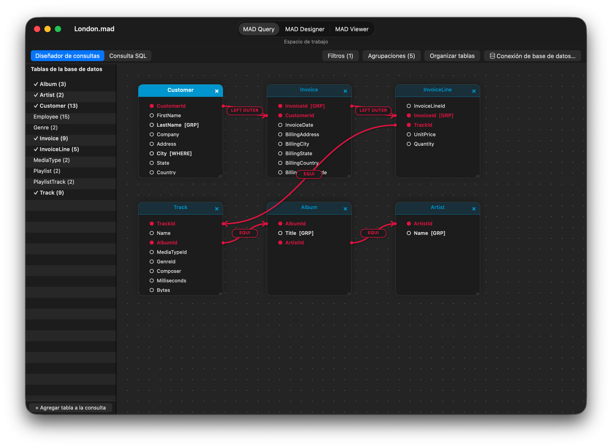
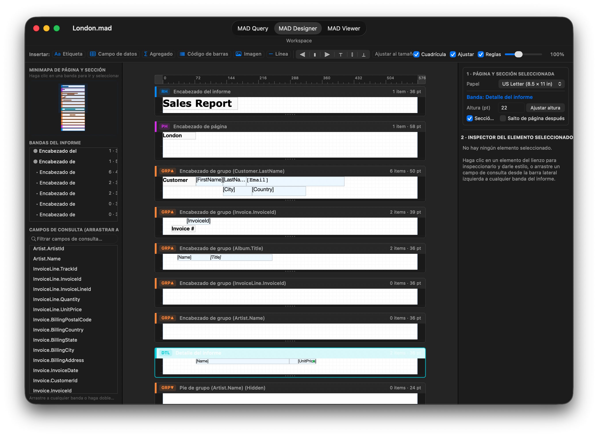
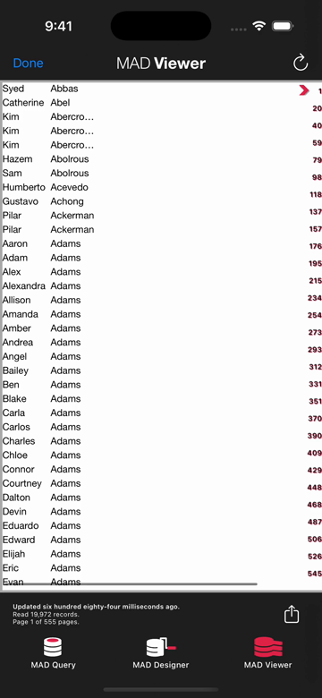
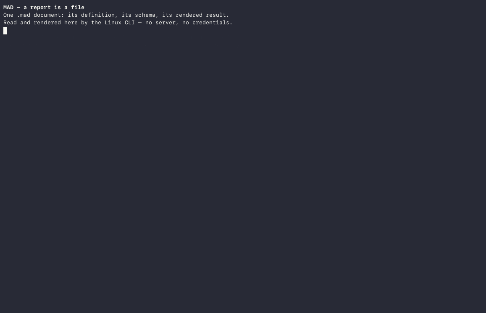

[English](../README.md) | [简体中文](README_zh.md) | [日本語](README_ja.md) | [Português (Brasil)](README_pt-BR.md) | [Deutsch](README_de.md) | **Español**

> **Una nota del autor sobre la programación con agentes y los LLM** — [Léala aquí](Note%20from%20Author%20on%20Agentic%20Programming%20and%20LLMs_es.md)

# <a href="../StaticResources/Images/icons/document/Designer%20Icon@3x.png"></a> MAD (Mobile Analytics Document)

[](https://github.com/mthomason/MAD/actions/workflows/linux.yml) [](https://github.com/mthomason/MAD/actions/workflows/windows.yml) [](https://github.com/mthomason/MAD/actions/workflows/macos.yml)

**Un formato abierto y un motor embebible para la generación de informes relacionales: cada informe es un grafo de consultas portátil, una tabla SQLite materializada y un diseño paramétrico, y un informe de composición une varios informes de distintas bases de datos en un solo documento.**

MAD es una plataforma de generación de informes relacionales construida desde cero en Objective-C para consultas ad hoc, informes y diseño: las aplicaciones **MAD Designer** y **MAD Viewer** para iOS, macOS nativo (`AppKit`) y Windows nativo (WPF); la **CLI y el motor `mad`** sin interfaz gráfica (headless) que se ejecutan en Linux y macOS; y la **especificación `.mad`** abierta.

Un archivo `.mad` contiene la definición completa de un informe —la instantánea del esquema de la base de datos, el grafo de consultas relacional (tablas, joins, predicados, agrupaciones) y el árbol de diseño por bandas— en un único archivo de menos de 100 KB, separado limpiamente de los datos que muestra. Un informe es un archivo ejecutable, no un servidor: cualquier entorno de ejecución que hable `.mad` puede inspeccionar el esquema, compilar SQL determinista para la base de datos de destino, materializar el conjunto de resultados en una tabla SQLite local y renderizarlo a vistas nativas de AppKit/UIKit, HTML paginado, PDF, CSV o JSON.

Un **Informe de composición** extiende ese modelo a través de las bases de datos. El documento contiene un grafo de informes completos —un **Resultado** más sus **orígenes**— y une sus tablas materializadas en SQLite local. Cada origen conserva su propia conexión de base de datos, consulta, diseño y datos. Un solo archivo `.mad` portable puede abarcar MySQL, PostgreSQL, SQL Server y SQLite sin un servidor de federación en medio.

El repositorio es un único proyecto autocontenido: las aplicaciones para iPad/iPhone, la aplicación de escritorio nativa para macOS (`AppKit`) (`Mac/`), la aplicación nativa para Windows (WPF) (`Windows/`), catorce frameworks (doce multiplataforma entre iOS, el Simulador de iOS y macOS nativo; doce sin interfaz gráfica en Linux), la compilación y la suite de pruebas de Linux sin interfaz gráfica (130 suites, 1 313 pruebas), la herramienta de línea de comandos `mad` y el sistema de compilación (`Compressor`) que compila las bibliotecas C de terceros desde fuentes fijadas. El código se publica bajo la licencia MIT; el formato `.mad` es una especificación abierta (consulte [`docs/`](../docs/es/)), aunque los nombres y el arte de las aplicaciones del proyecto no están cubiertos por la concesión de la licencia (consulte [`NOTICE`](https://github.com/mthomason/MAD/blob/master/NOTICE)).

> **Novedad en 0.8: Informes de composición.** Combine informes existentes en un solo documento en macOS y Windows; cada origen conserva su diseño y sus datos. Consulte [la guía de composición](../docs/es/composition.md) y los [informes de muestra](../Samples/README.md). La composición no está en la descarga publicada 0.7 de abajo; está disponible ahora desde el código fuente.

> **Pruebe MAD Designer en macOS (macOS 12.0+, Apple Silicon) — publicado 0.7:**
> * **Homebrew:** `brew install --cask mthomason/tap/mad-designer`
> * **Descarga directa:** [**MAD-Designer-macOS.dmg**](https://github.com/mthomason/MAD/releases/download/v0.7.0/MAD-Designer-macOS.dmg) | [**MAD-Designer-macOS.zip**](https://github.com/mthomason/MAD/releases/download/v0.7.0/MAD-Designer-macOS.zip) *(en las descargas directas, ejecute `xattr -cr "/Applications/MAD Designer.app"` una vez después de copiar la aplicación a `/Applications`)*
> * **Versión:** app 0.7 / motor 9.0 (r4433). El árbol de código fuente es app 0.8 / motor 9.1.

> **Pruebe MAD Designer en Windows (Windows 10 1903+, Windows 11, 64 bits) — publicado 0.7:**
> * **Descarga directa:** [**MAD-Designer-Windows-0.7.zip**](https://github.com/mthomason/MAD/releases/download/v0.7.0/MAD-Designer-Windows-0.7.zip) *(sin firmar: Windows SmartScreen preguntará — elija Más información → Ejecutar de todos modos; consulte [la guía de Windows](../docs/es/windows.md))*
> * **Versión:** app 0.7 / motor 9.0 (r4433) · **No se necesita instalar .NET** (autocontenido). El árbol de código fuente es app 0.8 / motor 9.1.

## Por qué MAD

Hoy, cualquier desarrollador puede pedirle a un LLM que genere un script SQL de un solo uso y una tabla de React en diez minutos. Seis meses después, la organización tiene cuarenta mini-aplicaciones a medida, cuarenta definiciones incompatibles de un `INNER JOIN` entre `customers` e `invoices`, credenciales de base de datos codificadas directamente, matemática de agregados alucinada y cero interoperabilidad entre móviles, escritorio, canalizaciones de CI y socios externos.

MAD resuelve el problema de la generación de informes en el **nivel del formato y del motor**:

* **Interoperabilidad mediante un contrato compartido.** En lugar de dispersar SQL ad hoc y código de interfaz de pegamento por scripts a medida, un documento `.mad` empaqueta el contrato del esquema, el AST de la consulta y el diseño de presentación en un único artefacto inspeccionable, comparable con diff y versionado. El mismo archivo se abre de forma nativa en macOS, Windows y iPad, se ejecuta sin interfaz gráfica en un contenedor Docker de Linux, se ejecuta en GitHub Actions o se incrusta dentro de otra aplicación, produciendo SQL y exportaciones idénticos byte a byte en Apple, Windows y Linux.
* **SQL determinista y matemática local en dos pasadas.** Ni el usuario final ni un modelo de IA necesita escribir a mano SQL específico del dialecto ni calcular totales en el código de la aplicación. El motor valida el grafo de consultas contra la instantánea del esquema del documento, compila SQL determinista para el driver de transporte, extrae el conjunto de resultados una vez a una caché local de filas SQLite (`MADDataTableFast`) y calcula las agrupaciones, las claves de ordenación y los agregados de encabezado y pie localmente en dos pasadas.
* **Composición sin un servidor de federación.** Un Informe de composición materializa cada origen en su propia base de datos y luego une las tablas materializadas localmente en SQLite. No hay ningún servidor central que desplegar, ningún almacén compartido que poblar ni un segundo dialecto SQL que mantener: cada origen entiende sus propios datos y MAD entiende las tablas resultantes. Un origen es un informe completo —consulta, diseño y filas—, no una tabla despojada de su diseño.
* **Escrito, no ensamblado.** El generador de SQL, el analizador de SQL, el motor de tablas de datos, el almacén portátil, el modelo de diseño y el renderizador de páginas son Objective-C propio distribuido en catorce frameworks. El código de terceros se limita estrictamente al transporte —MariaDB Connector/C, FreeTDS, `libpq` y SQLite— más `libarchive`/`bzip2` y `zint` para códigos de barras. No se revende ningún SDK de generación de informes propietario.
* **Diseñado primero para teléfonos y tabletas, con presupuesto de memoria.** Como el conjunto de resultados se materializa en una tabla SQLite indexada en disco y las páginas se formatean en una caché indexada por geometría, un teléfono o un contenedor pequeño puede paginar y agregar informes de cien mil filas sin mantener el conjunto de datos en la RAM.

La documentación técnica y la especificación del formato también se publican en <https://docs.everydayapps.com>.

## Informes de composición

Un **Informe de composición** combina otros informes en un solo documento `.mad`. Los informes que incorpora son **orígenes**; el informe predeterminado del documento es el **Resultado**, que une las tablas de resultados de los orígenes en un nuevo informe propio.


* **Cada miembro es un informe.** Un origen se importa con su definición de consulta, su propio diseño de informe y sus datos. Seleccionarlo en el selector **Report** de la barra de herramientas (macOS) o en el panel **Composición** y el selector **Componente** (Windows) cambia los espacios de trabajo Query, Designer y Viewer juntos. Un origen sin diseño sigue siendo un informe de filas: el visor muestra una cuadrícula y el diseñador ofrece crear su diseño.
* **Unión entre bases de datos.** Cada origen se ejecuta contra su propia base de datos con sus propias credenciales. El Resultado une las tablas materializadas localmente en SQLite: MySQL, PostgreSQL, SQL Server y SQLite en un solo documento.
* **Las credenciales quedan fuera del documento.** La actualización pide una contraseña por origen, con los detalles de conexión ya rellenados. Las contraseñas viven en el Llavero, en la sesión o en el almacén de credenciales de la plataforma, nunca en el `.mad`.
* **Portable como una unidad.** La definición, el diseño de cada origen y las referencias de conexión viven en el único archivo `.mad`. Las filas y las cachés de páginas permanecen en el almacenamiento complementario junto a él.

La composición se distribuye en MAD Designer para **macOS** y **Windows** 0.8. La aplicación de iOS todavía no crea composiciones. Lea [la guía de composición](../docs/es/composition.md) para el modelo, el flujo de trabajo y los límites actuales.

## Véalo

**[MAD Designer para macOS](../docs/es/macos.md)** — la aplicación de escritorio nativa de `AppKit` (`Mac/`), que muestra el lienzo visual de relaciones de **MAD Query** y el espacio de trabajo de diseño por bandas de **MAD Designer**:





**MAD Designer para iOS**, desde la elección de una fuente de datos hasta la lectura del informe terminado en MAD Viewer (28 segundos; [vídeo](https://docs.everydayapps.com/assets/app-preview.mp4)):

[](https://docs.everydayapps.com/assets/app-preview.mp4)

**El mismo motor ejecutándose sin interfaz gráfica en Linux**: `inspect`, `schema`, `query`, `refresh` y `export` a través de la CLI `mad`, sin servidor de informes:



El [informe exportado](https://docs.everydayapps.com/assets/london.html) de la grabación es HTML simple, y se abre en cualquier navegador.

## Informes de muestra

[`Samples/Reports`](../Samples/Reports) contiene documentos `.mad` ejecutables para las aplicaciones de escritorio:

* **Chinook-Standard.mad** — una tabla, encabezados de columna, una banda de detalle, un informe de varias páginas.
* **Chinook-Grouped.mad** — una agrupación de consulta con bandas de encabezado y pie de grupo.
* **Chinook-Composition.mad** — dos orígenes SQLite (uno con su propio diseño, otro sin él) unidos en un Resultado.
* **Composition-MySQL-PostgreSQL-SQLServer.mad** — una tabla de cada uno de MySQL, PostgreSQL y SQL Server, unidas por `demo_id`.
* **PostgreSQL-Chinook.mad** — una conexión de servidor sin contraseña almacenada; la primera actualización la pide.

Las muestras SQLite solo necesitan el `chinook.sqlite3` incluido. La muestra entre bases de datos necesita los tres servidores de prueba en vivo; un script idempotente los levanta y siembra la tabla de demostración:

```sh
./Samples/setup-databases.sh up
```

En Windows PowerShell:

```powershell
.\Samples\setup-databases.ps1 -Action up
```

Consulte [la guía de muestras](../Samples/README.md) para el recorrido de primera ejecución, las solicitudes de contraseña por origen y cómo se generan y comprueban las muestras.

## Localización

Las aplicaciones de iOS, macOS y Windows están totalmente localizadas al **inglés, alemán, español, japonés, portugués de Brasil y chino simplificado**. La interfaz sigue el idioma del sistema y la documentación está traducida a los mismos idiomas. Los nombres de marcas y productos, los identificadores SQL, los nombres de bases de datos y fuentes, y los textos de licencia permanecen en inglés por diseño. Las traducciones son asistidas por máquina; las correcciones son bienvenidas en el [gestor de incidencias](https://github.com/mthomason/MAD/issues).

## Privacidad

MAD respeta su privacidad. Las aplicaciones no contienen código de análisis, telemetría ni seguimiento, y no graban ni copian sus archivos. Las únicas conexiones de red son las conexiones de base de datos que usted configura; los datos del informe permanecen en la caché SQLite local y en los archivos complementarios del documento.

En macOS, la aplicación puede solicitar acceso a **Documentos**, **Escritorio**, **Descargas** u otra carpeta. Esa solicitud proviene del panel de apertura estándar de macOS que se usa para elegir un informe `.mad` (o un archivo de base de datos SQLite): macOS concede acceso a la carpeta para que el panel muestre su contenido, y la aplicación solo lee el archivo que usted selecciona. Es el comportamiento estándar de las aplicaciones de macOS: MAD no está escaneando, grabando, copiando ni rastreando nada.

## Dentro del formato `.mad`

Un archivo `.mad` no es una impresión estática como un PDF, ni un volcado de datos de fila. Es un **programa declarativo** que convierte una conexión a base de datos en una tabla tipada y una vista formateada.

La arquitectura divide un informe en **la definición portátil** (dentro del archivo `.mad`, normalmente 15–80 KB) y **las cachés complementarias derivadas** (generadas localmente al actualizar y desechables en cualquier momento):

| Capa | Archivo / Miembro | Formato | Función |
|---|---|---|---|
| **1. Contenedor** | `<Name>.mad` | Cabecera `MADFILE\0` v1 de 16 bytes + archivo tar bzip2 `pax restricted` | Archivo externo identificable por contenido (compatible con `tar xjf` para v0; cabecera + tar bzip2 para v1). |
| **2. Almacén de la definición** | `StoreContent/analyitics` | SQLite portátil (`MADStoreSchema`, versionado mediante `PRAGMA user_version`) | Contiene el grafo de objetos `Rptq*`: la instantánea del esquema de la base de datos importada, el grafo de consultas (tablas, alias, joins, predicados, agrupaciones y `sqlSourceText` opcional) y el árbol de diseño de secciones y elementos por bandas. Sin dependencias de Core Data ni de Apple. |
| **3. Metadatos y vista previa** | `meta.plist`, `AdditionalContent/` | Property List XML + `thumbnail@2x.png` opcional | Metadatos del generador, versión del formato y vista previa opcional del documento. |
| **4. Tabla materializada** *(complementaria)* | `<hash>.maddb` + `<hash>.mdcache` | Base de datos de filas SQLite (`t<tag>`) + lista de propiedades del esquema de columnas (`MADDataColumn`) | **La salida del informe como tabla de base de datos.** Contiene las filas obtenidas, los índices de claves de grupo y los metadatos de tipos de columna, de modo que los agregados en dos pasadas (`SUM`, `COUNT`, `AVG`, `MIN`, `MAX`), la ordenación y el renderizado posterior nunca vuelvan a consultar la base de datos remota. |
| **5. Caché de páginas** *(complementaria)* | `<hash>{ih,lh}{w,h}.madac` | Bases de datos SQLite de índice (`ih`) y de diseño (`lh`) indexadas por geometría de página | Saltos de página y marcos de elementos precalculados para una ventana de visualización de destino (p. ej., `{612, 792}` US Letter), lo que mantiene instantáneos el desplazamiento y la exportación. |

Un Informe de composición escribe el mismo contenedor y almacén con una adición: el almacén registra la raíz del grafo de consultas (`rootQuery`), las tablas ascendentes de cada consulta y las secciones de diseño propias de cada consulta. Un documento compuesto declara la capacidad requerida `query-composition` y una cabecera de contenedor `1.1`; un informe normal permanece en `1.0`. La especificación completa —disposición del contenedor, tablas del almacén, esquemas de los archivos complementarios, rarezas conocidas (incluida la razón por la que el nombre del archivo del almacén interno se escribe históricamente `analyitics` por compatibilidad hacia atrás) y verificación de resúmenes entre plataformas— está documentada capítulo a capítulo en [`docs/`](../docs/es/).

## Hacia dónde va MAD

La composición dentro del mismo documento está construida. La dirección ahora la extiende a ella y al resto de la arquitectura:

1. **Composición entre documentos y una identidad estable de objeto de datos.**
   Un Informe de composición ya direcciona la tabla materializada de cada origen dentro de su propio documento. El siguiente paso es una identidad estable para la salida de un informe *entre* documentos, de modo que un `.mad` pueda referenciar el informe de otro `.mad` con identidad de documento, resolución de rutas, datos en vivo frente a fijados y una política de credenciales. El [diseño del objeto de datos](../docs/es/developers/data-object.md) registra el modelo y lo que hace falta para formalizarlo.
2. **Más allá del paradigma del papel: vistas de datos interactivas nativas.**
   El diseño de página por bandas nació de la impresión. En MAD, la paginación de papel es una vista sobre el objeto de datos del documento; el mismo diseño y la misma tabla local `.maddb` pueden impulsar tablas interactivas, exploradores de datos y vistas nativas. Diseñe una vez, renderice como papel paginado o como interfaz nativa interactiva.
3. **Convertir informes heredados de Crystal Reports (`.rpt`) y archivos de informes empresariales a `.mad`.**
   Miles de empresas siguen atadas a décadas de archivos de Crystal Reports que nadie quiere reescribir a mano. Como MAD comparte el ADN clásico de secciones por bandas y grafo de consultas relacionales de Crystal Reports —almacenando todo en un formato abierto e inspeccionable de SQLite dentro de tar—, MAD está construyendo importadores para convertir definiciones heredadas directamente en archivos `.mad` abiertos.
4. **Documentos creados por IA.**
   Un modelo podría proponer un documento MAD real y editable —descubrir orígenes y metadatos del esquema, elegir tablas y campos, construir grafos de consulta y diseños, y enviar el resultado al motor para su validación y ejecución— en lugar de generar una respuesta puntual. El documento sigue siendo inspeccionable, editable e independiente del modelo.

Consulte [`docs/vision.md`](../docs/es/vision.md), [`docs/developers/data-object.md`](../docs/es/developers/data-object.md) y [`docs/project/registers/TODO.md`](../docs/project/registers/TODO.md).

## Pruébelo

El motor sin interfaz gráfica ejecuta la CLI `mad` en Docker. Descargue la imagen publicada e inspeccione uno de los documentos de muestra incluidos en el repositorio:

```sh
docker run --rm -v "$PWD/CLI/Fixtures":/docs:ro ghcr.io/mthomason/mad \
    mad inspect /docs/London.portable.mad
```

Cada verbo funciona de la misma manera: `schema`, `query`, `refresh`, `export` (facsímil paginado en HTML y `html-flow` reflujable, texto plano, CSV, contrato de datos JSON y `json-report`; el PDF se ejecuta de forma nativa en Apple y está aplazado en Linux por diseño):

```sh
docker run --rm -v "$PWD/CLI/Fixtures":/docs:ro ghcr.io/mthomason/mad \
    mad refresh /docs/Music.portable.mad
docker run --rm -v "$PWD/CLI/Fixtures":/docs:ro -v "$PWD/out":/out ghcr.io/mthomason/mad \
    mad export /docs/London.portable.mad --format html --out /out/london.html
```

Las etiquetas publicadas son `latest` y el SHA corto del commit, compiladas para `linux/amd64` por el flujo de publicación en cada push a `master`. En Apple Silicon añada `--platform linux/amd64`: Docker Desktop ejecuta la etiqueta bajo emulación, y sin el indicador la descarga falla (`no matching manifest`). Compilar localmente una imagen `arm64` nativa (`mad-cli:latest`) y ejecutar la suite completa de verificación multiplataforma es un solo comando:

```sh
./Linux/build.sh --verify                 # build the toolchain and run the checks (~20 min first time)
```

Los documentos de muestra se actualizan contra la base de datos de muestra de Sqlite3 incluida en la imagen; las fixtures de MySQL, SQL Server y PostgreSQL esperan los servidores de prueba de [`docs/project/build/DEVELOPER.md`](../docs/project/build/DEVELOPER.md). Un documento compuesto actualiza cada origen y exporta el informe seleccionado; `mad` resuelve las credenciales de cada origen desde el llavero, con `--credentials` como alternativa.

## En CI

La GitHub Action [mad-action](https://github.com/mthomason/mad-action) ejecuta un `.mad` incluido en el repositorio dentro de un flujo de trabajo y carga su exportación como artefacto:

```yaml
- uses: mthomason/mad-action@v1
  with:
    command: export
    document: reports/sales.mad
```

Ejecuta la imagen publicada, así que la acción y la CLI son el mismo motor. La acción se genera desde [`satellites/mad-action/`](../satellites/mad-action/) aquí; [`docs/developers/satellites.md`](../docs/developers/satellites.md) registra cómo se mantiene actualizado el repositorio satélite.

## Drivers de base de datos

MAD se comunica con las bases de datos a través de subclases de `MADDatabase`. Hoy se distribuyen cuatro drivers:

* **MySQL / MariaDB** — `MADMySQL`, sobre MariaDB Connector/C;
* **SQL Server** — `MADTdsClient`, sobre FreeTDS;
* **PostgreSQL** — `MADPostgres`, sobre `libpq`;
* **SQLite** — `MADSqlite3`, para documentos de muestra, bases de datos locales y tablas de materialización internas.

Un driver es un framework que crea una subclase de `MADDatabase` y se registra con `MADDatabaseDriverRegistry`: el diseñador de consultas y el motor nunca ven el protocolo de transporte. Escribir uno es la primera contribución prevista (consulte el tutorial para escribir drivers en [`docs/tutorials/driver-authoring.md`](../docs/es/tutorials/driver-authoring.md)). La costura es real: los usuarios pueden construir una consulta visualmente o pegar SQL (`MADSQLParser`), el motor genera la sentencia específica del dialecto y el driver solo tiene que ejecutarla y transmitir las filas a `id<MADDataTableWriting>`.

## Incrustar el motor

Doce de los catorce frameworks no dependen de UIKit y se compilan sin interfaz gráfica. La CLI `mad` anterior es ese motor vestido de línea de comandos: el conjunto de verbos —`inspect`, `schema`, `query`, `refresh`, `export`, `write` y el protocolo JSON `serve`— es la superficie de incrustación, y una aplicación que enlaza `MAD`, un framework de driver y `MADSqlite3` tiene generación de informes relacionales sin ningún servidor de por medio. Los drivers y los formatos de exportación (`<MADReportExporting>` / `MADReportExporterRegistry`) se autorregistran, así que añadir una fuente de datos o un formato de salida es una subclase, no un fork.

Un documento compuesto es un caso más de la misma superficie: `MADOperationRefreshComposed` recorre el grafo, cada nodo materializa su propia tabla, y el resultado del informe seleccionado es lo que leen la CLI, las aplicaciones y los exportadores.

## Aplicación nativa de macOS

La aplicación de escritorio nativa de macOS ([`docs/macos.md`](../docs/es/macos.md), [`Mac/`](../Mac/)) se compila directamente con `AppKit` (SDK `macosx`, `MACOSX_DEPLOYMENT_TARGET = 12.0`) sobre los doce frameworks multiplataforma de MAD y las diez bibliotecas C estáticas universales (`arm64` + `x86_64`) compiladas por `Compressor`:

* **Arquitectura nativa de `NSDocument` (`MADMacDocument` / `MADMacDocumentController`):** Abre y guarda archivos `.mad` de forma nativa desde el Finder o el panel de apertura estándar (con un botón integrado **New Document**), migra automáticamente los archivos `.mad` heredados de Core Data mediante `MADStoreConverter` e integra `MADDesignerLayout` directamente con `NSDocument.undoManager` (`Cmd+Z` / `Cmd+Shift+Z`).
* **Asistente de conexión a base de datos e importación de esquema (`MADMacConnectionWindowController`):** Se conecta a **SQLite**, **MySQL / MariaDB**, **Microsoft SQL Server** o **PostgreSQL**, verifica la conectividad, guarda las credenciales en el Llavero de macOS (`MADKeyChain`) e importa los esquemas de tablas y columnas a un nuevo documento `.mad`.
* **Informes de composición:** Un selector **Report** en la barra de herramientas cambia todos los espacios de trabajo entre el Resultado y sus orígenes; el Diseñador edita las bandas y la lista de campos del informe seleccionado; el Visor renderiza sus propias páginas o, para un origen sin diseño, sus filas en caché como una cuadrícula. **Archivo ▸ Nueva composición…**, **Importar informe…** y **Convertir en composición…** crean el grafo, y la actualización pregunta una vez por cada origen que requiere credenciales. Consulte [la guía de composición](../docs/es/composition.md).
* **Tres espacios de trabajo integrados** (`Cmd+1`, `Cmd+2`, `Cmd+3`):
  1. **MAD Query (`MADMacQueryViewController`):** Alterna entre el **Query Designer** interactivo (tarjetas de tabla arrastrables, conectores de join Bézier con distintivos de tipo de join en los que se puede hacer clic, y paneles emergentes de filtro `WHERE` y `GROUP BY`) y el editor **SQL Query** (`MADSQLParser` + `MADSQLQueryCompiler`).
  2. **MAD Designer (`MADMacDesignerViewController`):** Vista dividida en tres paneles con un **Page & Section Minimap** interactivo, un esquema **Report Bands**, una fuente de arrastre **Query Fields** con búsqueda, un lienzo de diseño ampliable y con reglas (`MADMacDesignerCanvasView`) con arrastrar y soltar entre secciones y guías de alineación inteligentes, y un **Page & Element Inspector** de dos tarjetas.
  3. **MAD Viewer (`MADMacViewerViewController`):** Actualización de datos en vivo (`Cmd+R`), repaginación instantánea por **Page Size** (`US Letter`, `Legal`, `Tabloid`, `A3`, `A4`, `A5`, `B4`, `B5`, `JIS B4`, `JIS B5`), vista previa enmarcada en `PDFView`, impresión nativa con `NSPrintOperation` (`Cmd+P`) y exportación (`Cmd+E`) a **PDF**, **HTML**, **HTML Flow**, **CSV**, **JSON**, **JSON Full Report** y **Plain Text**.

Consulte [`docs/macos.md`](../docs/es/macos.md) para la guía completa y [`docs/developers/build/macos.md`](../docs/developers/build/macos.md) para la auditoría de portabilidad multiplataforma.

## Aplicación nativa para Windows

La aplicación nativa para Windows ([`docs/windows.md`](../docs/es/windows.md), [`Windows/`](../Windows/)) es una aplicación WPF sobre .NET 10 sobre el mismo motor Objective-C propio (`mad.exe`), de modo que sus documentos son compatibles con macOS, iOS, la CLI y `mad-action`:

* **Tres espacios de trabajo:** el lienzo visual de consultas y el editor SQL, el Diseñador por bandas con minimapa, esquema, lista de campos e inspector, y el Visor con paginación exacta y exportación a PDF, HTML, HTML Flow, CSV, JSON, JSON Full Report y texto sin formato.
* **Informes de composición:** Un panel **Composición** acoplado muestra el Resultado y sus orígenes como un grafo; sus tarjetas y el selector **Componente** de la barra de herramientas comparten una sola selección en los tres espacios de trabajo. Cada origen conserva su propia consulta, diseño y filas, y un origen sin diseño se renderiza como una cuadrícula de filas. **Archivo ▸ Nueva composición…**, **Importar…** y **Convertir en composición** crean el grafo.
* **Empaquetado:** `Windows/package.ps1` compila el archivo zip de versión autocontenido sin firma y el recurso del motor para CI; el motor en sí se compila con `Windows/Engine/build.ps1` sobre el toolchain fijado.

Consulte [`docs/windows.md`](../docs/es/windows.md) para la guía de instalación y [`docs/developers/build/windows.md`](../docs/developers/build/windows.md) para el registro de compilación.

## Compilación y pruebas

El espacio de trabajo (`Reports.xcworkspace`) compila los catorce frameworks, las aplicaciones de iOS y la aplicación nativa de macOS (`MAD Designer Mac`).

### macOS nativo

Compile, ejecute la suite de pruebas de humo integral y empaquete los artefactos de versión `.zip` y `.dmg` desde la raíz del repositorio:

```sh
./Mac/build.sh                     # build 12 macOS frameworks + Mac/build/MAD Designer.app
./Mac/build.sh --no-frameworks     # rebuild only MAD Designer.app (fast iteration)
./Mac/build.sh --smoke-test        # build and run the end-to-end macOS smoke suite
./Mac/build.sh --package           # create Mac/build/MAD-Designer-macOS.zip and .dmg
```

También puede compilar y depurar de forma interactiva en Xcode con el scheme compartido **`MAD Designer Mac`**, o ejecutar la suite de pruebas unitarias de cualquier framework de forma nativa en macOS:

```sh
xcodebuild test -workspace Reports.xcworkspace -scheme MAD \
	-destination 'platform=macOS,arch=arm64' \
	-derivedDataPath ~/Library/Developer/Xcode/DerivedData/Reports-cozeiyczmvgrbeapplwfuygymqci
```

### Simulador de iOS

Ejecute la suite de un framework contra el Simulador de iOS:

```sh
xcodebuild test -workspace Reports.xcworkspace -scheme MADFoundation \
	-destination 'platform=iOS Simulator,id=94952340-7629-4EBB-BBD3-6FEE068793B8' \
	-derivedDataPath ~/Library/Developer/Xcode/DerivedData/Reports-cozeiyczmvgrbeapplwfuygymqci
```

(`MADMySQL`, `MADTdsClient` y `MADPostgres` también incluyen suites en vivo que se comunican con un servidor de base de datos real y se omiten cuando no hay ninguno disponible; consulte [`docs/project/build/DEVELOPER.md`](../docs/project/build/DEVELOPER.md)).)

### Linux (motor y CLI sin interfaz gráfica)

El motor sin interfaz gráfica se verifica del mismo modo en Linux. Desde la raíz del repositorio, con Docker instalado:

```sh
./Linux/build.sh       # build the toolchain image, compile the twelve frameworks, run the suites
```

Esto ejecuta 130 suites y 1 313 pruebas dentro del contenedor, y `--verify` añade las comprobaciones integrales de la CLI contra las fixtures incluidas y sus resúmenes fijados. Consulte [`Linux/README.md`](../Linux/README_es.md) para la imagen, las versiones fijadas y las divergencias de GNUstep que encontró el port.

### Windows (aplicación WPF y motor)

El motor nativo se compila en una estación de trabajo Windows con privilegios elevados —Clang 20.1.8, el MSVC de Visual Studio, NASM, Strawberry Perl, Meson, Python y GNUstep compilado desde el código fuente en `C:\GNUstep`— y la aplicación WPF con el SDK de .NET fijado en `Windows/global.json`:

```powershell
pwsh -File .\Windows\Engine\build.ps1 -SkipToolchain   # rebuild after the toolchain exists
dotnet test Windows\App\Mad.Designer.Windows.slnx      # both .NET suites, against the built engine
pwsh -File .\Windows\package.ps1                      # the unsigned release zip and the CI engine asset
```

CI no recompila el motor (necesita ese toolchain de estación de trabajo): [`windows.yml`](../.github/workflows/windows.yml) descarga un recurso de motor precompilado y ejecuta ambas suites. Consulte [`docs/windows.md`](../docs/es/windows.md) para la guía de instalación y [`docs/developers/build/windows.md`](../docs/developers/build/windows.md) para el registro de compilación.

### Bases de datos de muestra

La composición entre bases de datos de las muestras usa los tres servidores de prueba fijados. Inícielos y siembre la tabla de demostración con un solo script:

```sh
./Samples/setup-databases.sh up       # macOS, Linux, Git Bash
.\Samples\setup-databases.ps1 -Action up   # Windows PowerShell
```

Los contenedores y sus credenciales de prueba públicas están documentados en [`TestDatabase/README.md`](../TestDatabase/README.md) y [`docs/project/build/DEVELOPER.md`](../docs/project/build/DEVELOPER.md).

## Soporte

MAD es software libre y sigue siendo libre. Una sola persona lo mantiene: los documentos de diseño, la matriz de pruebas multiplataforma y el desarrollo impulsado por agentes consumen tiempo real y tokens de API. Si MAD le ahorra tiempo a su equipo, aquí tiene cómo devolver parte de él, y gracias de cualquier forma:

* **[Patrocine al mantenedor](https://github.com/sponsors/mthomason)** — único o mensual, mediante GitHub Sponsors.
* **Envíe créditos de API.** El proyecto se desarrolla con agentes de IA; los créditos de OpenAI, Anthropic o de tokens de agentes vuelven directamente al trabajo. Póngase en contacto a través de la página de patrocinio o de un issue.
* **[Contribuya](CONTRIBUTING_es.md).** Un driver de base de datos, un elemento de documento, un formato de exportación, un importador heredado o una corrección: las costuras son el punto.

## Licencia

MIT — consulte [`LICENSE`](https://github.com/mthomason/MAD/blob/master/LICENSE). La licencia cubre el software; los nombres «MAD», «MAD Designer» y «MAD Viewer», los iconos de las aplicaciones y el resto del arte del producto, y los medios de vista previa de la aplicación son del autor y quedan excluidos de ella (consulte [`NOTICE`](https://github.com/mthomason/MAD/blob/master/NOTICE)). Cada componente de terceros, su licencia y las obligaciones que su distribución nos impone se registran en [`docs/project/THIRD_PARTY_LICENSES.md`](https://github.com/mthomason/MAD/blob/master/docs/project/THIRD_PARTY_LICENSES.md).

## Cumplimiento de exportación

Los drivers de MySQL, FreeTDS y PostgreSQL usan OpenSSL/TLS; no se implementa cifrado propio. Según las directrices de cumplimiento de exportación de Apple, se trata de cifrado exento, y la aplicación establece `ITSAppUsesNonExemptEncryption = NO`.
