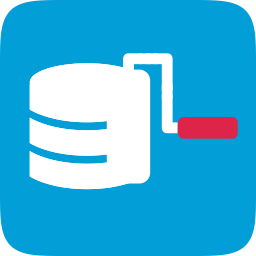
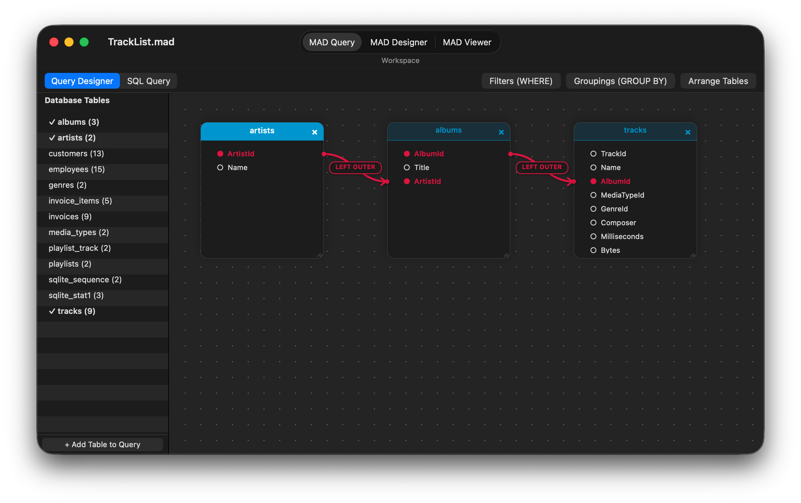
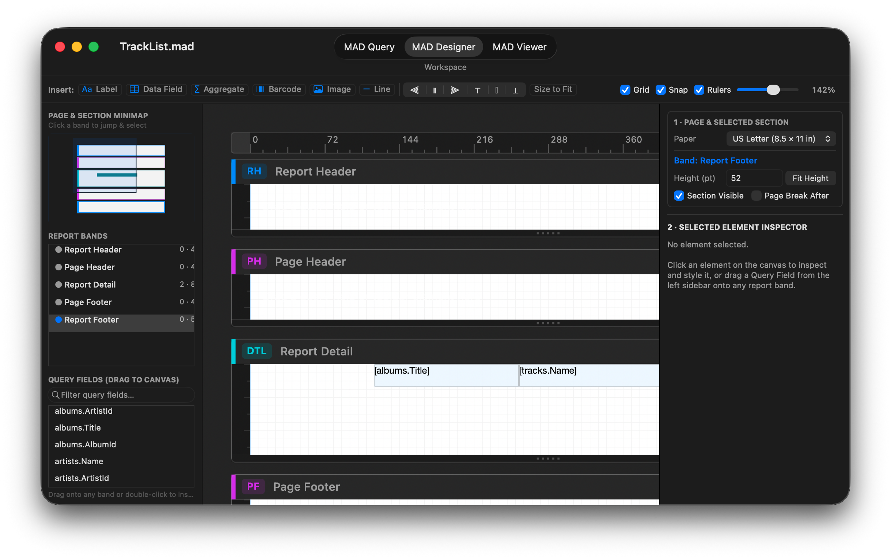
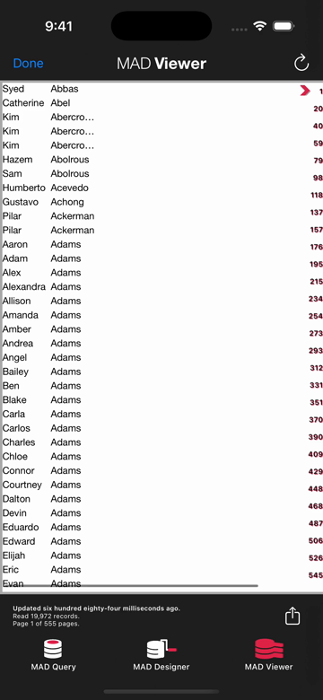
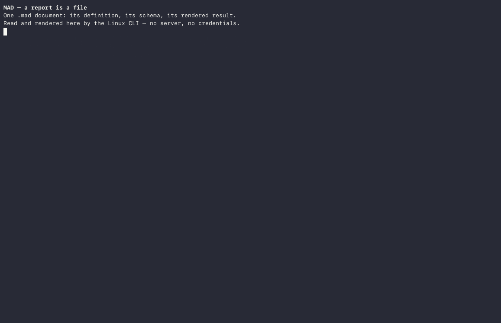

[English](../README.md) | [简体中文](README_zh.md) | **日本語** | [Português (Brasil)](README_pt-BR.md) | [Deutsch](README_de.md) | [Español](README_es.md)

> **エージェント型プログラミングと LLM に関する著者からの注記** — [こちらからお読みください](Note%20from%20Author%20on%20Agentic%20Programming%20and%20LLMs_ja.md)

# <a href="../StaticResources/Images/icons/document/Designer%20Icon@3x.png"></a> MAD (Mobile Analytics Document)

[](https://github.com/mthomason/MAD/actions/workflows/linux.yml) [](https://github.com/mthomason/MAD/actions/workflows/windows.yml) [](https://github.com/mthomason/MAD/actions/workflows/macos.yml)

**リレーショナルレポーティングのためのオープンフォーマットおよび組み込み可能なエンジン——すべてのレポートは、ポータブルなクエリグラフ、マテリアライズドSQLiteテーブル、そしてパラメトリックレイアウトとして表現され、コンポジションレポートは異なるデータベースの複数のレポートを1つのドキュメントに統合します。**

MADは、アドホッククエリ、レポーティング、およびレポート設計のためにObjective-Cで一から構築されたリレーショナルレポーティングプラットフォームです。iOS、ネイティブmacOS（`AppKit`）、およびネイティブWindows（WPF）向けの**MAD Designer**および**MAD Viewer**アプリ、LinuxおよびmacOS上で動作するヘッドレスな**`mad` CLIおよびエンジン**、そしてオープンな**`.mad`仕様**で構成されています。

`.mad`ファイルは、データベースのスキーマスナップショット、リレーショナルクエリグラフ（テーブル、結合、述語、グループ化）、およびバンド型レイアウトツリーというレポート定義全体を、表示対象のデータから明確に分離したまま100 KB未満の単一ファイルに保持します。レポートはサーバーではなく実行可能なファイルです。`.mad`を解釈できるランタイムであれば、スキーマを検査し、対象データベース向けの決定論的SQLをコンパイルし、結果セットをローカルのSQLiteテーブルにマテリアライズ（実体化）したうえで、ネイティブのAppKit/UIKitビュー、ページ分割HTML、PDF、CSV、またはJSONとして描画・出力できます。

**コンポジションレポート**は、そのモデルをデータベースをまたいで拡張します。ドキュメントは完全なレポートのグラフ——**結果**とその**ソース**——を保持し、それらのマテリアライズ済みテーブルをローカルのSQLiteで結合します。各ソースは自身のデータベース接続、クエリ、レイアウト、データを保持します。1つのポータブルな`.mad`ファイルが、中間にフェデレーションサーバーを置かずにMySQL、PostgreSQL、SQL Server、SQLiteにまたがることができます。

本リポジトリは自己完結した単一プロジェクトです。iPad/iPhoneアプリ、ネイティブmacOS（`AppKit`）デスクトップアプリ（`Mac/`）、ネイティブWindows（WPF）アプリ（`Windows/`）、14個のフレームワーク（うち12個はiOS、iOSシミュレータ、ネイティブmacOS対応のマルチプラットフォーム、12個はLinux上でヘッドレス動作）、ヘッドレスLinuxビルドおよびテストスイート（130スイート、1,313テスト）、`mad`コマンドラインツール、およびピン留めされたソースからサードパーティ製Cライブラリをコンパイルするビルドシステム（`Compressor`）を含んでいます。コードはMITライセンスの下で公開されており、`.mad`フォーマットはオープン仕様です（[`docs/`](../docs/ja/)を参照）。ただし、プロジェクト名およびアプリのアートワークはライセンス供与の対象外です（[`NOTICE`](../NOTICE)を参照）。

> **0.8の新機能：コンポジションレポート。** macOSとWindowsで既存のレポートを1つのドキュメントに統合できます。各ソースは自身のレイアウトとデータを保持します。[コンポジションガイド](../docs/ja/composition.md)と[サンプルレポート](../Samples/README.md)を参照してください。コンポジションは下記の公開済み0.8.0ダウンロードに含まれています。

> **macOSでMAD Designerを試す（macOS 12.0以降、Apple Silicon）——公開済み0.8.0：**
> * **Homebrew：** `brew install --cask mthomason/tap/mad-designer`
> * **直接ダウンロード：** [**MAD-Designer-macOS.dmg**](https://github.com/mthomason/MAD/releases/download/v0.8.0/MAD-Designer-macOS.dmg) | [**MAD-Designer-macOS.zip**](https://github.com/mthomason/MAD/releases/download/v0.8.0/MAD-Designer-macOS.zip) *（直接ダウンロードして`/Applications`へ配置した場合は、初回起動前に一度`xattr -cr "/Applications/MAD Designer.app"`を実行してください）*
> * **バージョン：** アプリ 0.8.0 / エンジン 9.1 (r5164)。

> **WindowsでMAD Designerを試す（Windows 10 1903以降、Windows 11、64ビット）——公開済み0.8.0：**
> * **直接ダウンロード：** [**MAD-Designer-Windows-0.8.0.zip**](https://github.com/mthomason/MAD/releases/download/v0.8.0/MAD-Designer-Windows-0.8.0.zip) *（未署名：Windows SmartScreenが警告します。「詳細情報」→「実行」を選択してください。詳しくは[Windowsガイド](../docs/ja/windows.md)を参照）*
> * **バージョン：** アプリ 0.8.0 / エンジン 9.1 (r5164) · **.NETのインストール不要**（自己完結型）。

## なぜMADなのか

今日では、どの開発者もLLMに頼めば10分で使い捨てのSQLスクリプトとReactテーブルを生成できます。しかし半年後には、組織には40個の個別ミニアプリ、`customers`と`invoices`の`INNER JOIN`に対する40通りの非互換な定義、ハードコードされたデータベース認証情報、ハルシネーションによる誤った集計ロジックが乱立し、モバイル、デスクトップ、CIパイプライン、外部パートナー間の相互運用性はゼロになります。

MADはレポーティングの課題を**フォーマットとエンジンのレベル**で解決します：

* **共有された契約による相互運用性。** アドホックなSQLやUIグルーコードを個別スクリプトに散在させる代わりに、`.mad`ドキュメントはスキーマ契約、クエリAST、およびプレゼンテーションレイアウトを、検査可能・diff可能・バージョン管理可能な1つのアーティファクトにパッケージ化します。同じファイルをmacOS、Windows、iPadでネイティブに開き、Linux Dockerコンテナでヘッドレス実行し、GitHub Actionsで実行し、あるいは別のアプリケーションに組み込むことができ、Apple、Windows、Linuxの間でバイト単位で同一のSQLとエクスポート結果を生成します。
* **決定論的SQLと2パスのローカル集計計算。** エンドユーザーもAIモデルも、ダイアレクト固有のSQLを手書きしたりアプリケーションコード側で合計を計算したりする必要はありません。エンジンがドキュメントのスキーマスナップショットに対してクエリグラフを検証し、ワイヤドライバ向けの決定論的SQLをコンパイルし、結果セットを一度だけローカルSQLite行キャッシュ（`MADDataTableFast`）に取り込み、グループ化・ソートキー・ヘッダー／フッター集計をローカルの2パス処理で計算します。
* **フェデレーションサーバーなしのコンポジション。** コンポジションレポートは各ソースをそれぞれのデータベースでマテリアライズし、そのマテリアライズ済みテーブルをSQLite内でローカルに結合します。デプロイする中央サーバーも、投入する共有ウェアハウスも、維持する2つ目のSQLダイアレクトもありません。各ソースは自身のデータを理解し、MADは結果として得られるテーブルを理解します。ソースは完全なレポート——クエリ、レイアウト、行——であり、設計を剥ぎ取られたテーブルではありません。
* **寄せ集めではなく、一からの自社実装。** SQLジェネレータ、SQLパーサー、データテーブルエンジン、ポータブルストア、レイアウトモデル、およびページレンダラーは、14個のフレームワークにわたるファーストパーティのObjective-C実装です。サードパーティ製コードは通信層のワイヤライブラリ（MariaDB Connector/C、FreeTDS、`libpq`、SQLite）と、アーカイブ用の`libarchive`/`bzip2`およびバーコード用の`zint`のみに厳格に限定されています。プロプライエタリなレポーティングSDKの再販ではありません。
* **モバイルファースト＝メモリ予算を考慮した設計。** 結果セットはディスク上のインデックス付きSQLiteテーブルにマテリアライズされ、ページはジオメトリをキーとするキャッシュにフォーマットされるため、スマートフォンや小さなコンテナでもデータセット全体をRAMに保持することなく数十万行規模のレポートをページ分割・集計できます。

技術ドキュメントおよびフォーマット仕様書は<https://docs.everydayapps.com>でも公開されています。

## コンポジションレポート

**コンポジションレポート**は、他のレポートを1つの`.mad`ドキュメントに統合します。取り込むレポートは**ソース**であり、ドキュメントの既定レポートは**結果**です。結果は、各ソースの結果テーブルを結合して、それ自体が新しいレポートになります。


* **すべてのメンバーがレポートです。** ソースはクエリ定義、自身のレポートレイアウト、データとともに取り込まれます。ツールバーの**レポート**ピッカー（macOS）または**コンポジション**ペインと**コンポーネント**ピッカー（Windows）で選択すると、クエリ、デザイナ、ビューアの各ワークスペースが同時に切り替わります。レイアウトのないソースも行のレポートです。ビューアはグリッドを表示し、デザイナはレイアウトの作成を提案します。
* **データベースをまたいで結合。** 各ソースは自身の認証情報で自身のデータベースに対して実行されます。結果はマテリアライズ済みテーブルをSQLite内でローカルに結合します——MySQL、PostgreSQL、SQL Server、SQLiteを1つのドキュメントで。
* **認証情報はドキュメントの外に。** 更新はソースごとに1つのパスワードを要求し、接続の詳細はあらかじめ入力されています。パスワードはキーチェーン、セッション、またはプラットフォームの認証情報ストアにあり、`.mad`には決して入りません。
* **単位としてポータブル。** 定義、各ソースのレイアウト、接続参照は1つの`.mad`ファイルにあります。行とページキャッシュはその隣のコンパニオンストレージに残ります。

コンポジションはMAD Designer for **macOS**および**Windows** 0.8で出荷されています。iOSアプリはまだコンポジションを作成できません。モデル、ワークフロー、現在の制限については[コンポジションガイド](../docs/ja/composition.md)をお読みください。

## 実際の動作を見る

**[MAD Designer for macOS](../docs/ja/macos.md)**——ネイティブ`AppKit`デスクトップアプリケーション（`Mac/`）で、**MAD Query**のビジュアルリレーションシップキャンバスと**MAD Designer**のバンド型レイアウトワークスペースを表示しています：





**MAD Designer for iOS**——データソースの選択からMAD Viewerで完成したレポートを閲覧するまで（28秒、[動画](https://docs.everydayapps.com/assets/app-preview.mp4)）：

[](https://docs.everydayapps.com/assets/app-preview.mp4)

**Linux上でヘッドレス動作する同一エンジン**：レポーティングサーバーなしで、`mad` CLIから`inspect`、`schema`、`query`、`refresh`、`export`を実行：



録画内で生成された[エクスポート済みレポート](https://docs.everydayapps.com/assets/london.html)はプレーンなHTMLであり、任意のブラウザで開くことができます。

## サンプルレポート

[`Samples/Reports`](../Samples/Reports)には、デスクトップアプリ向けの実行可能な`.mad`ドキュメントがあります：

* **Chinook-Standard.mad** — 1つのテーブル、列ヘッダー、詳細バンド、複数ページのレポート。
* **Chinook-Grouped.mad** — グループヘッダーとフッターバンドを備えたクエリグループ化。
* **Chinook-Composition.mad** — 2つのSQLiteソース（1つは独自のレイアウトあり、1つはなし）を結果に結合したもの。
* **Composition-MySQL-PostgreSQL-SQLServer.mad** — MySQL、PostgreSQL、SQL Serverのそれぞれから1つずつ取り、`demo_id`で結合したもの。
* **PostgreSQL-Chinook.mad** — パスワードを保存しないサーバー接続。初回の更新時にパスワードを要求します。

SQLiteのサンプルは同梱の`chinook.sqlite3`だけを必要とします。クロスデータベースのサンプルは3つのライブテストサーバーを必要とします。1つの冪等なスクリプトがそれらを起動し、デモテーブルをシードします：

```sh
./Samples/setup-databases.sh up
```

Windows PowerShellの場合：

```powershell
.\Samples\setup-databases.ps1 -Action up
```

初回実行のウォークスルー、ソースごとのパスワードプロンプト、およびサンプルがどのように生成・検証されるかについては[サンプルガイド](../Samples/README.md)を参照してください。

## ローカライズ

iOS、macOS、およびWindowsアプリケーションは、**英語、ドイツ語、スペイン語、日本語、ブラジルポルトガル語、簡体字中国語**に完全対応しています。インターフェースはシステム言語に従い、ドキュメントも同じ言語に翻訳されています。ブランド名と製品名、SQL 識別子、データベース名とフォント名、ライセンス本文は設計上英語のままです。翻訳は機械支援によるもので、修正は[イシュートラッカー](https://github.com/mthomason/MAD/issues)で受け付けています。

## プライバシー

MAD はユーザーのプライバシーを尊重します。アプリケーションには分析、テレメトリ、トラッキングのコードは含まれておらず、ユーザーのファイルを記録したりコピーしたりすることもありません。ネットワーク接続は、ユーザーが設定したデータベース接続のみです。レポートのデータは文書のローカル SQLite キャッシュとコンパニオンファイルに保持されます。

macOS では、アプリが**書類**、**デスクトップ**、**ダウンロード**などのフォルダへのアクセスを求めることがあります。このプロンプトは、`.mad` レポート（または SQLite データベースファイル）を選択する標準の macOS オープンパネルによるものです。パネルが内容を表示できるよう macOS がフォルダへのアクセスを許可し、アプリは選択したファイルだけを読み取ります。これは macOS アプリケーションの標準的な動作であり、MAD が何かをスキャン、記録、コピー、追跡しているわけではありません。

## `.mad`フォーマットの内部構造

`.mad`ファイルはPDFのような静的な印刷物でもなければ、行データのダンプでもありません。データベース接続を型付きテーブルとフォーマット済みビューに変換する**宣言的プログラム**です。

このアーキテクチャでは、レポートを**ポータブルな定義**（`.mad`ファイル内部、通常15〜80 KB）と**派生コンパニオンキャッシュ**（更新時にローカルで生成され、いつでも破棄可能）に分離しています：

| レイヤー | ファイル／メンバ | フォーマット | 役割 |
|---|---|---|---|
| **1. コンテナ** | `<Name>.mad` | 16バイトの`MADFILE\0` v1ヘッダー + `pax restricted` bzip2 tarアーカイブ | コンテンツから識別可能な外装アーカイブ（v0は`tar xjf`互換、v1はヘッダー＋bzip2 tar）。 |
| **2. 定義ストア** | `StoreContent/analyitics` | ポータブルSQLite（`MADStoreSchema`、`PRAGMA user_version`でバージョン管理） | `Rptq*`オブジェクトグラフを保持：インポートされたデータベーススキーマスナップショット、クエリグラフ（テーブル、エイリアス、結合、述語、グループ化、および任意の`sqlSourceText`）、ならびにバンド型セクション／要素レイアウトツリー。Core DataやAppleへの依存はゼロ。 |
| **3. メタデータ＆プレビュー** | `meta.plist`, `AdditionalContent/` | XMLプロパティリスト + 任意の`thumbnail@2x.png` | ジェネレータのメタデータ、フォーマットバージョン、および任意のドキュメントプレビュー画像。 |
| **4. マテリアライズドテーブル** *(コンパニオン)* | `<hash>.maddb` + `<hash>.mdcache` | SQLite行データベース（`t<tag>`）+ カラムスキーマplist（`MADDataColumn`） | **データベーステーブルとしてのレポート出力。** 取得した行、グループキーインデックス、およびカラム型メタデータを保持し、2パス集計（`SUM`、`COUNT`、`AVG`、`MIN`、`MAX`）、ソート、再描画時にリモートデータベースへの再クエリを一切発生させません。 |
| **5. ページキャッシュ** *(コンパニオン)* | `<hash>{ih,lh}{w,h}.madac` | ページジオメトリをキーとするSQLiteインデックス（`ih`）およびレイアウト（`lh`）データベース | 対象ビューポート（例：US Letterの`{612, 792}`）向けに事前計算された改ページ位置と要素フレームを保持し、瞬時のスクロールとエクスポートを実現します。 |

コンポジションレポートは同じコンテナとストアを、1つの追加とともに書き込みます。ストアはクエリグラフのルート（`rootQuery`）、各クエリの上流テーブル、および各クエリ自身のレイアウトセクションを記録します。コンポジションドキュメントは`query-composition`必須機能と`1.1`コンテナヘッダーを宣言し、通常のレポートは`1.0`のままです。コンテナレイアウト、ストアテーブル、コンパニオンスキーマ、既知の癖（後方互換性のために内部ストアファイル名が歴史的に`analyitics`と綴られている理由など）、およびクロスプラットフォームのダイジェスト検証を含む完全な仕様は、[`docs/`](../docs/ja/)にて章ごとに文書化されています。

## MADの今後の方向性

同一ドキュメントのコンポジションは構築済みです。方向性はそれを、そしてアーキテクチャの残りを広げます：

1. **クロスドキュメントのコンポジションと安定したデータオブジェクトの識別子。**
   コンポジションレポートはすでに、各ソースのマテリアライズ済みテーブルを自身のドキュメント内でアドレス指定します。次のステップは、*ドキュメントをまたいだ*レポート出力の安定した識別子です。1つの`.mad`が別の`.mad`のレポートを、ドキュメントの識別子、パス解決、ライブ対ピン留めデータ、認証情報ポリシーとともに参照できるようになります。[データオブジェクトの設計](../docs/ja/developers/data-object.md)がモデルと、それを正式化するために必要なものを記録しています。
2. **紙のパラダイムを超えて：ネイティブのインタラクティブデータビュー。**
   バンド型ページレイアウトは印刷から生まれました。MADでは、紙のページ分割はドキュメントのデータオブジェクトに対する1つのビューです。同じレイアウトとローカルの`.maddb`テーブルが、インタラクティブなテーブル、データエクスプローラー、ネイティブビューを駆動できます。一度設計し、ページ分割された紙面としても、ネイティブのインタラクティブUIとしても描画できます。
3. **レガシーなCrystal Reports（`.rpt`）およびエンタープライズレポートファイルの`.mad`への変換。**
   何千もの企業が今なお何十年分ものCrystal Reportsファイルに縛られており、手作業で書き直したい人はいません。MADはCrystal Reportsの古典的なバンド型セクションとリレーショナルクエリグラフのDNAを共有しつつ、すべてをオープンで検査可能なSQLite-in-tar形式で保存するため、レガシー定義をオープンな`.mad`ファイルへ直接変換するインポータを構築しています。
4. **AIが作成するドキュメント。**
   モデルは、一度きりの答えを生成するのではなく、実際の編集可能なMADドキュメントを提案できます——ソースとスキーマメタデータを発見し、テーブルとフィールドを選択し、クエリグラフとレイアウトを構築し、その結果を検証と実行のためにエンジンに送信します。ドキュメントは検査可能で編集可能、かつモデルから独立したままです。

[`docs/vision.md`](../docs/ja/vision.md)、[`docs/developers/data-object.md`](../docs/ja/developers/data-object.md)、および[`docs/project/registers/TODO.md`](../docs/project/registers/TODO.md)を参照してください。

## 試してみる

ヘッドレスエンジンはDocker内で`mad` CLIを実行します。公開されているイメージをpullし、リポジトリにコミットされているサンプルドキュメントの1つを検査してみてください：

```sh
docker run --rm -v "$PWD/CLI/Fixtures":/docs:ro ghcr.io/mthomason/mad \
    mad inspect /docs/London.portable.mad
```

すべてのサブコマンド（verb）が同じ方法で動作します——`schema`、`query`、`refresh`、`export`（ページ再現HTMLおよびリフロー可能な`html-flow`、プレーンテキスト、CSV、JSONデータ契約、および`json-report`に対応。PDFはApple上でネイティブ動作し、Linuxでは設計上対象外としています）：

```sh
docker run --rm -v "$PWD/CLI/Fixtures":/docs:ro ghcr.io/mthomason/mad \
    mad refresh /docs/Music.portable.mad
docker run --rm -v "$PWD/CLI/Fixtures":/docs:ro -v "$PWD/out":/out ghcr.io/mthomason/mad \
    mad export /docs/London.portable.mad --format html --out /out/london.html
```

公開されているタグは`latest`およびコミットの短縮SHAであり、`master`へのpushごとに公開ワークフローによって`linux/amd64`向けにビルドされます。Appleシリコン環境では`--platform linux/amd64`を追加してください（Docker Desktopがエミュレーション下でタグを実行します。フラグがない場合は`no matching manifest`でpullに失敗します）。ローカルでネイティブ`arm64`イメージ（`mad-cli:latest`）をビルドし、クロスプラットフォーム検証スイート全体を実行するには、次の1コマンドを実行します：

```sh
./Linux/build.sh --verify                 # build the toolchain and run the checks (~20 min first time)
```

サンプルドキュメントはイメージ内に同梱されているSqlite3サンプルデータベースに対して更新（リフレッシュ）されます。MySQL、SQL Server、およびPostgreSQLのフィクスチャは[`docs/project/build/DEVELOPER.md`](../docs/project/build/DEVELOPER.md)に記載されているテストサーバーを前提としています。コンポジションドキュメントはすべてのソースを更新し、選択されたレポートをエクスポートします。`mad`は各ソースの認証情報をキーチェーンから解決し、フォールバックとして`--credentials`を使用します。

## CIでの利用

[mad-action](https://github.com/mthomason/mad-action) GitHub Actionを使うと、リポジトリにコミットされた`.mad`をワークフロー内で実行し、そのエクスポート結果をアーティファクトとしてアップロードできます：

```yaml
- uses: mthomason/mad-action@v1
  with:
    command: export
    document: reports/sales.mad
```

このActionは公開イメージを実行するため、ActionとCLIは同一のエンジンです。Actionは本リポジトリの[`satellites/mad-action/`](../satellites/mad-action/)から生成されており、[`docs/developers/satellites.md`](../docs/ja/developers/satellites.md)にサテライトリポジトリを最新に保つ仕組みが記録されています。

## データベースドライバ

MADは`MADDatabase`のサブクラスを介してデータベースと通信します。現在、4つのドライバが同梱されています：

* **MySQL / MariaDB** — `MADMySQL`（MariaDB Connector/Cベース）
* **SQL Server** — `MADTdsClient`（FreeTDSベース）
* **PostgreSQL** — `MADPostgres`（`libpq`ベース）
* **SQLite** — `MADSqlite3`（サンプルドキュメント、ローカルデータベース、および内部マテリアライズテーブル用）

ドライバは`MADDatabase`をサブクラス化し、`MADDatabaseDriverRegistry`に自身を登録するフレームワークです。クエリデザイナーやエンジンがワイヤプロトコルを直接意識することはありません。新しいドライバの作成は最初のコントリビューションとして推奨されています（[`docs/tutorials/driver-authoring.md`](../docs/ja/tutorials/driver-authoring.md)のドライバ作成チュートリアルを参照）。この拡張ポイント（seam）は明確に分離されており、ユーザーが視覚的にクエリを構築するかSQLを貼り付ける（`MADSQLParser`）と、エンジンがダイアレクト固有のSQL文を生成し、ドライバはそれを実行して`id<MADDataTableWriting>`へ行をストリーム書き込みするだけで完結します。

## エンジンの組み込み

14個のフレームワークのうち12個はUIKitに依存せず、ヘッドレスでビルドできます。上記の`mad` CLIはそのエンジンにコマンドラインインターフェースを被せたものにすぎません。サブコマンド群——`inspect`、`schema`、`query`、`refresh`、`export`、`write`、および`serve` JSONプロトコル——がそのまま組み込み用のインターフェースに対応しており、`MAD`、ドライバフレームワーク、および`MADSqlite3`をリンクしたアプリケーションは、サーバーを一切介さずにリレーショナルレポーティング機能を利用できます。ドライバおよびエクスポートフォーマット（`<MADReportExporting>` / `MADReportExporterRegistry`）は自己登録方式であるため、データソースや出力フォーマットの追加はフォークではなくサブクラス化だけで行えます。

コンポジションドキュメントは同じ表面のもう1つのケースです。`MADOperationRefreshComposed`がグラフを歩き、各ノードが自身のテーブルをマテリアライズし、選択されたレポートの結果をCLI、アプリ、エクスポーターが読みます。

## ネイティブmacOSアプリケーション

ネイティブmacOSデスクトップアプリ（[`docs/macos.md`](../docs/ja/macos.md)、[`Mac/`](../Mac/)）は、12個のマルチプラットフォームMADフレームワークと`Compressor`でコンパイルされた10個のユニバーサル（`arm64` + `x86_64`）静的Cライブラリの上に、`AppKit`（`macosx` SDK、`MACOSX_DEPLOYMENT_TARGET = 12.0`）で直接構築されています：

* **ネイティブ`NSDocument`アーキテクチャ（`MADMacDocument` / `MADMacDocumentController`）：** Finderまたは標準のオープンパネル（統合された**New Document**ボタン付き）から`.mad`アーカイブをネイティブに開いて保存し、`MADStoreConverter`を介してレガシーなCore Data形式の`.mad`ファイルを自動移行し、`MADDesignerLayout`を`NSDocument.undoManager`（`Cmd+Z` / `Cmd+Shift+Z`）と直接統合します。
* **データベース接続＆スキーマインポートアシスタント（`MADMacConnectionWindowController`）：** **SQLite**、**MySQL / MariaDB**、**Microsoft SQL Server**、または**PostgreSQL**に接続して疎通を確認し、認証情報をmacOSキーチェーン（`MADKeyChain`）に保存し、テーブルおよびカラムスキーマを新しい`.mad`ドキュメントにインポートします。
* **コンポジションレポート：** ツールバーの**レポート**ピッカーが、すべてのワークスペースを結果とそのソースの間で切り替えます。デザイナは選択したレポート自身のバンドとフィールドリストを編集し、ビューアはそのレポート自身のページ、またはレイアウトのないソースの場合はキャッシュされた行をグリッドとして描画します。**File ▸ New Composition…**、**Import Report…**、**Convert to Composition…** がグラフを作成し、更新は認証情報を必要とするソースごとに1回プロンプトを表示します。[コンポジションガイド](../docs/ja/composition.md)を参照してください。
* **3つの統合ワークスペース**（`Cmd+1`、`Cmd+2`、`Cmd+3`）：
  1. **MAD Query（`MADMacQueryViewController`）：** インタラクティブな**Query Designer**（ドラッグ可能なテーブルカード、クリック可能な結合タイプバッジ付きのベジェ結合コネクタ、`WHERE`フィルタおよび`GROUP BY`ポップオーバー）と、**SQL Query**エディタ（`MADSQLParser` + `MADSQLQueryCompiler`）を切り替えます。
  2. **MAD Designer（`MADMacDesignerViewController`）：** インタラクティブな**Page & Section Minimap**、**Report Bands**アウトライン、検索可能な**Query Fields**ドラッグソース、セクション間ドラッグ＆ドロップとスマート整列ガイドを備えたズーム・ルーラー付きデザインキャンバス（`MADMacDesignerCanvasView`）、および2カード構成の**Page & Element Inspector**を備えた3ペイン分割ビューです。
  3. **MAD Viewer（`MADMacViewerViewController`）：** ライブデータの更新（`Cmd+R`）、即座の**Page Size**再ページ分割（`US Letter`、`Legal`、`Tabloid`、`A3`、`A4`、`A5`、`B4`、`B5`、`JIS B4`、`JIS B5`）、フレーム付き`PDFView`プレビュー、ネイティブ`NSPrintOperation`印刷（`Cmd+P`）、および**PDF**、**HTML**、**HTML Flow**、**CSV**、**JSON**、**JSON Full Report**、**Plain Text**へのエクスポート（`Cmd+E`）を提供します。

完全なガイドは[`docs/macos.md`](../docs/ja/macos.md)を、マルチプラットフォーム移植の監査記録は[`docs/developers/build/macos.md`](../docs/ja/developers/build/macos.md)を参照してください。

## ネイティブWindowsアプリケーション

ネイティブWindowsアプリ（[`docs/windows.md`](../docs/ja/windows.md)、[`Windows/`](../Windows/)）は、同じファーストパーティのObjective-Cエンジン（`mad.exe`）上の.NET 10のWPFアプリケーションであり、そのドキュメントはmacOS、iOS、CLI、および`mad-action`と互換性があります：

* **3つのワークスペース：** ビジュアルクエリキャンバスとSQLエディタ、ミニマップ・アウトライン・フィールドリスト・インスペクタを備えたバンド型デザイナ、およびPDF、HTML、HTML Flow、CSV、JSON、JSON Full Report、プレーンテキストのエクスポートを備えたページ精度のビューア。
* **コンポジションレポート：** ドッキングされた**コンポジション**ペインが結果とそのソースをグラフとして表示します。そのカードとツールバーの**コンポーネント**ピッカーは3つのワークスペースすべてで1つの選択を共有します。各ソースは自身のクエリ、レイアウト、行を保持し、レイアウトのないソースは行グリッドとして描画されます。**File ▸ New Composition…**、**Import…**、**Convert to Composition** がグラフを作成します。
* **パッケージング：** `Windows/package.ps1`が署名なしの自己完結型リリースzipとCI用エンジンアセットをビルドします。エンジン自体は固定されたツールチェーン上で`Windows/Engine/build.ps1`によりビルドされます。

インストールガイドは[`docs/windows.md`](../docs/ja/windows.md)、ビルド記録は[`docs/developers/build/windows.md`](../docs/ja/developers/build/windows.md)を参照してください。

## ビルドとテスト

ワークスペース（`Reports.xcworkspace`）は、14個のフレームワーク、iOSアプリ、およびネイティブmacOSアプリ（`MAD Designer Mac`）をビルドします。

### ネイティブmacOS

リポジトリルートからビルド、エンドツーエンドのスモークテストスイート実行、および`.zip`／`.dmg`リリースアーティファクトのパッケージ化を行います：

```sh
./Mac/build.sh                     # build 12 macOS frameworks + Mac/build/MAD Designer.app
./Mac/build.sh --no-frameworks     # rebuild only MAD Designer.app (fast iteration)
./Mac/build.sh --smoke-test        # build and run the end-to-end macOS smoke suite
./Mac/build.sh --package           # create Mac/build/MAD-Designer-macOS.zip and .dmg
```

また、Xcodeで共有スキーム**`MAD Designer Mac`**を使ってインタラクティブにビルド・デバッグしたり、任意のフレームワークのユニットテストスイートをmacOS上でネイティブ実行したりすることもできます：

```sh
xcodebuild test -workspace Reports.xcworkspace -scheme MAD \
	-destination 'platform=macOS,arch=arm64' \
	-derivedDataPath ~/Library/Developer/Xcode/DerivedData/Reports-cozeiyczmvgrbeapplwfuygymqci
```

### iOSシミュレータ

iOSシミュレータに対してフレームワークのテストスイートを実行します：

```sh
xcodebuild test -workspace Reports.xcworkspace -scheme MADFoundation \
	-destination 'platform=iOS Simulator,id=94952340-7629-4EBB-BBD3-6FEE068793B8' \
	-derivedDataPath ~/Library/Developer/Xcode/DerivedData/Reports-cozeiyczmvgrbeapplwfuygymqci
```

（`MADMySQL`、`MADTdsClient`、および`MADPostgres`には実際のデータベースサーバーと通信するライブテストスイートも含まれており、サーバーに到達できない場合は自動的にスキップされます——[`docs/project/build/DEVELOPER.md`](../docs/project/build/DEVELOPER.md)を参照してください。）

### Linux（ヘッドレスエンジン＆CLI）

ヘッドレスエンジンはLinux上でも同じ方法で検証されます。Dockerがインストールされた環境で、リポジトリルートから以下を実行します：

```sh
./Linux/build.sh       # build the toolchain image, compile the twelve frameworks, run the suites
```

これによりコンテナ内で130スイートと1,313テストが実行され、`--verify`を付けるとコミット済みフィクスチャとその固定ダイジェストに対するCLIのエンドツーエンド検証が追加実行されます。イメージ、ピン留めされたバージョン、および移植時に判明したGNUstepとの差異については[`Linux/README.md`](../Linux/README_ja.md)を参照してください。

### Windows（WPFアプリ＆エンジン）

ネイティブエンジンは管理者権限のWindowsワークステーションでビルドします——Clang 20.1.8、Visual StudioのMSVC、NASM、Strawberry Perl、Meson、Python、そしてソースから`C:\GNUstep`にビルドするGNUstep——WPFアプリは`Windows/global.json`で固定された.NET SDKでビルドします：

```powershell
pwsh -File .\Windows\Engine\build.ps1 -SkipToolchain   # rebuild after the toolchain exists
dotnet test Windows\App\Mad.Designer.Windows.slnx      # both .NET suites, against the built engine
pwsh -File .\Windows\package.ps1                      # the unsigned release zip and the CI engine asset
```

CIはエンジンを再ビルドしません（あのワークステーションツールチェーンが必要です）：[`windows.yml`](../.github/workflows/windows.yml)がビルド済みエンジンアセットをダウンロードし、両方のスイートを実行します。インストールガイドは[`docs/windows.md`](../docs/ja/windows.md)、ビルド記録は[`docs/developers/build/windows.md`](../docs/ja/developers/build/windows.md)を参照してください。

### サンプルデータベース

サンプルのクロスデータベースコンポジションは3つの固定されたテストサーバーを使用します。1つのスクリプトでそれらを起動し、デモテーブルをシードします：

```sh
./Samples/setup-databases.sh up       # macOS, Linux, Git Bash
.\Samples\setup-databases.ps1 -Action up   # Windows PowerShell
```

コンテナとその公開テスト認証情報は[`TestDatabase/README.md`](../TestDatabase/README.md)と[`docs/project/build/DEVELOPER.md`](../docs/project/build/DEVELOPER.md)に記載されています。

## サポート

MADはフリーソフトウェアであり、今後もフリーであり続けます。メンテナンスは1人のメンテナによって行われており、設計ドキュメント、マルチプラットフォームのテストマトリクス、およびエージェント駆動の開発にはすべて実時間とAPIトークンが費やされています。もしMADによってチームの時間が節約できたなら、以下のような形でご支援いただけると幸いです（もちろん、そのままお使いいただくだけでも感謝いたします）：

* **[メンテナをスポンサーする](https://github.com/sponsors/mthomason)** — GitHub Sponsorsでの1回限りまたは毎月のスポンサー。
* **APIクレジットの提供。** 本プロジェクトはAIエージェントを活用して開発されており、OpenAI、Anthropic、またはエージェントトークンのクレジットはそのまま開発作業に還元されます。スポンサーページまたはIssueからご連絡ください。
* **[コントリビュートする](CONTRIBUTING_ja.md)。** データベースドライバ、ドキュメント要素、エクスポートフォーマット、レガシーインポータ、またはバグ修正——拡張ポイント（seam）はそのために用意されています。

## ライセンス

MIT — [`LICENSE`](../LICENSE)を参照してください。ライセンスはソフトウェアのコードをカバーしますが、「MAD」「MAD Designer」「MAD Viewer」という名称、アプリアイコンおよびその他の製品アートワーク、ならびにアプリプレビューメディアは著作者に帰属し、ライセンスの対象外です（[`NOTICE`](../NOTICE)を参照）。すべてのサードパーティ製コンポーネント、そのライセンス、および同梱・配布に伴う義務については[`docs/project/THIRD_PARTY_LICENSES.md`](../docs/project/THIRD_PARTY_LICENSES.md)に記録されています。

## 輸出コンプライアンス

MySQL、FreeTDS、およびPostgreSQLドライバはOpenSSL/TLSを使用しており、独自暗号は実装していません。Appleの輸出コンプライアンスガイドラインにおいてこれは免除対象の暗号化に該当するため、アプリでは`ITSAppUsesNonExemptEncryption = NO`を設定しています。
