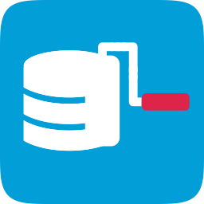
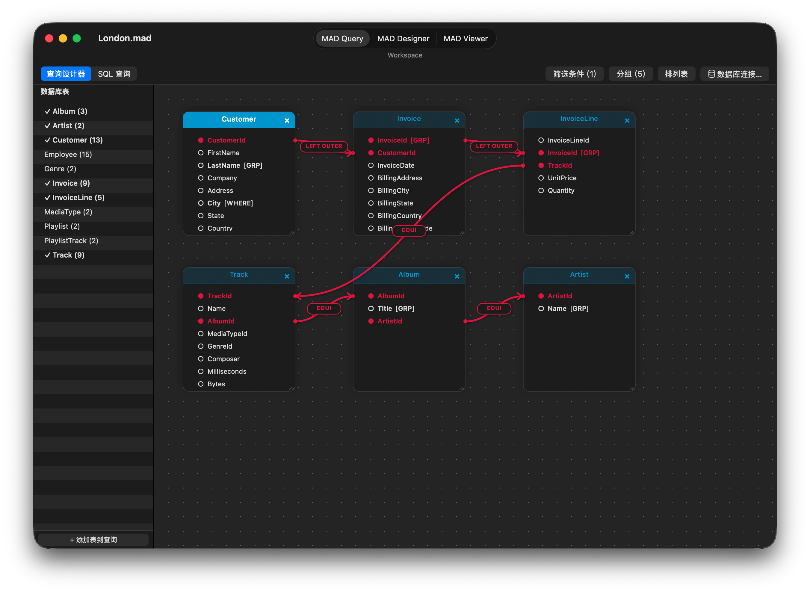
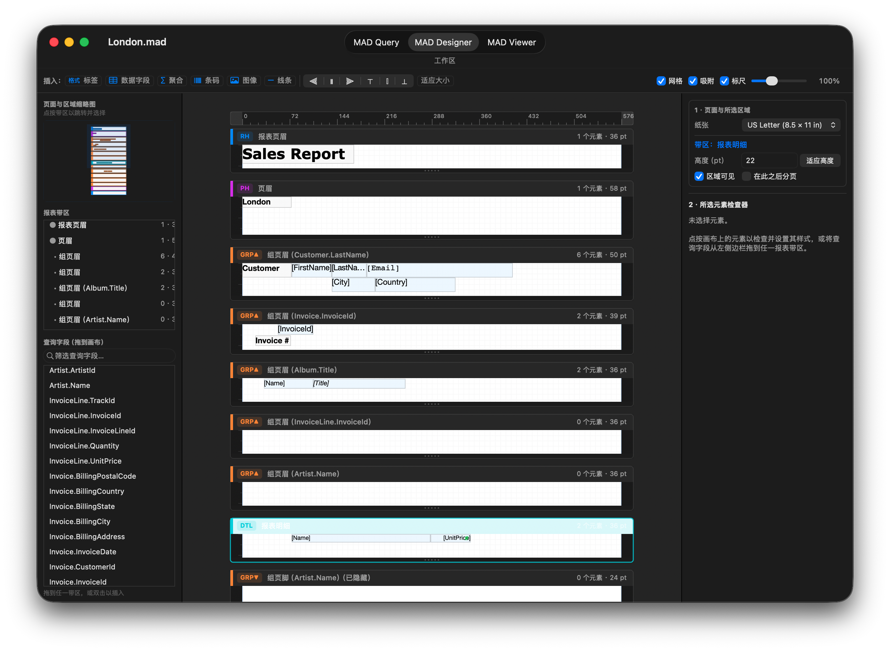
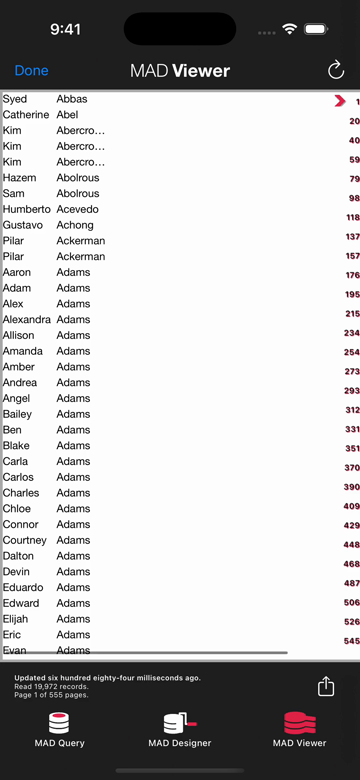
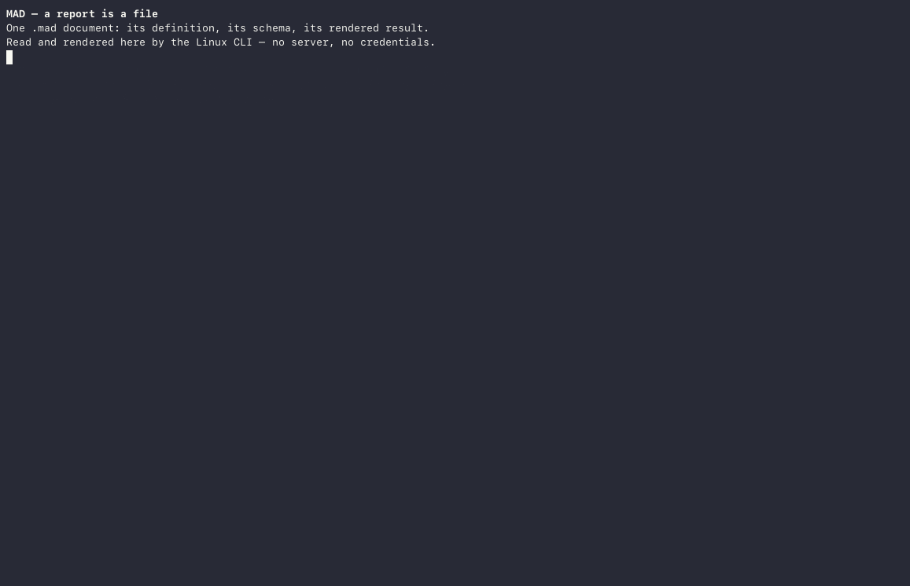

[English](../README.md) | **简体中文** | [日本語](README_ja.md) | [Português (Brasil)](README_pt-BR.md) | [Deutsch](README_de.md) | [Español](README_es.md)

> **作者关于智能体编程与 LLM 的说明** — [点击阅读](Note%20from%20Author%20on%20Agentic%20Programming%20and%20LLMs_zh.md)

# <a href="../StaticResources/Images/icons/document/Designer%20Icon@3x.png"></a> MAD（Mobile Analytics Document，移动分析文档）

[](https://github.com/mthomason/MAD/actions/workflows/linux.yml) [](https://github.com/mthomason/MAD/actions/workflows/windows.yml) [](https://github.com/mthomason/MAD/actions/workflows/macos.yml)

**面向关系型报表的开放格式与可嵌入引擎——每一份报表都是一个可移植的查询图、一张物化的 SQLite 表和一套参数化布局，而组合报表把来自不同数据库的多份报表联接进一个文档。**

MAD 是一个用 Objective-C 从零构建的关系型报表平台，用于即席查询、报表与设计：面向 iOS、原生 macOS（`AppKit`）和原生 Windows（WPF）的 **MAD Designer** 和 **MAD Viewer** 应用；在 Linux 和 macOS 上运行的无头 **`mad` CLI 与引擎**；以及开放的 **`.mad` 规范**。

一个 `.mad` 文件在不到 100 KB 的单个文件中保存报表的完整定义——数据库架构快照、关系查询图（表、连接、谓词、分组）以及带区分层布局树——并与它所展示的数据清晰分离。报表是可执行文件，不是服务器：任何支持 `.mad` 的运行时都可以检查架构、为目标数据库编译确定性 SQL、把结果集物化到本地 SQLite 表，并将其渲染为原生 AppKit/UIKit 视图、分页 HTML、PDF、CSV 或 JSON。

一份**组合报表**把这一模型扩展到多个数据库之间。文档保存一张由完整报表构成的图——一个**结果**加上它的各个**源**——并在本地 SQLite 中联接它们的物化表。每个源都保留自己的数据库连接、查询、布局和数据。一个可移植的 `.mad` 文件可以横跨 MySQL、PostgreSQL、SQL Server 和 SQLite，而无需在中间放置联邦服务器。

本仓库是一个自包含项目：iPad/iPhone 应用、原生 macOS（`AppKit`）桌面应用（`Mac/`）、原生 Windows（WPF）应用（`Windows/`）、十四个框架（其中十二个跨 iOS、iOS 模拟器和原生 macOS 多平台；十二个在 Linux 上无头运行）、无头 Linux 构建与测试套件（130 个套件，1,313 个测试）、`mad` 命令行工具，以及从固定源码编译第三方 C 库的构建系统（`Compressor`）。代码以 MIT 许可证发布；`.mad` 格式是开放规范（参见 [`docs/`](../docs/zh/)），但项目名称和应用美术资源不在许可证授权范围内（参见 [`NOTICE`](../NOTICE)）。

## 仓库布局

这是当前的布局，没有移动任何内容。顶层条目按角色分组：

* **应用** — `MADDesigner/`（iOS 应用及其目标）、`Mac/`（原生 `AppKit` 应用）、`Windows/`（原生 WPF 应用）。
* **框架** — 十四个 `MAD*` 目录：`MADFoundation`、`MADAPI`、`MAD`、`MADCocoaExtensions`、`MADDataStructures`、`MADFileManager`、`MADExplorer`、`MADMySQL`、`MADTdsClient`、`MADPostgres`、`MADSqlite3`、`MADTds`、`MADBarcodes` 和 `MADFeedback`。
* **无头引擎** — `Linux/`、`CLI/` 和 `Windows/Engine/`。
* **构建与随附库** — `Compressor/` 和 `ThirdParty/`。
* **示例、资源与数据** — `Samples/`、`StaticResources/` 和 `TestDatabase/`。
* **工具与卫星仓库** — `scripts/`、`satellites/` 和 `Scrimpter/`。
* **工作区** — `Reports.xcworkspace` 和 `Scrimpter.xcworkspace`。
* **文档** — `docs/`（规范、指南和内部记录）和 `translations/`（翻译的根文档）。

> **0.8 新增：组合报表。** 在 macOS 和 Windows 上把现有报表合并到一个文档；每个源保留自己的布局和数据。参见[组合指南](../docs/zh/composition.md)和[示例报表](../Samples/README.md)。组合功能已包含在下文的 0.8.0 已发布下载中。

> **在 macOS 上试用 MAD Designer（macOS 12.0+，Apple Silicon）——已发布 0.8.0：**
> * **Homebrew 安装：** `brew install --cask mthomason/tap/mad-designer`
> * **直接下载：** [**MAD-Designer-macOS.dmg**](https://github.com/mthomason/MAD/releases/download/v0.8.0/MAD-Designer-macOS.dmg) | [**MAD-Designer-macOS.zip**](https://github.com/mthomason/MAD/releases/download/v0.8.0/MAD-Designer-macOS.zip) *（浏览器直接下载拖入 `/Applications` 后，首次打开前可在终端执行一次 `xattr -cr "/Applications/MAD Designer.app"`）*
> * **版本：** 应用 0.8.0 / 引擎 9.1 (r5164)。

> **在 Windows 上试用 MAD Designer（Windows 10 1903+、Windows 11，64 位）——已发布 0.8.0：**
> * **直接下载：** [**MAD-Designer-Windows-0.8.0.zip**](https://github.com/mthomason/MAD/releases/download/v0.8.0/MAD-Designer-Windows-0.8.0.zip) *（未签名：Windows SmartScreen 会提示——选择“更多信息”→“仍要运行”；参见 [Windows 指南](../docs/zh/windows.md)）*
> * **版本：** 应用 0.8.0 / 引擎 9.1 (r5164) · **无需安装 .NET**（自包含）。

## 为什么选择 MAD

今天，任何开发者都可以让 LLM 在十分钟内生成一个一次性 SQL 脚本和一个 React 表格。六个月后，组织里有了四十个定制的小应用、四十个互不兼容的 `customers` 与 `invoices` 之间 `INNER JOIN` 定义、硬编码的数据库凭据、凭空编造的聚合计算，以及移动端、桌面端、CI 流水线和外部合作伙伴之间零互操作。

MAD 在**格式和引擎层面**解决报表问题：

* **通过共享契约实现互操作。** 与其在整个组织内散落一次性的 SQL 脚本和定制的仪表板胶水代码，`.mad` 文档把架构契约、查询 AST 和呈现布局打包成一个可检查、可 diff、可版本化的产物。同一个文件可以在 macOS、Windows 和 iPad 上原生打开，在 Linux Docker 容器中无头运行，在 GitHub Actions 中执行，或嵌入另一个应用——在 Apple、Windows 与 Linux 上生成逐字节一致的 SQL 和导出结果。
* **确定性 SQL 与两趟本地计算。** 终端用户和 AI 模型都不需要手写方言特定的 SQL，也不需要在应用代码中计算总计。引擎根据文档的架构快照校验查询图，为线路驱动编译确定性 SQL，把结果集一次性拉入本地 SQLite 行缓存（`MADDataTableFast`），并在本地分两趟计算分组、排序键以及页眉/页脚聚合。
* **无需联邦服务器的组合。** 组合报表在各自的数据库中物化每个源，然后在本地 SQLite 中联接这些物化表。无需部署中心服务器，无需填充共享数据仓库，也无需维护第二套 SQL 方言：每个源理解自己的数据，而 MAD 理解由此得到的表。源是一份完整的报表——查询、布局和数据行——而不是被剥离设计的表。
* **自研，而非拼装。** SQL 生成器、SQL 解析器、数据表引擎、可移植存储、布局模型和页面渲染器都是十四个框架中自研的 Objective-C 代码。第三方代码严格限于通信链路——MariaDB Connector/C、FreeTDS、`libpq` 和 SQLite——以及用于条形码的 `libarchive`/`bzip2` 和 `zint`。没有转售任何专有报表 SDK。
* **移动优先意味着按内存预算设计。** 由于结果集被物化到磁盘上带索引的 SQLite 表中，页面被格式化到以几何为键的缓存中，手机或小型容器无需把数据集常驻内存，就能对十万行级别的报表进行分页和聚合。

技术文档和格式规范也发布在 <https://docs.everydayapps.com>。

## 组合报表

一份**组合报表**把其他报表合并到一个 `.mad` 文档。你引入的报表是**源**；文档的默认报表是**结果**，它把各源的结果表联接成一份属于它自己的新报表。


* **每个成员都是一份报表。** 源连同其查询定义、自己的报表布局和数据一起导入。在工具栏的 **Report** 选取器（macOS）或 **Composition** 窗格与 **Component** 选取器（Windows）中选择它，会把 Query、Designer 和 Viewer 工作区一起切换。没有布局的源仍然是一份由数据行组成的报表：查看器显示网格，设计器提议为它创作布局。
* **跨数据库联接。** 每个源以自己的凭据针对自己的数据库执行。结果在本地 SQLite 中联接各物化表——一个文档中可以有 MySQL、PostgreSQL、SQL Server 和 SQLite。
* **凭据不进入文档。** 刷新会为每个源请求一个密码，连接详情已预先填好。密码保存在钥匙串、会话或平台凭据存储中——绝不在 `.mad` 中。
* **作为整体可移植。** 定义、每个源的布局以及连接引用都保存在同一个 `.mad` 文件中。数据行和页面缓存留在它旁边的伴随存储中。

组合随 **macOS** 和 **Windows** 的 MAD Designer 0.8 发布。iOS 应用尚不能创作组合。阅读[组合指南](../docs/zh/composition.md)，了解模型、工作流和当前限制。

## 看看效果

**[适用于 macOS 的 MAD Designer](../docs/zh/macos.md)**——原生 `AppKit` 桌面应用（`Mac/`），展示 **MAD Query** 可视化关系画布和 **MAD Designer** 带区布局工作区：





**适用于 iOS 的 MAD Designer**，从选择数据源到在 MAD Viewer 中阅读完成的报表（28 秒；[视频](https://docs.everydayapps.com/assets/app-preview.mp4)）：

[](https://docs.everydayapps.com/assets/app-preview.mp4)

**同一引擎在 Linux 上以无头方式运行**：通过 `mad` CLI 执行 `inspect`、`schema`、`query`、`refresh` 和 `export`，无需报表服务器：



录像中[导出的报表](https://docs.everydayapps.com/assets/london.html)是纯 HTML，可在任意浏览器中打开。

## 示例报表

[`Samples/Reports`](../Samples/Reports) 保存了可供桌面应用运行的 `.mad` 文档：

* **Chinook-Standard.mad**——一张表、列标题、一个明细带区、一份多页报表。
* **Chinook-Grouped.mad**——带分组页眉和页脚带区的查询分组。
* **Chinook-Composition.mad**——两个 SQLite 源（一个有布局，一个没有）联接成一个结果。
* **Composition-MySQL-PostgreSQL-SQLServer.mad**——从 MySQL、PostgreSQL 和 SQL Server 各取一张表，按 `demo_id` 联接。
* **PostgreSQL-Chinook.mad**——一个不存储密码的服务器连接；首次刷新会询问密码。

SQLite 示例只需要随附的 `chinook.sqlite3`。跨数据库示例需要三个实时测试服务器；一个幂等脚本可以启动它们并填充演示表：

```sh
./Samples/setup-databases.sh up
```

在 Windows PowerShell 上：

```powershell
.\Samples\setup-databases.ps1 -Action up
```

首次运行的操作演练、每个源的密码提示，以及示例如何生成和检查，见[示例指南](../Samples/README.md)。

## 本地化

iOS、macOS 和 Windows 应用程序已完整本地化为**英语、德语、西班牙语、日语、巴西葡萄牙语和简体中文**。界面跟随系统语言，文档也已翻译为相同语言。品牌和产品名称、SQL 标识符、数据库和字体名称以及许可证文本按设计保留英文。翻译由机器辅助生成，欢迎在[问题跟踪器](https://github.com/mthomason/MAD/issues)中报告更正。

## 隐私

MAD 尊重您的隐私。应用程序不包含分析、遥测或跟踪代码，也不会记录或复制您的文件。唯一的网络连接是您配置的数据库连接；报表数据保留在文档的本地 SQLite 缓存和配套文件中。

在 macOS 上，应用程序可能会请求访问**文稿**、**桌面**、**下载**或其他文件夹。该提示来自用于选择 `.mad` 报表（或 SQLite 数据库文件）的标准 macOS 打开面板：macOS 授予该文件夹的访问权限，以便面板显示其内容，而应用程序只读取您选择的文件。这是 macOS 应用程序的标准行为——MAD 不会扫描、记录、复制或跟踪任何内容。

## 深入 `.mad` 格式

`.mad` 文件不是像 PDF 那样的静态打印件，也不是行数据的转储。它是一个**声明式程序**，把数据库连接变成有类型的表和格式化的视图。

该架构把报表拆分为**可移植定义**（位于 `.mad` 文件内，通常为 15–80 KB）和**派生的伴随缓存**（在刷新时本地生成，随时可以丢弃）：

| 层 | 文件 / 成员 | 格式 | 作用 |
|---|---|---|---|
| **1. 容器** | `<Name>.mad` | 16 字节的 `MADFILE\0` v1 文件头 + `pax restricted` bzip2 tar 归档 | 可通过内容识别的外层归档（v0 兼容 `tar xjf`，v1 为文件头 + bzip2 tar）。 |
| **2. 定义存储** | `StoreContent/analyitics` | 可移植 SQLite（`MADStoreSchema`，通过 `PRAGMA user_version` 进行版本管理） | 保存 `Rptq*` 对象图：导入的数据库架构快照、查询图（表、别名、连接、谓词、分组以及可选的 `sqlSourceText`），以及带区节区/元素布局树。零 Core Data 或 Apple 依赖。 |
| **3. 元数据与预览** | `meta.plist`、`AdditionalContent/` | XML 属性列表 + 可选的 `thumbnail@2x.png` | 生成器元数据、格式版本和可选的文档预览。 |
| **4. 物化表** *(伴随)* | `<hash>.maddb` + `<hash>.mdcache` | SQLite 行数据库（`t<tag>`）+ 列架构 plist（`MADDataColumn`） | **报表输出作为数据库表。** 保存已获取的行、分组键索引和列类型元数据，使两趟聚合（`SUM`、`COUNT`、`AVG`、`MIN`、`MAX`）、排序和重新渲染永远不需要重新查询远程数据库。 |
| **5. 页面缓存** *(伴随)* | `<hash>{ih,lh}{w,h}.madac` | 以页面几何为键的 SQLite 索引（`ih`）和布局（`lh`）数据库 | 为视口（例如 `{612, 792}` 的 US Letter）预先计算分页和元素框，使滚动和导出保持即时。 |

组合报表写入相同的容器和存储，只增加一项内容：存储记录查询图的根（`rootQuery`）、每个查询的上游表，以及每个查询自己的布局节区。组合文档声明 `query-composition` 必需能力以及 `1.1` 容器头；普通报表仍为 `1.0`。完整规范——容器布局、存储表、伴随架构、已知怪癖（包括内部存储文件名为什么历史上拼作 `analyitics` 以保持向后兼容），以及跨平台摘要验证——在 [`docs/`](../docs/zh/) 中逐章记录。

## MAD 的前进方向

同一文档内的组合已经构建。方向现在在此基础上扩展，并扩展到架构的其余部分：

1. **跨文档组合与稳定的数据对象身份。**
   组合报表已经在其自身文档内寻址每个源的物化表。下一步是为报表的输出在*跨*文档之间建立稳定身份，使一个 `.mad` 可以引用另一个 `.mad` 的报表，并具备文档身份、路径解析、实时与钉住数据，以及凭据策略。[数据对象设计](../docs/zh/developers/data-object.md)记录了模型以及形式化它需要什么。
2. **超越纸面范式：原生交互式数据视图。**
   带区页面布局诞生于打印。在 MAD 中，纸面分页只是文档数据对象之上的一种视图；同一套布局和本地 `.maddb` 表可以驱动交互式表格、数据浏览器和原生视图。设计一次，既可渲染为分页纸面，也可渲染为原生交互 UI。
3. **把旧版 Crystal Reports（`.rpt`）和企业报表文件转换为 `.mad`。**
   成千上万家公司仍被数十年的 Crystal Reports 文件锁住，没有人愿意手工重写。由于 MAD 与 Crystal Reports 共享经典的带区节和关系查询图基因——同时把所有内容存储在开放、可检查的 SQLite-in-tar 格式中——MAD 正在构建导入器，把旧版定义直接转换为开放的 `.mad` 文件。
4. **由 AI 编写的文档。**
   模型可以提出一份真实、可编辑的 MAD 文档——发现来源和架构元数据，选择表和字段，构造查询图和布局，并把结果提交给引擎进行校验和执行——而不是生成一次性的答案。文档仍然可检查、可编辑，并独立于模型。

参见 [`docs/vision.md`](../docs/zh/vision.md)、[`docs/developers/data-object.md`](../docs/zh/developers/data-object.md) 和 [`docs/project/registers/TODO.md`](../docs/zh/project/TODO.md)。

## 试一试

无头引擎在 Docker 中运行 `mad` CLI。拉取已发布的镜像并检查仓库中签入的一份示例文档：

```sh
docker run --rm -v "$PWD/CLI/Fixtures":/docs:ro ghcr.io/mthomason/mad \
    mad inspect /docs/London.portable.mad
```

每个动词的用法都相同——`schema`、`query`、`refresh`、`export`（分页 HTML 复制件和可重排的 `html-flow`、纯文本、CSV、JSON 数据契约以及 `json-report`；PDF 在 Apple 上原生运行，在 Linux 上按设计推迟）：

```sh
docker run --rm -v "$PWD/CLI/Fixtures":/docs:ro ghcr.io/mthomason/mad \
    mad refresh /docs/Music.portable.mad
docker run --rm -v "$PWD/CLI/Fixtures":/docs:ro -v "$PWD/out":/out ghcr.io/mthomason/mad \
    mad export /docs/London.portable.mad --format html --out /out/london.html
```

已发布的标签是 `latest` 和提交的短 SHA，由发布工作流在每次推送到 `master` 时为 `linux/amd64` 构建。在 Apple 芯片上请加上 `--platform linux/amd64`——Docker Desktop 会在模拟下运行该标签，不加这个标志拉取会失败（`no matching manifest`）。在本地构建原生 `arm64` 镜像（`mad-cli:latest`）并运行完整的跨平台验证套件只需一条命令：

```sh
./Linux/build.sh --verify                 # build the toolchain and run the checks (~20 min first time)
```

示例文档针对镜像内附带的 Sqlite3 示例数据库刷新；MySQL、SQL Server 和 PostgreSQL 夹具需要 [`docs/project/build/DEVELOPER.md`](../docs/zh/project/DEVELOPER.md) 中描述的测试服务器。组合文档会刷新每个源并导出所选报表；`mad` 从钥匙串解析每个源的凭据，并以 `--credentials` 作为回退。

## 在 CI 中

[mad-action](https://github.com/mthomason/mad-action) GitHub Action 在工作流中运行仓库中签入的 `.mad`，并把其导出结果作为制品上传：

```yaml
- uses: mthomason/mad-action@v1
  with:
    command: export
    document: reports/sales.mad
```

它运行已发布的镜像，因此该 action 和 CLI 是同一个引擎。该 action 由这里的 [`satellites/mad-action/`](../satellites/mad-action/) 生成；[`docs/developers/satellites.md`](../docs/zh/developers/satellites.md) 记录了卫星仓库如何保持最新。

## 数据库驱动

MAD 通过 `MADDatabase` 子类与数据库通信。目前随版本发布四个驱动：

* **MySQL / MariaDB**——`MADMySQL`，基于 MariaDB Connector/C；
* **SQL Server**——`MADTdsClient`，基于 FreeTDS；
* **PostgreSQL**——`MADPostgres`，基于 `libpq`；
* **SQLite**——`MADSqlite3`，用于示例文档、本地数据库和内部物化表。

驱动是一个继承 `MADDatabase` 并向 `MADDatabaseDriverRegistry` 注册自身的框架——查询设计器和引擎永远看不到线路协议。编写驱动是理想的第一个贡献（参见 [`docs/tutorials/driver-authoring.md`](../docs/zh/tutorials/driver-authoring.md) 下的驱动编写教程）。这条接缝是真实存在的：用户可以可视化地构建查询或粘贴 SQL（`MADSQLParser`），引擎生成方言特定的语句，而驱动只需执行它并把行流式写入 `id<MADDataTableWriting>`。

## 嵌入引擎

十四个框架中有十二个不依赖 UIKit，可以无头构建。上面的 `mad` CLI 就是穿上命令行的该引擎：动词集合——`inspect`、`schema`、`query`、`refresh`、`export`、`write`，以及 `serve` JSON 协议——就是嵌入界面，一个链接了 `MAD`、某个驱动框架和 `MADSqlite3` 的应用，无需服务器参与即可获得关系型报表能力。驱动和导出格式（`<MADReportExporting>` / `MADReportExporterRegistry`）会自注册，因此添加数据源或输出格式是写一个子类，而不是分叉。

组合文档是同一界面的又一种情形：`MADOperationRefreshComposed` 遍历图，每个节点物化自己的表，而所选报表的结果正是 CLI、各应用和导出器所读取的内容。

## 原生 macOS 应用

原生 macOS 桌面应用（[`docs/macos.md`](../docs/zh/macos.md)、[`Mac/`](../Mac/)）直接基于 `AppKit`（`macosx` SDK，`MACOSX_DEPLOYMENT_TARGET = 12.0`）构建，运行在十二个多平台 MAD 框架和 `Compressor` 编译的十个通用（`arm64` + `x86_64`）静态 C 库之上：

* **原生 `NSDocument` 架构（`MADMacDocument` / `MADMacDocumentController`）：** 从 Finder 或标准打开面板原生打开和保存 `.mad` 归档（带有集成的 **New Document** 按钮），通过 `MADStoreConverter` 自动迁移旧版 Core Data `.mad` 文件，并把 `MADDesignerLayout` 直接与 `NSDocument.undoManager`（`Cmd+Z` / `Cmd+Shift+Z`）集成。
* **数据库连接与架构导入助手（`MADMacConnectionWindowController`）：** 连接 **SQLite**、**MySQL / MariaDB**、**Microsoft SQL Server** 或 **PostgreSQL**，验证连接性，把凭据存储在 macOS 钥匙串（`MADKeyChain`）中，并把表和列架构导入新的 `.mad` 文档。
* **组合报表：** 工具栏中的 **Report** 选取器可在结果及其各个源之间切换每个工作区；设计器编辑所选报表自己的带区和字段列表；查看器渲染它自己的页面，或者，对于无布局的源，把其缓存行渲染为网格。**File ▸ New Composition…**、**Import Report…** 和 **Convert to Composition…** 负责创作图，刷新会为每个需要凭据的源提示一次。参见[组合指南](../docs/zh/composition.md)。
* **三个集成工作区**（`Cmd+1`、`Cmd+2`、`Cmd+3`）：
  1. **MAD Query（`MADMacQueryViewController`）：** 在交互式 **Query Designer**（可拖动的表卡片、带可点击连接类型徽标的贝塞尔连接线、`WHERE` 筛选和 `GROUP BY` 弹出框）与 **SQL Query** 编辑器（`MADSQLParser` + `MADSQLQueryCompiler`）之间切换。
  2. **MAD Designer（`MADMacDesignerViewController`）：** 三栏分割视图，包含交互式 **Page & Section Minimap**、**Report Bands** 大纲、可搜索的查询字段拖放源、带标尺且可缩放的跨节区设计画布（`MADMacDesignerCanvasView`，支持跨节区拖放和智能对齐参考线），以及双卡片 **Page & Element Inspector**。
  3. **MAD Viewer（`MADMacViewerViewController`）：** 实时数据刷新（`Cmd+R`）、即时 **Page Size** 重新分页（`US Letter`、`Legal`、`Tabloid`、`A3`、`A4`、`A5`、`B4`、`B5`、`JIS B4`、`JIS B5`）、带框 `PDFView` 预览、原生 `NSPrintOperation` 打印（`Cmd+P`），以及导出（`Cmd+E`）为 **PDF**、**HTML**、**HTML Flow**、**CSV**、**JSON**、**JSON Full Report** 和 **Plain Text**。

完整指南参见 [`docs/macos.md`](../docs/zh/macos.md)，多平台可移植性审计参见 [`docs/developers/build/macos.md`](../docs/zh/developers/build/macos.md)。

## 原生 Windows 应用

原生 Windows 应用（[`docs/windows.md`](../docs/zh/windows.md)、[`Windows/`](../Windows/)）是运行在 .NET 10 上的 WPF 应用，基于同一套自研 Objective-C 引擎（`mad.exe`），因此它的文档与 macOS、iOS、CLI 和 `mad-action` 兼容：

* **三个工作区：** 可视化查询画布和 SQL 编辑器、带缩略图、大纲、字段列表和检查器的带区设计器，以及可精确分页的查看器，支持 PDF、HTML、HTML Flow、CSV、JSON、JSON Full Report 和纯文本导出。
* **组合报表：** 停靠的 **Composition** 窗格把结果及其各个源显示为图；它的卡片与工具栏的 **Component** 选取器在全部三个工作区中共享同一个选择。每个源保留自己的查询、布局和数据行，无布局的源渲染为行网格。**File ▸ New Composition…**、**Import…** 和 **Convert to Composition** 负责创作图。
* **打包：** `Windows/package.ps1` 构建未签名、自包含的发布压缩包和 CI 引擎资源；引擎本身由 `Windows/Engine/build.ps1` 在固定工具链上构建。

安装指南参见 [`docs/windows.md`](../docs/zh/windows.md)，构建记录参见 [`docs/developers/build/windows.md`](../docs/zh/developers/build/windows.md)。

## 构建与测试

工作区（`Reports.xcworkspace`）构建十四个框架、iOS 应用和原生 macOS 应用（`MAD Designer Mac`）。

### 原生 macOS

从仓库根目录构建、运行端到端冒烟测试套件，并打包 `.zip` 和 `.dmg` 发布制品：

```sh
./Mac/build.sh                     # build 12 macOS frameworks + Mac/build/MAD Designer.app
./Mac/build.sh --no-frameworks     # rebuild only MAD Designer.app (fast iteration)
./Mac/build.sh --smoke-test        # build and run the end-to-end macOS smoke suite
./Mac/build.sh --package           # create Mac/build/MAD-Designer-macOS.zip and .dmg
```

你也可以在 Xcode 中使用共享的 **`MAD Designer Mac`** 方案交互式构建和调试，或者在 macOS 上原生运行任意框架的单元测试套件：

```sh
xcodebuild test -workspace Reports.xcworkspace -scheme MAD \
	-destination 'platform=macOS,arch=arm64' \
	-derivedDataPath ~/Library/Developer/Xcode/DerivedData/Reports-cozeiyczmvgrbeapplwfuygymqci
```

### iOS 模拟器

在 iOS 模拟器上运行框架的测试套件：

```sh
xcodebuild test -workspace Reports.xcworkspace -scheme MADFoundation \
	-destination 'platform=iOS Simulator,id=94952340-7629-4EBB-BBD3-6FEE068793B8' \
	-derivedDataPath ~/Library/Developer/Xcode/DerivedData/Reports-cozeiyczmvgrbeapplwfuygymqci
```

（`MADMySQL`、`MADTdsClient` 和 `MADPostgres` 还带有实时测试套件，它们与真实数据库服务器通信，不可达时会跳过——参见 [`docs/project/build/DEVELOPER.md`](../docs/zh/project/DEVELOPER.md)。）

### Linux（无头引擎与 CLI）

无头引擎在 Linux 上以同样的方式验证。从仓库根目录运行，需要安装 Docker：

```sh
./Linux/build.sh       # build the toolchain image, compile the twelve frameworks, run the suites
```

这会在容器内运行 130 个套件和 1,313 个测试，`--verify` 还会针对签入的夹具及其固定摘要添加 CLI 的端到端检查。关于镜像、固定版本以及移植中发现的 GNUstep 差异，参见 [`Linux/README.md`](../Linux/README_zh.md)。

### Windows（WPF 应用与引擎）

原生引擎在提升权限的 Windows 工作站上构建——Clang 20.1.8、Visual Studio 的 MSVC、NASM、Strawberry Perl、Meson、Python，以及从源码构建到 `C:\GNUstep` 的 GNUstep——WPF 应用则使用 `Windows/global.json` 固定的 .NET SDK 构建：

```powershell
pwsh -File .\Windows\Engine\build.ps1 -SkipToolchain   # rebuild after the toolchain exists
dotnet test Windows\App\Mad.Designer.Windows.slnx      # both .NET suites, against the built engine
pwsh -File .\Windows\package.ps1                      # the unsigned release zip and the CI engine asset
```

CI 不会重新构建引擎（它需要那套工作站工具链）：[`windows.yml`](../.github/workflows/windows.yml) 下载预构建的引擎资源并运行两个套件。安装指南参见 [`docs/windows.md`](../docs/zh/windows.md)，构建记录参见 [`docs/developers/build/windows.md`](../docs/zh/developers/build/windows.md)。

### 示例数据库

示例的跨数据库组合使用三个固定版本的测试服务器。用一个脚本启动它们并填充演示表：

```sh
./Samples/setup-databases.sh up       # macOS, Linux, Git Bash
.\Samples\setup-databases.ps1 -Action up   # Windows PowerShell
```

这些容器及其公开测试凭据记录在 [`TestDatabase/README.md`](../TestDatabase/README.md) 和 [`docs/project/build/DEVELOPER.md`](../docs/zh/project/DEVELOPER.md) 中。

## 支持

MAD 是自由软件，并将保持自由。一位维护者维护它：设计文档、多平台测试矩阵和智能体驱动的开发都要消耗真实的时间和 API token。如果 MAD 为你的团队节省了时间，以下是回馈一些时间的方式——无论是否回馈，都谢谢你：

* **[赞助维护者](https://github.com/sponsors/mthomason)**——通过 GitHub Sponsors 一次性或按月赞助。
* **赠送 API 额度。** 本项目使用 AI 智能体开发；OpenAI、Anthropic 或智能体 token 额度会直接重新投入工作。通过赞助页面或 issue 联系。
* **[参与贡献](CONTRIBUTING_zh.md)。** 一个数据库驱动、一个文档元素、一种导出格式、一个旧版导入器，或者一个修复——这些接缝正是重点。

## 许可证

MIT——参见 [`LICENSE`](../LICENSE)。许可证覆盖软件；“MAD”“MAD Designer”和“MAD Viewer”这些名称、应用图标和其他产品美术资源，以及应用预览媒体，归作者所有且不在许可证范围内（参见 [`NOTICE`](../NOTICE)）。每个第三方组件、其许可证以及随附它需要我们履行的义务，都记录在 [`docs/project/THIRD_PARTY_LICENSES.md`](../docs/zh/project/THIRD_PARTY_LICENSES.md) 中。

## 出口合规

MySQL、FreeTDS 和 PostgreSQL 驱动使用 OpenSSL/TLS；未实现自定义加密。根据 Apple 的出口合规指南，这属于豁免加密，应用设置 `ITSAppUsesNonExemptEncryption = NO`。
